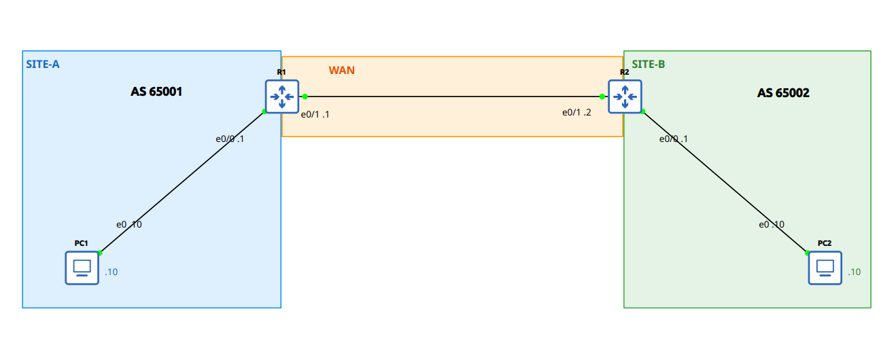

## LAB: Basic BGP (difficulty: basic)

## Scenario

  Two sites in different autonomous systems - R1 = AS 65001,
R2 = AS 65002 - joined by WAN 10.0.12.0/30. Design intent: an eBGP
session between R1 and R2 exchanging both site LAN routes. The
acceptance criteria below are NOT yet met by the running config.



```
Interface IPs:
  SITE-A: 192.168.1.0/24
    R1 Ethernet0/0, PC1 Ethernet0
    R1 192.168.1.1, PC1 192.168.1.10
  WAN: 10.0.12.0/30
    R1 Ethernet0/1, R2 Ethernet0/1
    R1 10.0.12.1, R2 10.0.12.2
  SITE-B: 192.168.2.0/24
    R2 Ethernet0/0, PC2 Ethernet0
    R2 192.168.2.1, PC2 192.168.2.10

Verification goals:
  1. R1 and R2: show ip bgp summary - State/PfxRcd = Established.
  2. From PC1: ping 192.168.2.10 - replies received.
  3. From PC2: ping 192.168.1.10 - replies received.
```

## Action
1. Set BGP AS number: `router bgp [as-num]`
2. Form eBGP peer with other AS: `neighbor [neighbor-ip] remote-as [neighbor-as]`
3. Advertise network: `network [network-ip] mask [subnet-mask]`

R1:
```
  router bgp 65001
  neighbor 10.0.12.2 remote-as 65002
  network 192.168.1.0 mask 255.255.255.0
```
R2:
```
  router bgp 65002
  neighbor 10.0.12.1 remote-as 65001
  network 192.168.2.0 mask 255.255.255.0
```
## Note & Result
1. BGP network command: advertise the subnet, use subnet mask.
2. OSPF/EIGRP network command: enable OSPF/EIGRP on interface fall in that range, use wildcard mask.
3. LAB:
  - show ip bgp summary
```
  R1#show ip bgp summary 
  BGP router identifier 192.168.1.1, local AS number 65001
  BGP table version is 3, main routing table version 3
  2 network entries using 496 bytes of memory
  2 path entries using 272 bytes of memory
  2/2 BGP path/bestpath attribute entries using 608 bytes of memory
  1 BGP AS-PATH entries using 24 bytes of memory
  0 BGP route-map cache entries using 0 bytes of memory
  0 BGP filter-list cache entries using 0 bytes of memory
  BGP using 1400 total bytes of memory
  BGP activity 2/0 prefixes, 2/0 paths, scan interval 60 secs
  2 networks peaked at 07:55:58 Oct 13 2026 +07 (00:25:48.748 ago)
  
  Neighbor        V           AS MsgRcvd MsgSent   TblVer  InQ OutQ Up/Down  State/PfxRcd
  10.0.12.2       4        65002      33      33        3    0    0 00:26:33        1
```
```
  R2#show ip bgp summary 
  BGP router identifier 192.168.2.1, local AS number 65002
  BGP table version is 3, main routing table version 3
  2 network entries using 496 bytes of memory
  2 path entries using 272 bytes of memory
  2/2 BGP path/bestpath attribute entries using 608 bytes of memory
  1 BGP AS-PATH entries using 24 bytes of memory
  0 BGP route-map cache entries using 0 bytes of memory
  0 BGP filter-list cache entries using 0 bytes of memory
  BGP using 1400 total bytes of memory
  BGP activity 2/0 prefixes, 2/0 paths, scan interval 60 secs
  2 networks peaked at 07:56:20 Oct 13 2026 +07 (00:26:20.306 ago)
  
  Neighbor        V           AS MsgRcvd MsgSent   TblVer  InQ OutQ Up/Down  State/PfxRcd
  10.0.12.1       4        65001      34      33        3    0    0 00:27:27        1
```
  - pings
```
  PC1> ping 192.168.2.10
  84 bytes from 192.168.2.10 icmp_seq=1 ttl=62 time=1.579 ms
  84 bytes from 192.168.2.10 icmp_seq=2 ttl=62 time=0.680 ms
  84 bytes from 192.168.2.10 icmp_seq=3 ttl=62 time=0.668 ms
  84 bytes from 192.168.2.10 icmp_seq=4 ttl=62 time=0.675 ms
  84 bytes from 192.168.2.10 icmp_seq=5 ttl=62 time=0.621 ms
```
```
  PC2> ping 192.168.1.10
  84 bytes from 192.168.1.10 icmp_seq=1 ttl=62 time=0.691 ms
  84 bytes from 192.168.1.10 icmp_seq=2 ttl=62 time=0.852 ms
  84 bytes from 192.168.1.10 icmp_seq=3 ttl=62 time=0.524 ms
  84 bytes from 192.168.1.10 icmp_seq=4 ttl=62 time=0.612 ms
  84 bytes from 192.168.1.10 icmp_seq=5 ttl=62 time=0.847 ms
```
