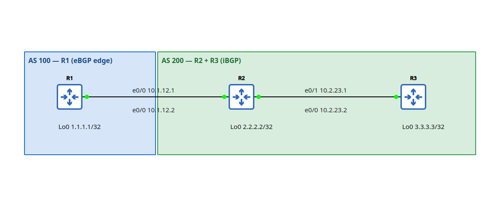

## LAB: iBGP-next-hop-self (eBGP vs iBGP next-hop behavior)

## Scenario
  R1 (AS 100) --eBGP--> R2; R2+R3 run iBGP in AS 200. No IGP.


```
Interface IPs
  AS 100 — R1 (eBGP edge)
    1.1.1.1/32 (Lo0); 10.1.12.0/30 (eBGP link)
    R1 e0/0 10.1.12.1 · R2 e0/0 10.1.12.2 (peer end)
  AS 200 — R2 + R3 (iBGP)
    2.2.2.2/32, 3.3.3.3/32 (Lo0); 10.2.23.0/30 (iBGP link)
    R2 e0/1 10.2.23.1 · R3 e0/0 10.2.23.2
    
Verification goals:
  1. show ip bgp summary on R1, R2, R3 - all Established
  2. R3: show ip bgp 1.1.1.1 - next hop is 10.2.23.1
  3. R3: ping 1.1.1.1 - success rate 100 percent
  4. R1: ping 3.3.3.3 source 1.1.1.1 - success rate 100 percent
```
## Action
Configuration
  1. Reachability: 
    - Within AS: directly connected (no need igp like static routing/ospf)
    - Between AS: point to point
  2. Neighbor forming
    - eBGP: 
      - R1 `router bgp [100]` then `neighbor [R2-ip] remote-as [200]`
      - R2 `router bgp [200]` then `neighbor [R1-ip] remote-as [100]`
    - iBGP:
      - R2 `router bgp [200]` then `neighbor [R3-ip] remote-as [200]`
      - R3 `router bgp [200]` then `neighbor [R2-ip] remote-as [200]`
    - iBGP Routing:
      - R2 `router bgp [200]` then `neighbor [R3-ip] next-hop-self`
  3. Advertisement: `network [subnet address] mask [subnet-mask]`
    - R1 advertise lo0: `network 1.1.1.1 mask 255.255.255.255`
    - R3 advertise their lo0: `network 3.3.3.3 mask 255.255.255.255`
    - R3 advertise their subnet: `network 10.2.23.0 mask 255.255.255.252`

## Note & Result
1. BGP must:
  - Reach the neighbor first (directly connected or via IGP).
  - Neighbor forms.
  - Advertise networks over the session.
  If the same network also comes from another source, lowest AD wins (OSPF 110 beats iBGP 200).
  
2. On R2 advertising BGP to other iBGP router R3 by
  - `neighbor 10.2.23.2 next-hop-self`
  For every BGP route I send to this neighbor, put myself as the next hop.
  (In static routing, we configure on Route and next hop on source, while BGP route advertise from other end.)
  
3. LAB:
  - show ip bgp summary
```
R1#show ip bgp
BGP table version is 7, local router ID is 1.1.1.1
Status codes: s suppressed, d damped, h history, * valid, > best, i - internal, 
              r RIB-failure, S Stale, m multipath, b backup-path, f RT-Filter, 
              x best-external, a additional-path, c RIB-compressed, 
              t secondary path, L long-lived-stale,
Origin codes: i - IGP, e - EGP, ? - incomplete
RPKI validation codes: V valid, I invalid, N Not found

     Network          Next Hop            Metric LocPrf Weight Path
 *>   1.1.1.1/32       0.0.0.0                  0         32768 i
 *>   10.2.23.0/30     10.1.12.2                              0 200 i
```
```
R2#show ip bgp
BGP table version is 11, local router ID is 2.2.2.2
Status codes: s suppressed, d damped, h history, * valid, > best, i - internal, 
              r RIB-failure, S Stale, m multipath, b backup-path, f RT-Filter, 
              x best-external, a additional-path, c RIB-compressed, 
              t secondary path, L long-lived-stale,
Origin codes: i - IGP, e - EGP, ? - incomplete
RPKI validation codes: V valid, I invalid, N Not found

     Network          Next Hop            Metric LocPrf Weight Path
 *>   1.1.1.1/32       10.1.12.1                0             0 100 i
 r>i  10.2.23.0/30     10.2.23.2                0    100      0 i
```
```
R3#show ip bgp
BGP table version is 11, local router ID is 3.3.3.3
Status codes: s suppressed, d damped, h history, * valid, > best, i - internal, 
              r RIB-failure, S Stale, m multipath, b backup-path, f RT-Filter, 
              x best-external, a additional-path, c RIB-compressed, 
              t secondary path, L long-lived-stale,
Origin codes: i - IGP, e - EGP, ? - incomplete
RPKI validation codes: V valid, I invalid, N Not found

     Network          Next Hop            Metric LocPrf Weight Path
 *>i  1.1.1.1/32       10.2.23.1                0    100      0 100 i
 *>   10.2.23.0/30     0.0.0.0                  0         32768 i
```
  - pings
```
R1#ping 10.2.23.2 source 1.1.1.1
Type escape sequence to abort.
Sending 5, 100-byte ICMP Echos to 10.2.23.2, timeout is 2 seconds:
Packet sent with a source address of 1.1.1.1 
!!!!!
Success rate is 100 percent (5/5), round-trip min/avg/max = 1/1/1 ms
R1#
```
