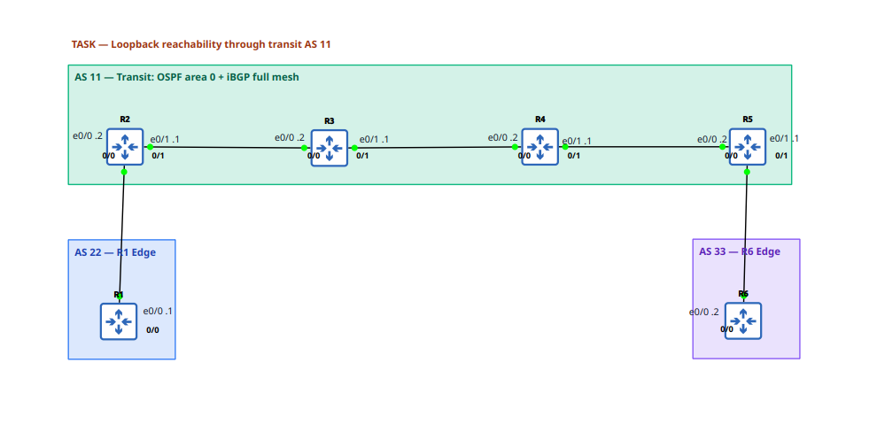

## LAB: Loopback reachability through transit AS 11 (difficulty: basic)

## Scenario
  AS 11 provides transit between customer AS 22 and customer AS 33. The goal — AS 22 (R1) Lo0 and AS 33 (R6) Lo0 reachable through the transit — is currently NOT working.



```
Interface IPs
  AS 22
    R1 e0/0, R2 e0/0: 10.0.12.0/30
    10.0.12.1, 10.0.12.2
    1.1.1.1/32 (R1 Lo0)

  AS 11 — 
    R2 e0/1, R3 e0/0: 10.0.23.0/30
    10.0.23.1, 10.0.23.2

  R3 e0/1, R4 e0/0: 10.0.34.0/30
    10.0.34.1, 10.0.34.2

  R4 e0/1, R5 e0/0: 10.0.45.0/30
    10.0.45.1, 10.0.45.2
    2.2.2.2/32 … 5.5.5.5/32 (Lo0, iBGP peering)
    
  AS 33
    R5 e0/1, R6 e0/0: 10.0.56.0/30
    10.0.56.1, 10.0.56.2
    6.6.6.6/32 (R6 Lo0)

Verification goals:
On R1: ping 6.6.6.6 sourced from Loopback0 → 5/5 success
On R6: ping 1.1.1.1 sourced from Loopback0 → 5/5 success
State the root cause and the minimal change that fixes it Note: acceptance uses extended pings sourced from the loopback; 
pings sourced from physical interfaces are out of scope.
```

## Action
1. Troublshoot: 
  - R1 ping R2, R6 ping R5 sucess = correct eBGP
  - R2, R3, R4, R5 ping sucess = correct OSPF
  - problem might be iBGP Router no route to exernal eBGP.
R2:
```
R2#show run | sec bgp 
router bgp 11
 bgp router-id 2.2.2.2
 bgp log-neighbor-changes
 neighbor 3.3.3.3 remote-as 11
 neighbor 3.3.3.3 update-source Loopback0
 neighbor 4.4.4.4 remote-as 11
 neighbor 4.4.4.4 update-source Loopback0
 neighbor 5.5.5.5 remote-as 11
 neighbor 5.5.5.5 update-source Loopback0
 neighbor 10.0.12.1 remote-as 22
```
R5:
```
R5#show run | sec bgp
router bgp 11
 bgp router-id 5.5.5.5
 bgp log-neighbor-changes
 neighbor 2.2.2.2 remote-as 11
 neighbor 2.2.2.2 update-source Loopback0
 neighbor 2.2.2.2 next-hop-self
 neighbor 3.3.3.3 remote-as 11
 neighbor 3.3.3.3 update-source Loopback0
 neighbor 3.3.3.3 next-hop-self
 neighbor 4.4.4.4 remote-as 11
 neighbor 4.4.4.4 update-source Loopback0
 neighbor 4.4.4.4 next-hop-self
 neighbor 10.0.56.2 remote-as 33
```
R2 missing eBGP route advertisement to iBGP routers.
2. Apply fix:
```
R2(config)#router bgp 11
R2(config-router)#neighbor 3.3.3.3 next-hop-self
R2(config-router)#neighbor 4.4.4.4 next-hop-self
R2(config-router)#neighbor 5.5.5.5 next-hop-self
```

## Note & Result
1. eGP or exterior gateway protocol advertise from the other end. 
  - static routing on A: go to that route via that B address.
  - iBGP/eBGP on B: come to this route via my address.
  - achieve same result, just "from who" is different.
  iBGP need to specify this feature, eBGP no need (automatic).
2. On R2 advertising BGP to other iBGP routers (R3,R4,R5) by
  - `neighbor 3.3.3.3 next-hop-self`
  - `neighbor 4.4.4.4 next-hop-self`
  - `neighbor 5.5.5.5 next-hop-self`
  For every BGP route I send to this neighbor, put myself as the next hop.
3. R1 ping R6 (6.6.6.6): `ping 6.6.6.6 source 1.1.1.1` why need specify source ip?
  - R1 pick its own interface ip
  - Lab scope: BGP only advertise interface lo0 
  - R6 no route to R1 interface ip (only advertised BGP lo0)
4. LAB:
  - show ip bgp summary
```
  R1#show ip bgp summary 
  BGP router identifier 192.168.1.1, local AS number 65001
  BGP table version is 3, main routing table version 3
  2 network entries using 496 bytes of memory
  2 path entries using 272 bytes of memory
  2/2 BGP path/bestpath attribute entries using 608 bytes of memory
  1 BGP AS-PATH entries using 24 bytes of memory
  0 BGP route-map cache entries using 0 bytes of memory
  0 BGP filter-list cache entries using 0 bytes of memory
  BGP using 1400 total bytes of memory
  BGP activity 2/0 prefixes, 2/0 paths, scan interval 60 secs
  2 networks peaked at 07:55:58 Oct 13 2026 +07 (00:25:48.748 ago)
  
  Neighbor        V           AS MsgRcvd MsgSent   TblVer  InQ OutQ Up/Down  State/PfxRcd
  10.0.12.2       4        65002      33      33        3    0    0 00:26:33        1
```
```
  R2#show ip bgp summary 
  BGP router identifier 192.168.2.1, local AS number 65002
  BGP table version is 3, main routing table version 3
  2 network entries using 496 bytes of memory
  2 path entries using 272 bytes of memory
  2/2 BGP path/bestpath attribute entries using 608 bytes of memory
  1 BGP AS-PATH entries using 24 bytes of memory
  0 BGP route-map cache entries using 0 bytes of memory
  0 BGP filter-list cache entries using 0 bytes of memory
  BGP using 1400 total bytes of memory
  BGP activity 2/0 prefixes, 2/0 paths, scan interval 60 secs
  2 networks peaked at 07:56:20 Oct 13 2026 +07 (00:26:20.306 ago)
  
  Neighbor        V           AS MsgRcvd MsgSent   TblVer  InQ OutQ Up/Down  State/PfxRcd
  10.0.12.1       4        65001      34      33        3    0    0 00:27:27        1
```
  - pings
```
R1#ping 6.6.6.6 source 1.1.1.1
Type escape sequence to abort.
Sending 5, 100-byte ICMP Echos to 6.6.6.6, timeout is 2 seconds:
Packet sent with a source address of 1.1.1.1 
!!!!!
Success rate is 100 percent (5/5), round-trip min/avg/max = 1/1/1 ms
```
```
R6#ping 1.1.1.1 source 6.6.6.6
Type escape sequence to abort.
Sending 5, 100-byte ICMP Echos to 1.1.1.1, timeout is 2 seconds:
Packet sent with a source address of 6.6.6.6 
!!!!!
Success rate is 100 percent (5/5), round-trip min/avg/max = 1/1/1 ms
```
