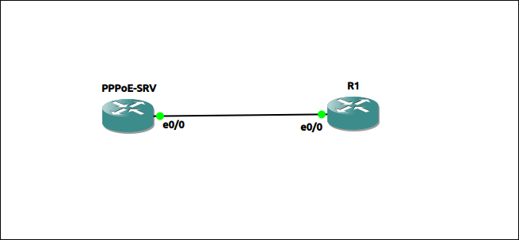

## LAB: PPPoe Client setup


## Scenario

PPPoe server already configured on ISP side, authentication using CHAP. Configure PPPoe on client, verify with a ping to gateway.

- username: cisco, password: cisco
- gateway(isp side): 10.1.1.1



## Action

1. Configure logical interface dialer1
```
  interface dialer 1
    encapsulation ppp
    ip address negotiation
    ppp chap username cisco
    ppp chap password 0 cisco
    
    dialer pool 1 
    # Link to pool 1 - to physical interface
```

2. Configure physical interface and bind to logical interface
```
  interface e0/0
    no ip address
    pppoe enable
    
    pppoe-client dial-pool-number 1 
    #Link to pool 1 - to logical interface
```

## Note & Result

1. Ping result:
```
R1#ping 10.1.1.1
Type escape sequence to abort.
Sending 5, 100-byte ICMP Echos to 10.1.1.1, timeout is 2 seconds:
!!!!!
Success rate is 100 percent (5/5), round-trip min/avg/max = 1/1/1 ms
```
2. IP interface brief:
```
R1#show ip int br | include up.*up   
Ethernet0/0            unassigned      YES NVRAM  up                    up      
Dialer1                10.1.1.101      YES IPCP   up                    up      
Virtual-Access1        unassigned      YES manual up                    up      
```
3. PPPoe session
```
R1#show pppoe session 
     1 client session 
Uniq ID  PPPoE  RemMAC          Port                    VT  VA         State SID  LocMAC                                      VA-st      Type
    N/A      2  aabb.cc00.0200  Et0/0                   Di1 Vi1        UP          aabb.cc00.0100                              UP 
```
3. Configure logical - physical interface - bind them via same pool, why?
  - no commands to bind logical and physical interface directly.
  - legacy: before PPPoe, require pool for dialer and moderm binding,                             
    Modem A ─────────────┤ pool 1 ───────────┤ Dialer 1                                                 
    Modem B ─────────────┤ pool 2 ───────────┤ Dialer 2                                                 
    Modem C ─────────────┤ pool 1 ───────────┤ Dialer 3
