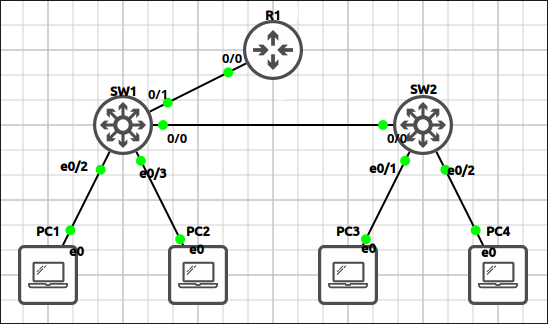

## Lab 1 - VLANs, Trunking and Router-on-a-Stick

> **GNS3 Project:** [`Module 1 - Switching (CCNA) | Lab 1 - VLANs, Trunking and Router-on-a-Stick.gns3`](./Module%201%20-%20Switching%20%28CCNA%29%20%7C%20Lab%201%20-%20VLANs%2C%20Trunking%20and%20Router-on-a-Stick.gns3)



## Scenario
Create VLAN 10 (ENGINEERING) and VLAN 20 (OPERATIONS) on SW1 and SW2. Create VLAN 99 (NATIVE) to be used as the native VLAN on the trunks. Place the PC ports in the VLANs shown in the topology.

- **Devices:** PC1 (PC), PC2 (PC), PC3 (PC), PC4 (PC), R1 (IOU L3), SW1 (IOU L2), SW2 (IOU L2)
- **Base Addressing:**
  - `R1` Ethernet0/0.10: `172.16.10.1` (255.255.255.0)
  - `R1` Ethernet0/0.20: `172.16.20.1` (255.255.255.0)
  - `PC1` Ethernet0: `172.16.10.11` (GW: 172.16.10.1)
  - `PC2` Ethernet0: `172.16.20.11` (GW: 172.16.20.1)
  - `PC4` Ethernet0: `172.16.20.12` (GW: 172.16.20.1)
  - `PC3` Ethernet0: `172.16.10.12` (GW: 172.16.10.1)

Task 1 - Create VLAN 10 (ENGINEERING) and VLAN 20 (OPERATIONS) on SW1 and SW2.
  - Create VLAN 99 (NATIVE) to be used as the native VLAN on the trunks.
  - Place the PC ports in the VLANs shown in the topology.

Task 2 - Configure the links between SW1 and SW2, and between SW1 and R1, as 802.1Q trunks.
  - Allow only VLANs 10, 20 and 99 on the trunks and use VLAN 99 as the native VLAN.

Task 3 - Configure R1 for router-on-a-stick so that VLAN 10 and VLAN 20 can reach each other.
  - Use the first address of each subnet as the gateway.
  - Verify by pinging from PC1 to PC4.

## Action
Task 1 - Create VLAN 10 (ENGINEERING) and VLAN 20 (OPERATIONS) on SW1 and SW2 and Access mode.

**SW1:**
```cisco
vlan 10
name ENGINEERING
vlan 20
name OPERATIONS
vlan 99
name NATIVE
interface Ethernet0/2
switchport mode access
switchport access vlan 10
interface Ethernet0/3
switchport mode access
switchport access vlan 20
```

**SW2:**
```cisco
vlan 10
name ENGINEERING
vlan 20
name OPERATIONS
vlan 99
name NATIVE
interface Ethernet0/1
switchport mode access
switchport access vlan 10
interface Ethernet0/2
switchport mode access
switchport access vlan 20
```

Task 2 - Configure the links between SW1 and SW2, and between SW1 and R1, as 802.1Q trunks.

**SW1:**
```cisco
interface range Ethernet0/0 - 1
switchport trunk encapsulation dot1q
switchport trunk native vlan 99
switchport trunk allowed vlan 10,20,99
switchport mode trunk
```

**SW2:**
```cisco
interface Ethernet0/0
switchport trunk encapsulation dot1q
switchport trunk native vlan 99
switchport trunk allowed vlan 10,20,99
switchport mode trunk
```

Task 3 - Configure R1 for router-on-a-stick so that VLAN 10 and VLAN 20 can reach each other.

**R1:**
```cisco
interface Ethernet0/0
no shutdown
interface Ethernet0/0.10
encapsulation dot1Q 10
ip address 172.16.10.1 255.255.255.0
interface Ethernet0/0.20
encapsulation dot1Q 20
ip address 172.16.20.1 255.255.255.0
```

## Note
1. Verification commands: `Show interfaces trunk`, `Ping 172.16.20.12`
2. Ethernet0/0 and Ethernet0/1 should be trunking with native VLAN 99.
3. The ping should succeed because R1 routes between VLAN 10 and VLAN 20.
4. On SW2, change the native VLAN of the trunk to VLAN 1. Watch the console and compare the trunk on both switches. Does PC1 still reach PC3? — A native VLAN mismatch message is logged. VLAN 10 and VLAN 20 traffic is tagged, so PC1 can still reach PC3. Note: Fix it with switchport trunk native vlan 99.
5. On SW1, remove VLAN 20 from the allowed list of the trunk towards SW2. Which PCs can no longer communicate? — PC2 can no longer reach PC4, because VLAN 20 is blocked between the switches. PC2 can still reach PC1 because R1 is connected to SW1. Note: Fix it with switchport trunk allowed vlan add 20.
