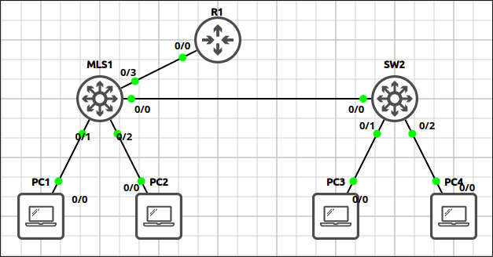
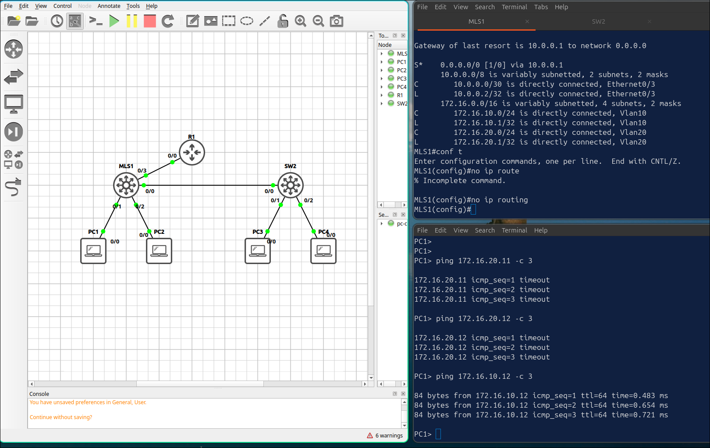
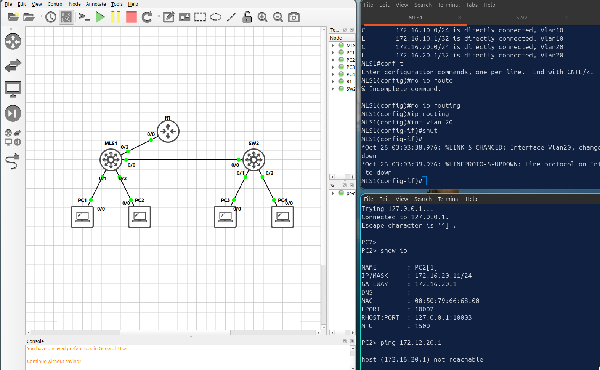

# Lab 1.2: Inter-VLAN Routing with SVIs

> **GNS3 Project:** [`Module 1 - Switching (CCNA) | Lab 2 - Inter-VLAN Routing with SVIs.gns3`](./Module%201%20-%20Switching%20%28CCNA%29%20%7C%20Lab%202%20-%20Inter-VLAN%20Routing%20with%20SVIs.gns3)
> **Platform:** GNS3 3.1 · Cisco IOL L2/L3 `17.18.2` · 1 multilayer switch (MLS1), 1 access switch, 1 router, 4 VPCS hosts
> **Key takeaway:** A multilayer switch routes between VLANs with SVIs, so no router-on-a-stick is needed. The SVIs only route while `ip routing` is on and their VLAN is active.

---

## 1. Scenario & Tasks

- **Task 1 — VLANs and trunk:** Create VLAN 10 and VLAN 20 on MLS1 and SW2, configure the link between them as an 802.1Q trunk, and place the PC ports in their VLANs.
- **Task 2 — SVIs:** Enable routing on MLS1 and create an SVI for each VLAN, using the first address of each subnet as the PC default gateway. Verify with a ping from PC1 to PC4.
- **Task 3 — Routed uplink:** Convert `E0/3` on MLS1 into a routed port towards R1 and add a default route on MLS1. Add a static route on R1 so return traffic reaches the VLANs.

### IPv4 Addressing

| Device | VLAN | Address | Gateway |
| :--- | :---: | :--- | :--- |
| **MLS1** `Vlan10` | 10 | 172.16.10.1/24 | — |
| **MLS1** `Vlan20` | 20 | 172.16.20.1/24 | — |
| **MLS1** `E0/3` (routed) | — | 10.0.0.2/30 | — |
| **R1** `E0/0` | — | 10.0.0.1/30 | — |
| **PC1** | 10 | 172.16.10.11/24 | 172.16.10.1 |
| **PC3** | 10 | 172.16.10.12/24 | 172.16.10.1 |
| **PC2** | 20 | 172.16.20.11/24 | 172.16.20.1 |
| **PC4** | 20 | 172.16.20.12/24 | 172.16.20.1 |

---

## 2. Configuration & Verification

### Task 1: VLANs, Trunk and Access Ports

**MLS1:**
~~~cisco
vlan 10
 name ENGINEERING
vlan 20
 name OPERATIONS
interface Ethernet0/0
 switchport trunk encapsulation dot1q
 switchport mode trunk
interface Ethernet0/1
 switchport mode access
 switchport access vlan 10
interface Ethernet0/2
 switchport mode access
 switchport access vlan 20
~~~

**SW2:**
~~~cisco
vlan 10
 name ENGINEERING
vlan 20
 name OPERATIONS
interface Ethernet0/0
 switchport trunk encapsulation dot1q
 switchport mode trunk
interface Ethernet0/1
 switchport mode access
 switchport access vlan 10
interface Ethernet0/2
 switchport mode access
 switchport access vlan 20
~~~

---

### Task 2: SVIs on MLS1

**MLS1:**
~~~cisco
ip routing
interface Vlan10
 ip address 172.16.10.1 255.255.255.0
 no shutdown
interface Vlan20
 ip address 172.16.20.1 255.255.255.0
 no shutdown
~~~
* **Verification:** `ping 172.16.20.12` from PC1 succeeds. The routing is done by MLS1, so no router is needed.

---

### Task 3: Routed Port and Default Route

**MLS1:**
~~~cisco
interface Ethernet0/3
 no switchport
 ip address 10.0.0.2 255.255.255.252
 no shutdown
ip route 0.0.0.0 0.0.0.0 10.0.0.1
~~~

**R1:**
~~~cisco
interface Ethernet0/0
 ip address 10.0.0.1 255.255.255.252
 no shutdown
ip route 172.16.0.0 255.255.0.0 10.0.0.2
~~~
* **Verification (`show ip route static`):** MLS1 has `S* 0.0.0.0/0 via 10.0.0.1`.

---

## 3. Notes & Fault-Injection (Break-It)

### Fault-Injection 1: Routing Disabled
* **Injected Fault:** On MLS1, `no ip routing`.
* **Symptom:** The SVIs stay up, but the switch no longer routes. PC1 cannot reach PC2 or PC4.
* **Fix:** `ip routing`

### Fault-Injection 2: VLAN Shut Down
* **Injected Fault:** On MLS1, shut down VLAN 20 (`vlan 20` → `shutdown`).
* **Symptom:** Interface `Vlan20` goes down, and PC2 and PC4 lose their default gateway.
* **Fix:** `no shutdown` under `vlan 20`.

