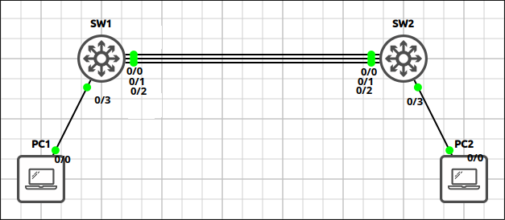
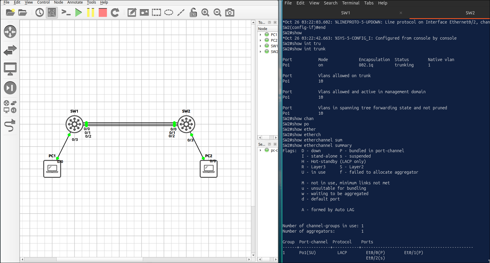
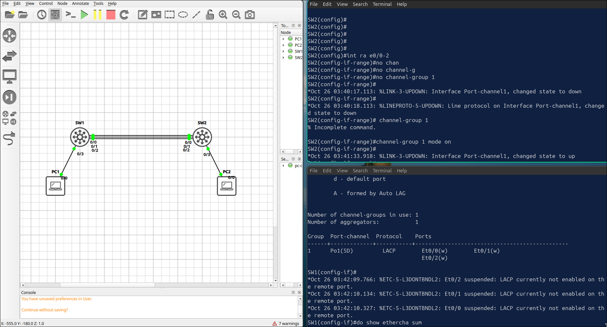
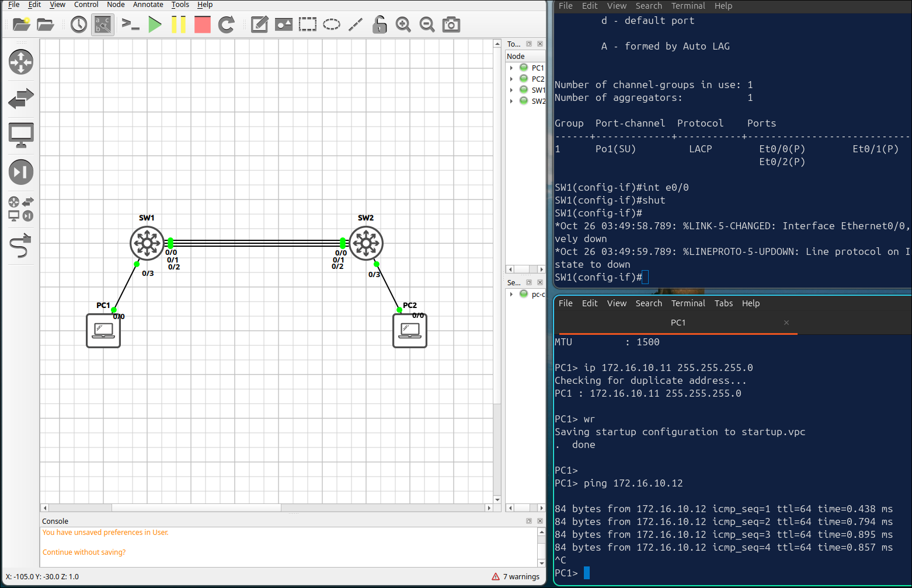

## Lab 3 - EtherChannel with LACP

> **GNS3 Project:** [`Module 1 - Switching (CCNA) | Lab 3 - EtherChannel with LACP.gns3`](./Module%201%20-%20Switching%20%28CCNA%29%20%7C%20Lab%203%20-%20EtherChannel%20with%20LACP.gns3)



## Scenario
Create VLAN 10 on both switches and place the PC ports in it. Bundle E 0/0 and E 0/1 between SW1 and SW2 into Port-channel 1 using LACP. SW1 must actively negotiate and SW2 must wait passively. Configure the EtherChannel as an 802.1Q trunk.

- **Devices:** PC1 (PC), PC2 (PC), SW1 (IOU L2), SW2 (IOU L2)

Task 1 - Create VLAN 10 on both switches and place the PC ports in it.
  - Bundle E 0/0 and E 0/1 between SW1 and SW2 into Port-channel 1 using LACP.
  - SW1 must actively negotiate and SW2 must wait passively.
  - Configure the EtherChannel as an 802.1Q trunk.

Task 2 - Add the third link (E 0/2) to the same EtherChannel.
  - Configure both switches to load-balance traffic using the source and destination IP addresses.

Task 3 - Verify that all three links are bundled and that PC1 can reach PC2.

## Action
Task 1 - Create VLAN 10 on both switches and place the PC ports in it.

**SW1:**
```cisco
vlan 10
interface Ethernet0/3
switchport mode access
switchport access vlan 10
interface Port-channel1
switchport trunk encapsulation dot1q
switchport trunk allowed vlan 10
switchport mode trunk
interface range Ethernet0/0 - 1
channel-protocol lacp
channel-group 1 mode active
```

**SW2:**
```cisco
vlan 10
interface Ethernet0/3
switchport mode access
switchport access vlan 10
interface Port-channel1
switchport trunk encapsulation dot1q
switchport trunk allowed vlan 10
switchport mode trunk
interface range Ethernet0/0 - 1
channel-protocol lacp
channel-group 1 mode passive
```

Task 2 - Add the third link (E 0/2) to the same EtherChannel.

**SW1:**
```cisco
interface Ethernet0/2
switchport trunk encapsulation dot1q
switchport trunk allowed vlan 10
switchport mode trunk
channel-group 1 mode active
port-channel load-balance src-dst-ip
```

**SW2:**
```cisco
interface Ethernet0/2
switchport trunk encapsulation dot1q
switchport trunk allowed vlan 10
switchport mode trunk
channel-group 1 mode passive
port-channel load-balance src-dst-ip
```

Task 3 - Verify that all three links are bundled and that PC1 can reach PC2.

## Note
1. Verification commands: `Show etherchannel summary`
2. Bundle an interface to existing Port-Channel must match the setting or they will not bundle. e.g., SW2, E0/2 still in access mode.

Fix:
  - Method 1 - manually match settings like switchport mode, encapsulations and allowed vlan etc, first.
  - Method 2 - Recommend to select all interfaces then bundle them once.

3. Port-channel1 should be trunking. PC1: Ping 172.16.10.12
4. On SW2, remove the three member ports from the channel and put them back using mode on. Check the EtherChannel on SW1. — SW1 still sends LACP packets, but SW2 does not answer them. The EtherChannel does not form and the ports on SW1 show as down (s). 

Note: Fix it with channel-group 1 mode passive.
5. On SW1, shut down E 0/0. Does PC1 still reach PC2? SW1 — Po1 stays up with Et0/1 and Et0/2. PC1 still reaches PC2, because the traffic uses the remaining links. 

Note: Fix it with no shutdown.
