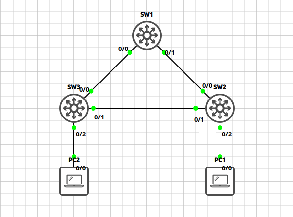
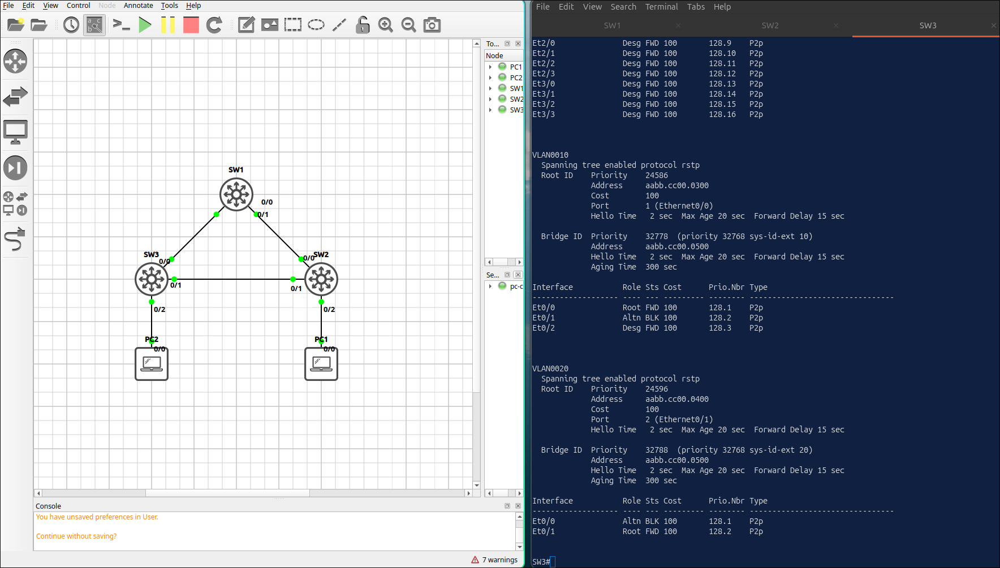
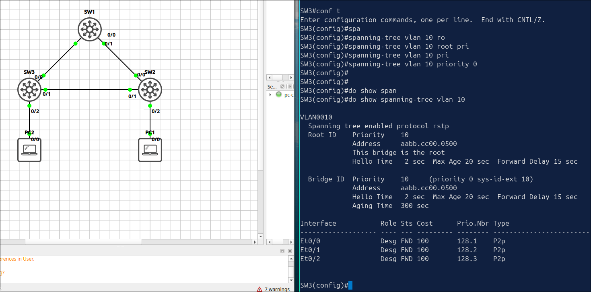
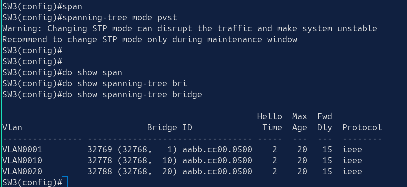

# Lab 1.4: Rapid PVST+ & Root Bridge Tuning

> **GNS3 Project:** [`Module 1 - Switching (CCNA) | Lab 4 - Rapid PVST+ and Root Bridge Tuning.gns3`](./Module%201%20-%20Switching%20%28CCNA%29%20%7C%20Lab%204%20-%20Rapid%20PVST%2B%20and%20Root%20Bridge%20Tuning.gns3)
> **Platform:** GNS3 3.1 · Cisco IOL L2 `17.18.2` · 3 switches, 2 VPCS hosts
> **Key takeaway:** With per-VLAN spanning tree, different switches can be root for different VLANs. A switch with priority 0 takes over as root bridge, so root placement must be protected.

---

## 1. Scenario & Tasks

- **Task 1 — Baseline:** Create VLAN 10 and VLAN 20 on all switches, configure the inter-switch links as 802.1Q trunks, and enable Rapid PVST+.
- **Task 2 — Root bridges:** Make SW1 the root bridge for VLAN 10 and SW2 the root bridge for VLAN 20, each being the backup root for the other VLAN. Do not set the priority value manually.
- **Task 3 — Verify** the spanning-tree roles on SW3.

---

## 2. Configuration & Verification

### Task 1: Baseline (VLANs, Trunks, Rapid PVST+)

**SW1:**
~~~cisco
spanning-tree mode rapid-pvst
vlan 10,20
interface range Ethernet0/0 - 1
 switchport trunk encapsulation dot1q
 switchport mode trunk
~~~

**SW2:**
~~~cisco
spanning-tree mode rapid-pvst
vlan 10,20
interface range Ethernet0/0 - 1
 switchport trunk encapsulation dot1q
 switchport mode trunk
interface Ethernet0/2
 switchport mode access
 switchport access vlan 10
~~~

**SW3:**
~~~cisco
spanning-tree mode rapid-pvst
vlan 10,20
interface range Ethernet0/0 - 1
 switchport trunk encapsulation dot1q
 switchport mode trunk
interface Ethernet0/2
 switchport mode access
 switchport access vlan 10
~~~

---

### Task 2: Root Bridge Placement

**SW1:**
~~~cisco
spanning-tree vlan 10 root primary
spanning-tree vlan 20 root secondary
~~~

**SW2:**
~~~cisco
spanning-tree vlan 20 root primary
spanning-tree vlan 10 root secondary
~~~

---

### Task 3: Verification on SW3 (`show spanning-tree`)

* **VLAN 10:** `E0/0` (towards SW1) is the Root port. `E0/1` is the Alternate port, in blocking state.
* **VLAN 20:** `E0/1` (towards SW2) is the Root port. `E0/0` is the Alternate port, in blocking state.

---

## 3. Notes & Fault-Injection (Break-It)

### Fault-Injection 1: Rogue Root Bridge
* **Injected Fault:** On SW3, set the priority of VLAN 10 to 0.
* **Symptom:** SW3 becomes the root bridge for VLAN 10 and the forwarding paths change.
* **Fix:** `no spanning-tree vlan 10 priority`

### Fault-Injection 2: Mixed STP Modes
* **Injected Fault:** On SW3, changed the spanning-tree mode to PVST+ and checked it with `show spanning-tree summary`.
* **Symptom:** PVST+ and Rapid PVST+ interoperate, but the links of SW3 fall back to the slower 802.1D (IEEE) convergence.
* **Fix:** `spanning-tree mode rapid-pvst`

