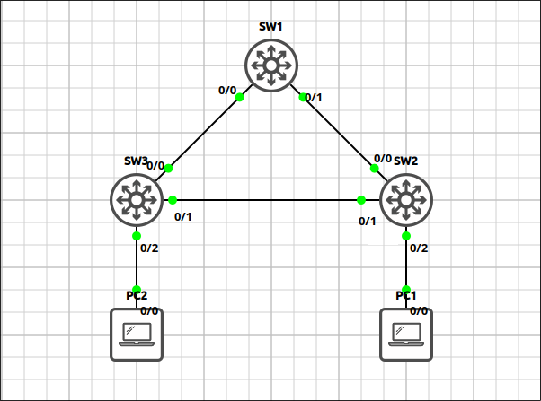
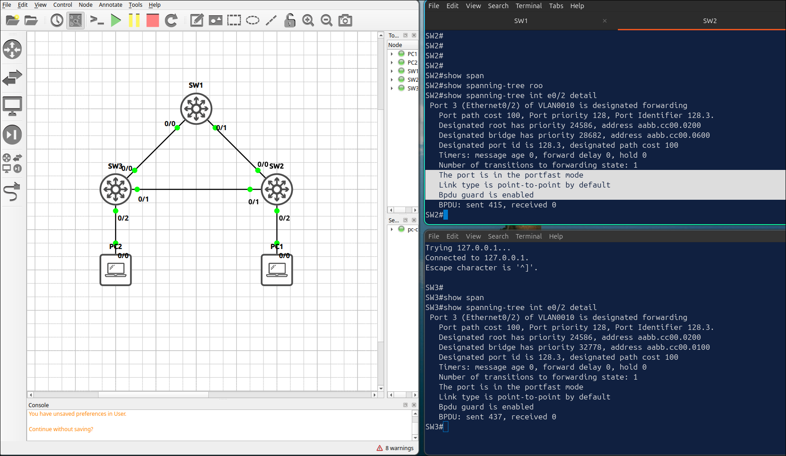
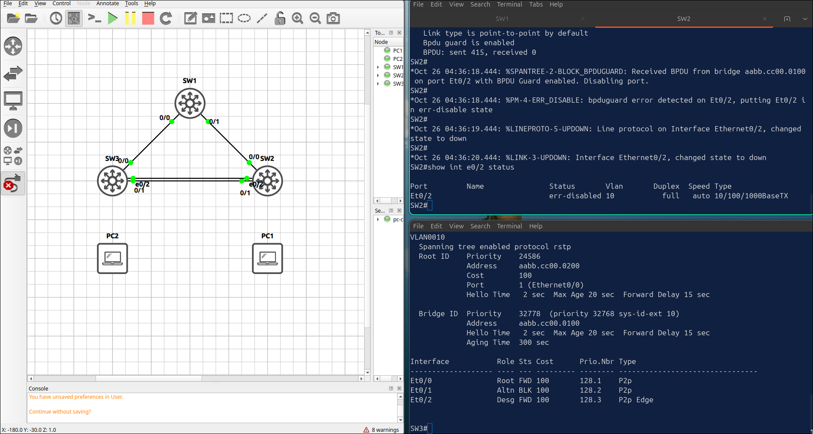
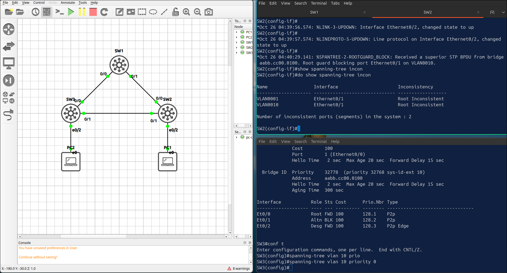
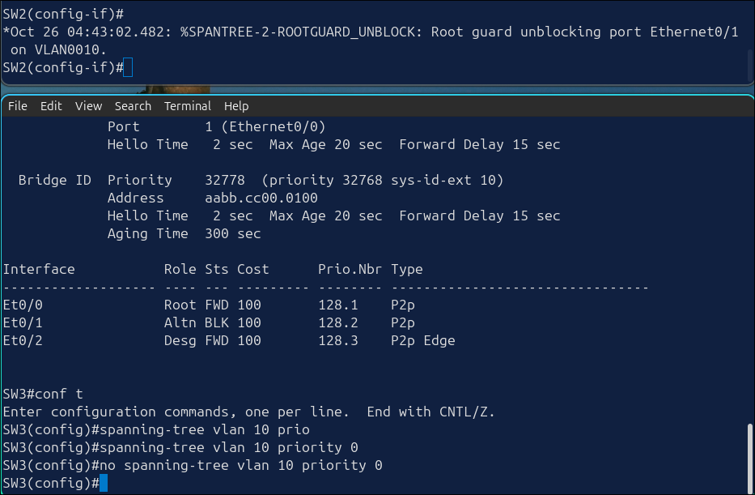

## Lab 5 - STP Protection: PortFast, BPDU Guard and Root Guard

> **GNS3 Project:** [`Module 1 - Switching (CCNA) | Lab 5 - STP Protection: PortFast, BPDU Guard and Root Guard.gns3`](./Module%201%20-%20Switching%20%28CCNA%29%20%7C%20Lab%205%20-%20STP%20Protection%3A%20PortFast%2C%20BPDU%20Guard%20and%20Root%20Guard.gns3)



## Scenario
Starting from the Lab 4 configuration, enable PortFast and BPDU Guard on the PC ports of SW2 and SW3 (E 0/2).

- **Devices:** PC1 (PC), PC2 (PC), SW1 (IOU L2), SW2 (IOU L2), SW3 (IOU L2)

Task 1 - Starting from the Lab 4 configuration, enable PortFast and BPDU Guard on the PC ports of SW2 and SW3 (E 0/2).
  - Configure on SW2
  - Configure on SW3

Task 2 - SW3 is an access-layer switch and must never become the root bridge.
  - Enable Root Guard on the ports of SW1 and SW2 that face SW3.

Task 3 - Verify the protection features.
  - Configure on SW2

## Action
Task 1 - Starting from the Lab 4 configuration, enable PortFast and BPDU Guard on the PC ports of SW2 and SW3 (E 0/2).

**SW2:**
```cisco
interface Ethernet0/2
spanning-tree portfast
spanning-tree bpduguard enable
```

**SW3:**
```cisco
interface Ethernet0/2
spanning-tree portfast
spanning-tree bpduguard enable
```

Task 2 - SW3 is an access-layer switch and must never become the root bridge.

**SW1:**
```cisco
interface Ethernet0/1
spanning-tree guard root
```

**SW2:**
```cisco
interface Ethernet0/1
spanning-tree guard root
```

Task 3 - Verify the protection features.



## Note
1. Verification commands: `Show spanning-tree interface INTERFACE-ID detail`, `Show spanning-tree inconsistentports`
 - The output should say that the port is in the portfast mode and that Bpdu guard is enabled.
 - No ports should be listed while the topology is stable.
2. Remove PC2 and PC1 and connect SW2 E 0/2 directly to SW3 E 0/2 with a cable. SW2 — The port is err-disabled. A BPDU was received on a BPDU Guard port.

5. On SW3, set the priority of VLAN 10 to 0. Check the ports of SW1 and SW2. SW3 — E 0/1 is root-inconsistent for VLAN 10, and a ROOTGUARD_BLOCK message is logged. 

Note: Fix it on SW3 with no spanning-tree vlan 10 priority. No need shut/no shut or err-recovery, it automatically unblock port.

