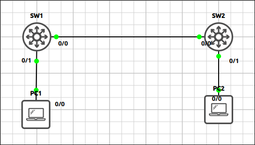
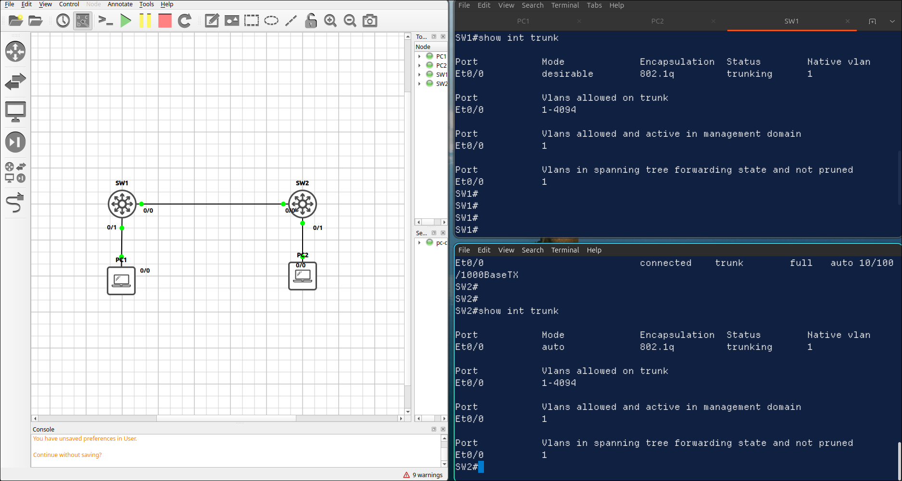
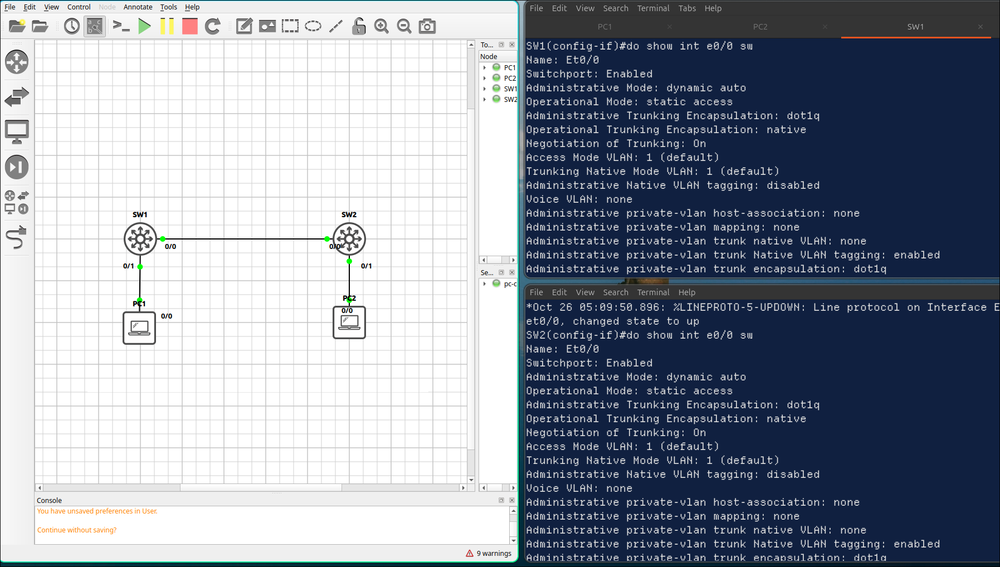
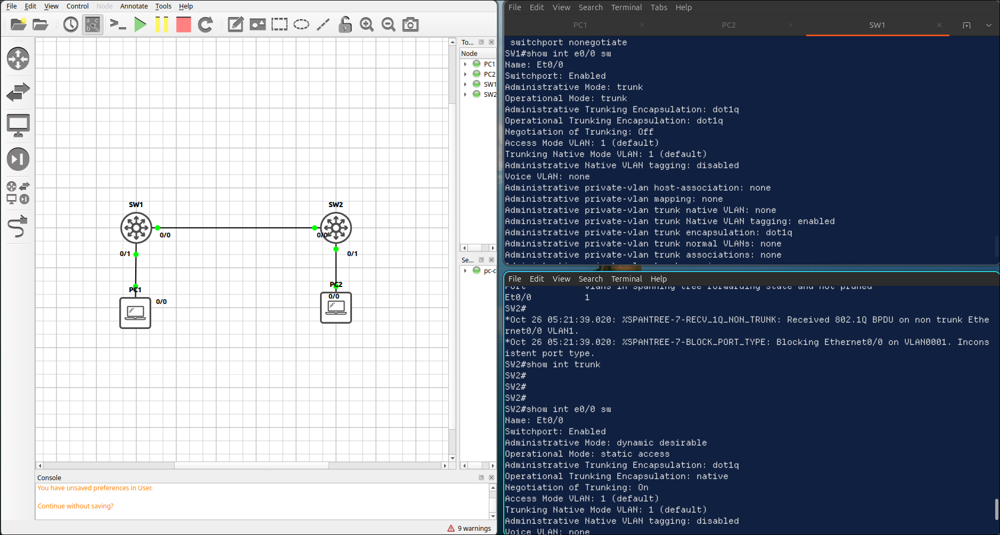

## Lab 6 - DTP and Trunk Negotiation

> **GNS3 Project:** [`Module 1 - Switching (CCNA) | Lab 6 - DTP and Trunk Negotiation.gns3`](./Module%201%20-%20Switching%20%28CCNA%29%20%7C%20Lab%206%20-%20DTP%20and%20Trunk%20Negotiation.gns3)



## Scenario
Configure the link between SW1 (E 0/1) and SW2 (E 0/0) so that a trunk forms through DTP negotiation. SW1 must actively ask for a trunk (dynamic desirable) and SW2 must accept it (dynamic auto).

- **Devices:** PC1 (PC), PC2 (PC), SW1 (IOU L2), SW2 (IOU L2)

Task 1 - Configure the link between SW1 (E 0/0) and SW2 (E 0/0) so that a trunk forms through DTP negotiation.
  - SW1 must actively ask for a trunk (dynamic desirable) and SW2 must accept it (dynamic auto).

Task 2 - Verify the administrative and operational mode on both switches.

Task 3 - Negotiation is a security risk.
  - Configure both ends as static trunks and turn DTP off.

## Action
Task 1 - Configure the link between SW1 (E 0/0) and SW2 (E 0/0) so that a trunk forms through DTP negotiation.

**SW1:**
```cisco
interface Ethernet0/1
switchport trunk encapsulation dot1q
switchport mode dynamic desirable
```

**SW2:**
```cisco
interface Ethernet0/0
switchport trunk encapsulation dot1q
switchport mode dynamic auto
```

Task 2 - Verify the administrative and operational mode on both switches.


Task 3 - Negotiation is a security risk.

**SW1:**
```cisco
interface Ethernet0/0
switchport mode trunk
switchport nonegotiate
```

**SW2:**
```cisco
interface Ethernet0/0
switchport mode trunk
switchport nonegotiate
```

## Note
1. Verification commands: `Show interfaces ethernet0/0 switchport`, `Show interfaces ethernet0/0 switchport`
  - Administrative Mode is dynamic desirable and Operational Mode is trunk.
  -Administrative Mode is dynamic auto and Operational Mode is trunk.
2. Negotiation of Trunking should be Off.
3. Set both ends back to dynamic auto. Check the operational mode on both switches. SW1 — Both sides wait for the other side to start the negotiation. The operational mode is static access and the VLANs do not pass between the switches.

6. Configure SW1 as a static trunk with switchport nonegotiate, and set SW2 to dynamic desirable. Compare the operational mode on both switches. — SW1 does not answer the DTP frames. SW2 stays in access mode while SW1 sends tagged frames, and the VLANs do not work between the switches. 

Note: Configure both ends as static trunks to fix it.
