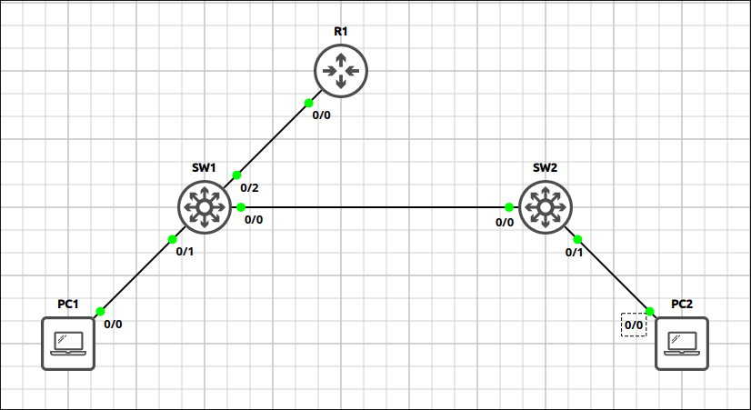
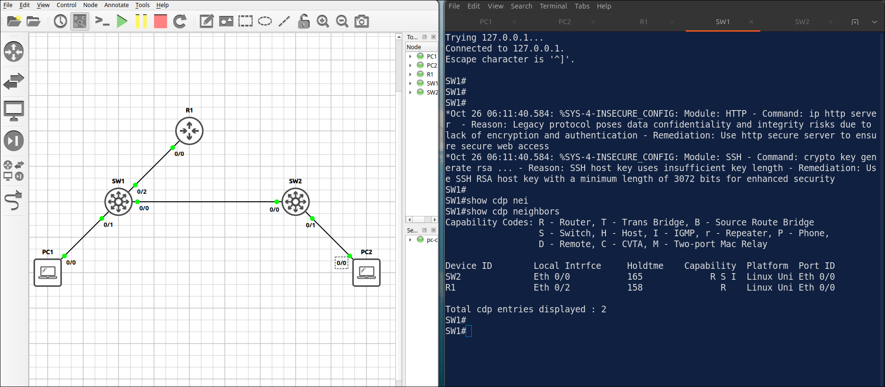
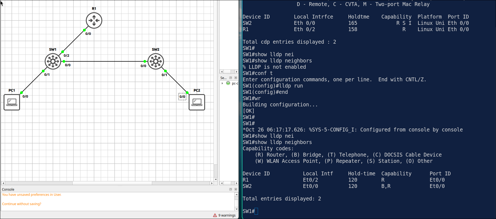

## Lab 7 - CDP and LLDP

> **GNS3 Project:** [`Module 1 - Switching (CCNA) | Lab 7 - CDP and LLDP.gns3`](./Module%201%20-%20Switching%20%28CCNA%29%20%7C%20Lab%207%20-%20CDP%20and%20LLDP.gns3)



## Scenario
Verify the CDP neighbors of SW1 and check the details of the neighbor R1.

- **Devices:** PC1 (PC), PC2 (PC), R1 (IOU L3), SW1 (IOU L2), SW2 (IOU L2)

Task 1 - Verify the CDP neighbors of SW1 and check the details of the neighbor R1.

Task 2 - Do not advertise R1 CDP to SW1 (as if the link were facing a provider).
  - Disable CDP on the interface of R1 towards SW1 and check the CDP neighbors of SW1 again.

Task 3 - Enable LLDP on R1, SW1 and SW2 and verify the LLDP neighbors of SW1.
  - Configure on R1

## Action
Task 1 - Verify the CDP neighbors of SW1 and check the details of the neighbor R1.



Task 2 - Disable cdp on R1 interface facing SW1

**R1:**
```cisco
interface Ethernet0/0
no cdp enable
```

Task 3 - Enable LLDP on R1, SW1 and SW2 and verify the LLDP neighbors of SW1.

**R1:**
```cisco
lldp run
```
Do the same on SW1 and SW2.



## Note
1. Verification commands:
  - `Show cdp neighbors` R1 (E 0/0) and SW2 (E 0/1) should be listed with their capabilities. 
  - `Show cdp neighbors detail` The output shows platform, ip address and the remote port of each neighbor.
2. CDP - Cisco Proprietry 
  - SW(config)#cdp run, no cdp run
  - SW(config-if)#cdp enable, no cdp enable
3. LLDP - open standard, more option on interface
  - SW(config)#lldp run, no lldp run
  - SW(config-if)#lldp transmit/receive, no lldp transmit/receive
4. On SW2, disable CDP globally. Check the CDP neighbors and the LLDP neighbors of SW1. — SW1 no longer sees SW2 in the CDP neighbor table. SW2 is still visible with LLDP. 

Note: Fix it with cdp run.
