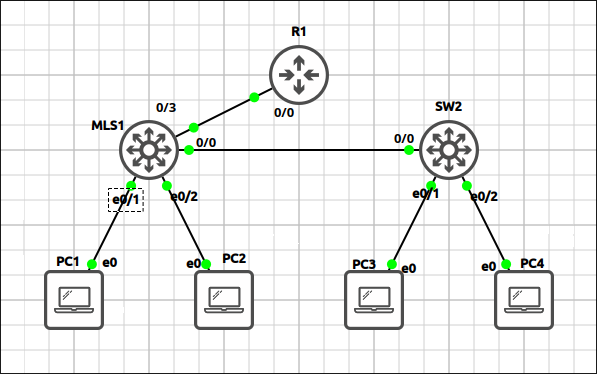
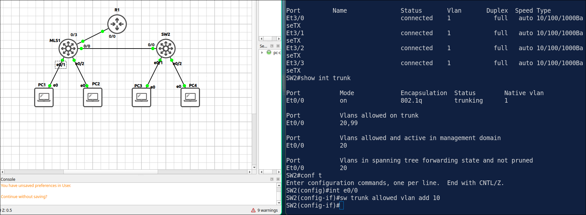
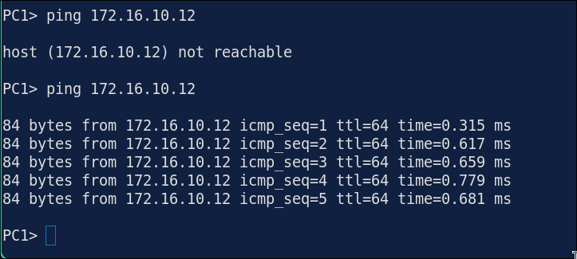
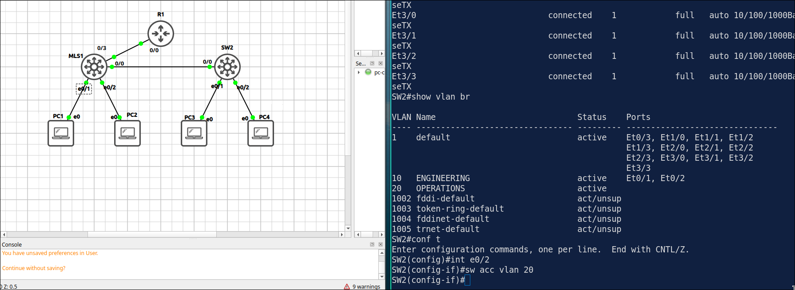
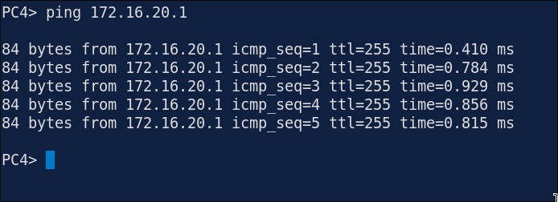
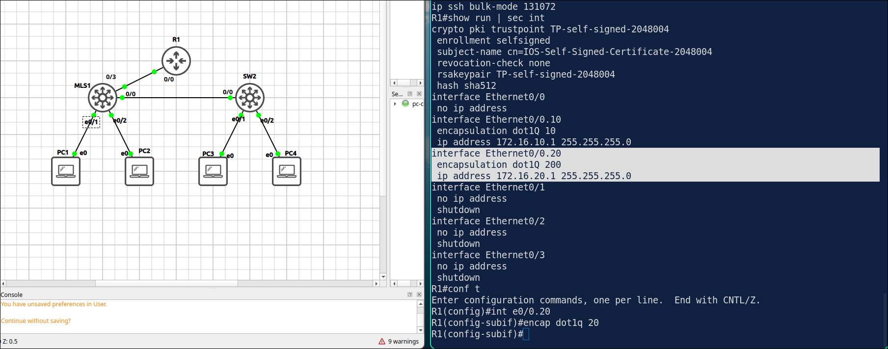
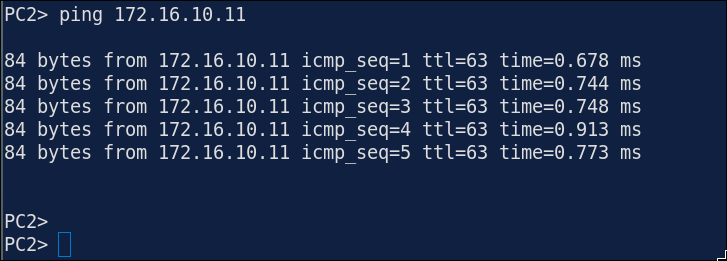
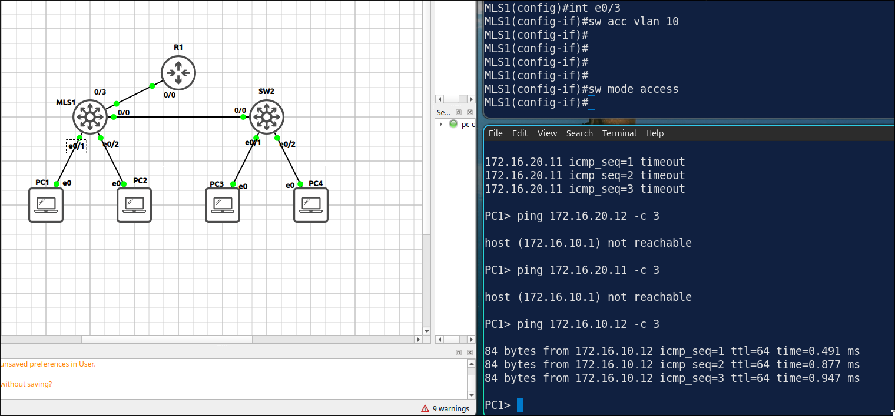

# Lab 1.8: Troubleshooting — VLANs, Trunks & Inter-VLAN Routing

> **GNS3 Project:** [`Module 1 - Switching (CCNA) | Lab 8 - Troubleshooting: VLANs, Trunks and Inter-VLAN Routing.gns3`](./Module%201%20-%20Switching%20%28CCNA%29%20%7C%20Lab%208%20-%20Troubleshooting%3A%20VLANs%2C%20Trunks%20and%20Inter-VLAN%20Routing.gns3)
> **Platform:** GNS3 3.1 · Cisco IOL L2/L3 `17.18.2` · 2 switches, 1 router, 4 VPCS hosts
> **Key takeaway:** Troubleshoot bottom-up: host settings, then VLAN and access-port membership, then trunks (allowed VLANs, native VLAN), then the router's sub-interface tags.

---

## 1. Scenario & Tasks

The network from Labs 1.1–1.2 has three faults. For each one, find the cause and fix it.

- **Task 1:** PC1 can no longer reach PC3.
- **Task 2:** PC4 can no longer reach its gateway.
- **Task 3:** PC2 can no longer reach PC1.

### Baseline Design

| Device | Configuration |
| :--- | :--- |
| **R1** | `E0/0.10`: 172.16.10.1/24, `E0/0.20`: 172.16.20.1/24 |
| **MLS1** | `E0/0` and `E0/3` trunks, `E0/1` in VLAN 10, `E0/2` in VLAN 20 |
| **SW2** | `E0/0` trunk, `E0/1` in VLAN 10, `E0/2` in VLAN 20 |

---

## 2. Troubleshooting & Verification

Commands used: `show interfaces trunk`, `show vlan brief`, `show vlans`.

### Task 1: PC1 → PC3 Fails
* **Method:** Checked the IP settings on the hosts, then the VLAN database and switchport modes on the access switches, then the trunks (allowed VLANs, native VLAN).
* **Root cause:** VLAN 10 is missing from the allowed list of the trunk.
* **Fix:** `interface Ethernet0/0` → `switchport trunk allowed vlan add 10`

Verification:

---

### Task 2: PC4 → Gateway Fails
* **Method:** Checked the IP settings, then the VLAN and switchport modes.
* **Root cause:** `E0/2` is listed under VLAN 10, but PC4 belongs in VLAN 20.
* **Fix:** `interface Ethernet0/2` → `switchport access vlan 20`

Verification:

---

### Task 3: PC2 → PC1 Fails
* **Method:** Checked the IP settings, the VLAN and switchport modes, then the trunks on SW1 and the encapsulation tags on R1.
* **Root cause:** Sub-interface `E0/0.20` is mapped to VLAN 200 instead of VLAN 20.
* **Fix:** `interface Ethernet0/0.20` → `encapsulation dot1Q 20`

Verification:

---

## 3. Notes & Fault-Injection (Break-It)

### Fault-Injection: Trunk to the Router Becomes an Access Port
* **Injected Fault:** On MLS1, changed `E0/3` (the link to R1) to an access port in VLAN 10.
* **Symptom:** `E0/3` is no longer listed as a trunk, so R1 only receives untagged frames and routing between the VLANs stops. PC1 can still reach PC3, because they are in the same VLAN.

