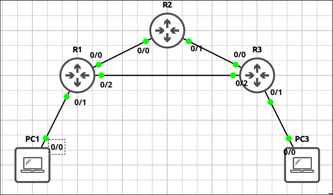
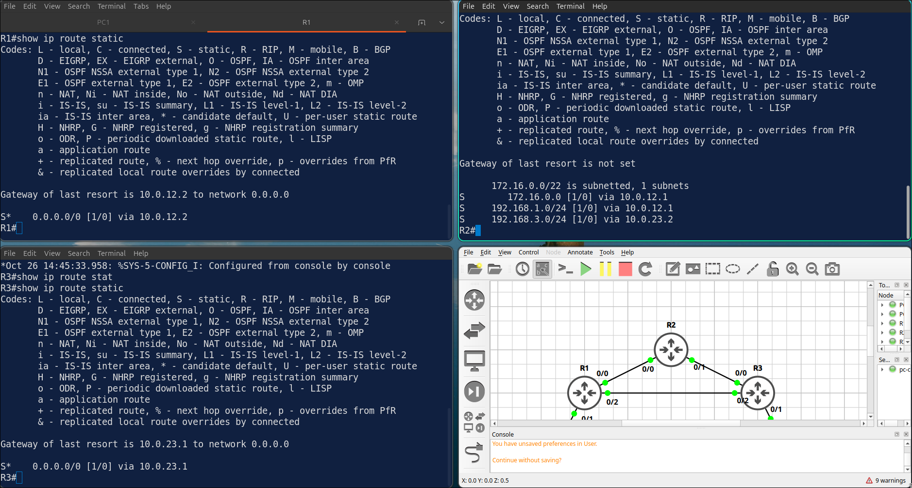
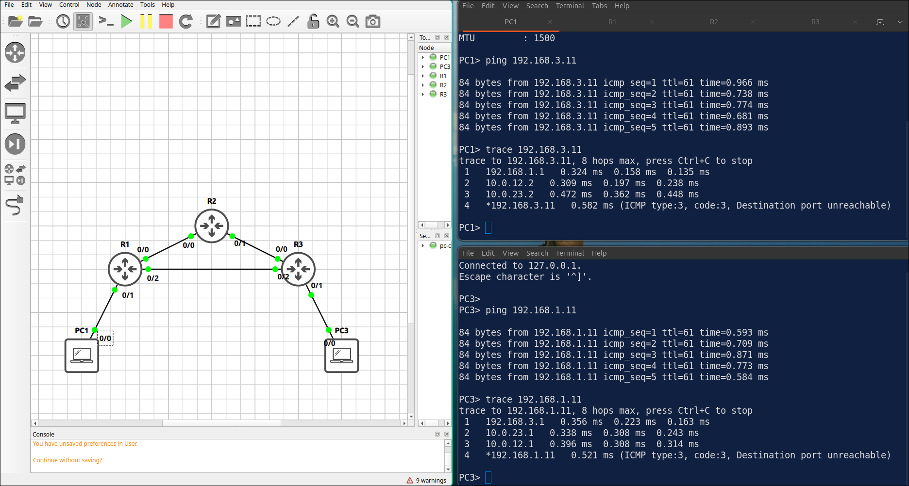
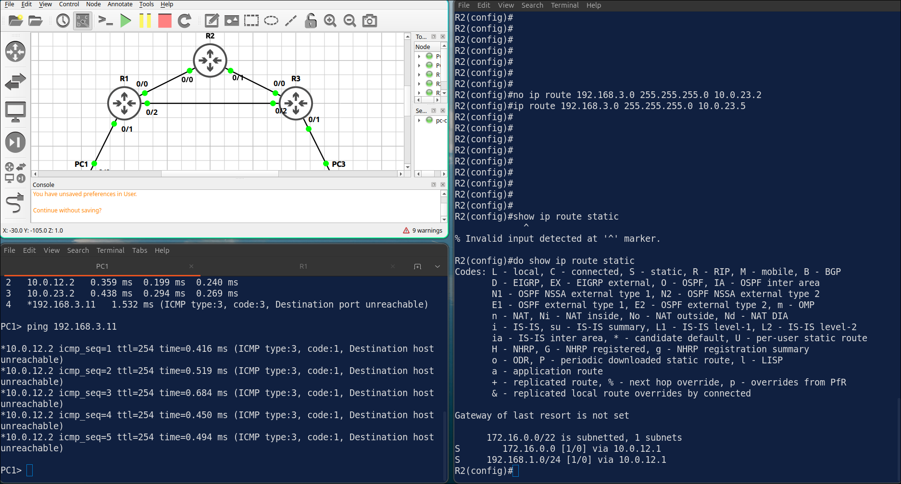
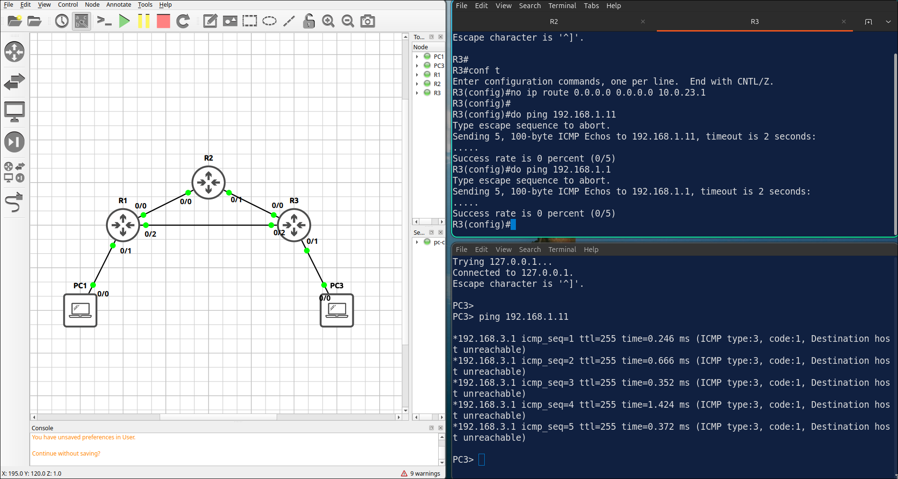

## Lab 1 - Static and Default Routes

> **GNS3 Project:** [`Module 2 - IP Connectivity (CCNA) | Lab 1 - Static and Default Routes.gns3`](./Module%202%20-%20IP%20Connectivity%20%28CCNA%29%20%7C%20Lab%201%20-%20Static%20and%20Default%20Routes.gns3)



## Scenario
Configure static routes so that PC1 and PC3 can reach each other through R2. Use the next-hop address in every route. R1 and R3 also need the route to the link network on the other side of R2.

- **Devices:** PC1 (PC), PC3 (PC), R1 (IOU L3), R2 (IOU L3), R3 (IOU L3)
- **Base Addressing:**
  - `R3` Ethernet0/0: `10.0.23.2` (255.255.255.252)
  - `R3` Ethernet0/1: `192.168.3.1` (255.255.255.0)
  - `R3` Ethernet0/2: `10.0.13.2` (255.255.255.252)
  - `R1` Ethernet0/0: `10.0.12.1` (255.255.255.252)
  - `R1` Ethernet0/1: `192.168.1.1` (255.255.255.0)
  - `R1` Ethernet0/2: `10.0.13.1` (255.255.255.252)
  - `R1` Loopback10: `172.16.0.1` (255.255.255.0)
  - `R1` Loopback11: `172.16.1.1` (255.255.255.0)
  - `R1` Loopback12: `172.16.2.1` (255.255.255.0)
  - `R1` Loopback13: `172.16.3.1` (255.255.255.0)
  - `R2` Ethernet0/0: `10.0.12.2` (255.255.255.252)
  - `R2` Ethernet0/1: `10.0.23.1` (255.255.255.252)
  - `PC3` Ethernet0: `192.168.3.11` (GW: 192.168.3.1)
  - `PC1` Ethernet0: `192.168.1.11` (GW: 192.168.1.1)

Task 1 - Configure static routes so that PC1 and PC3 can reach each other through R2.
  - Use the next-hop address in every route.
  - R1 and R3 also need the route to the link network on the other side of R2.

Task 2 - R1 and R3 are stub routers.
  - Replace their specific routes with a default route towards R2.
  - R1 has four loopbacks (172.16.0.0/24 – 172.16.3.0/24): configure one summary static route on R2 instead of four routes.

Task 3 - Verify the routing tables and the connectivity from PC1 to PC3.

## Action
Task 1 - Configure static routes so that PC1 and PC3 can reach each other through R2.

**R1:**
```cisco
ip route 192.168.3.0 255.255.255.0 10.0.12.2
ip route 10.0.23.0 255.255.255.252 10.0.12.2
```

**R2:**
```cisco
ip route 192.168.1.0 255.255.255.0 10.0.12.1
ip route 192.168.3.0 255.255.255.0 10.0.23.2
```

**R3:**
```cisco
ip route 192.168.1.0 255.255.255.0 10.0.23.1
ip route 10.0.12.0 255.255.255.252 10.0.23.1
```

Task 2 - R1 and R3 are stub routers.

**R1:**
```cisco
no ip route 192.168.3.0 255.255.255.0 10.0.12.2
no ip route 10.0.23.0 255.255.255.252 10.0.12.2
ip route 0.0.0.0 0.0.0.0 10.0.12.2
no ip route 192.168.1.0 255.255.255.0 10.0.23.1
no ip route 10.0.12.0 255.255.255.252 10.0.23.1
ip route 0.0.0.0 0.0.0.0 10.0.23.1
ip route 172.16.0.0 255.255.252.0 10.0.12.1
```

Task 3 - Verify the routing tables and the connectivity from PC1 to PC3.






## Note
1. Stub router has only one way out to the rest of the network.
2. Verification commands: `Show ip route static`
  - R1 have S* 0.0.0.0/0 via 10.0.12.2.
  - R3 have S* 0.0.0.0/0 via 10.0.23.1.
  - R2 have one route for 172.16.0.0/22 instead of four /24 routes.
3. On R2, change the next hop of the route to 192.168.3.0/24 to 10.0.23.5. Check the routing table of R2. — The route is not installed because the next hop is not reachable. PC1 cannot reach PC3. 


Note: Fix it with the next hop 10.0.23.2.

5. On R3, remove the default route. Ping PC1 from PC3. R3 — R3 has no route to 192.168.1.0/24. The ping fails with destination unreachable from R3. 

Note: When no route to PC1, why pings from PC3 and R3 look different?
- PC3 ping PC1 -> reach R3 -> no route -> send ICMP dest unreachable to R3.
- R3 ping PC1 -> check table -> drop packet before it leave router, R3 does not send ICMP to itself.
