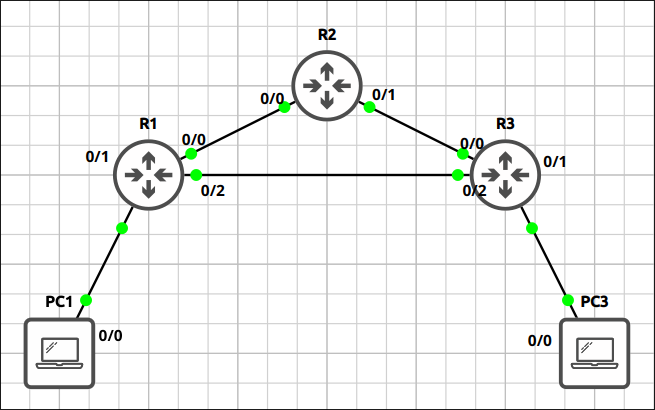
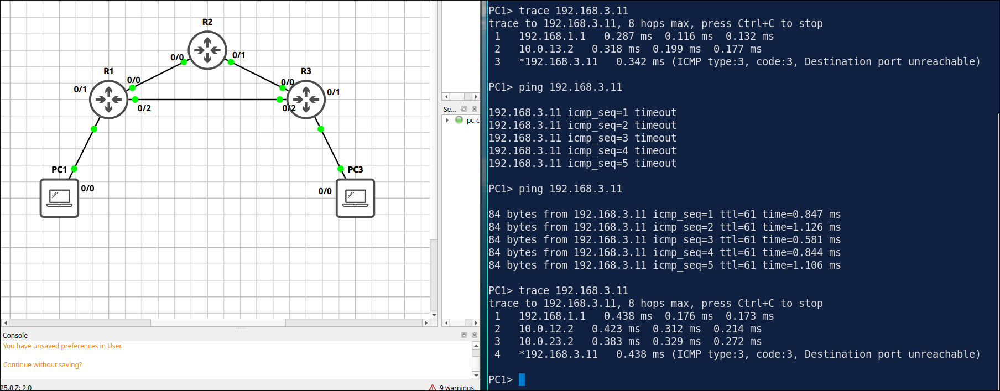
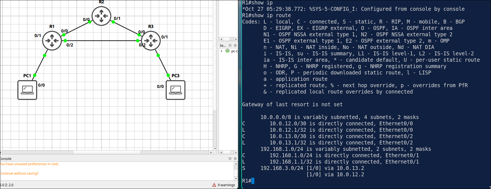
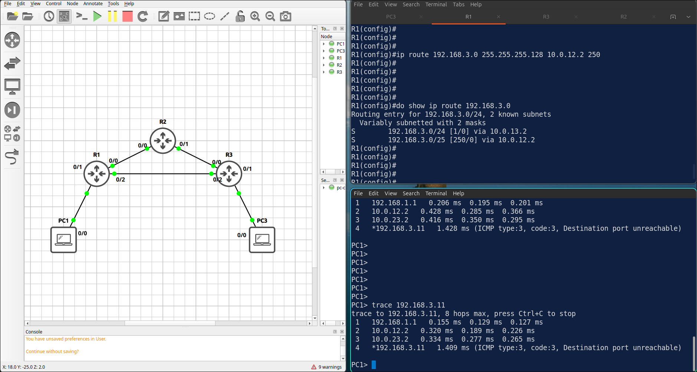

## Lab 2 - Route Selection: Longest Prefix, Administrative Distance and Floating Routes

> **GNS3 Project:** [`Module 2 - IP Connectivity (CCNA) | Lab 2 - Route Selection.gns3`](./Module%202%20-%20IP%20Connectivity%20%28CCNA%29%20%7C%20Lab%202%20-%20Route%20Selection.gns3)



## Scenario
Starting from the default routes of Lab 1, use the direct link between R1 and R3. Add a more specific static route on each router for the LAN of the other router. R2 keeps its static routes.

- **Devices:** PC1 (PC), PC3 (PC), R1 (IOU L3), R2 (IOU L3), R3 (IOU L3)
- **Base Addressing:**
  - `R3` Ethernet0/0: `10.0.23.2` (255.255.255.252)
  - `R3` Ethernet0/1: `192.168.3.1` (255.255.255.0)
  - `R3` Ethernet0/2: `10.0.13.2` (255.255.255.252)
  - `R2` Ethernet0/0: `10.0.12.2` (255.255.255.252)
  - `R2` Ethernet0/1: `10.0.23.1` (255.255.255.252)
  - `R1` Ethernet0/0: `10.0.12.1` (255.255.255.252)
  - `R1` Ethernet0/1: `192.168.1.1` (255.255.255.0)
  - `R1` Ethernet0/2: `10.0.13.1` (255.255.255.252)
  - `PC3` Ethernet0: `192.168.3.11` (GW: 192.168.3.1)
  - `PC1` Ethernet0: `192.168.1.11` (GW: 192.168.1.1)

Task 1 - Starting from the default routes of Lab 1, use the direct link between R1 and R3.
  - Add a more specific static route on each router for the LAN of the other router.
  - R2 keeps its static routes.

Task 2 - Make the path through R2 a backup.
  - Configure a floating static route with an administrative distance of 200 on R1 and R3 for the LAN of the other router.

Task 3 - Test the failover.
  - Shut down E 0/2 on R1, check the route and trace the path from PC1.
  - Then bring the interface back up.

## Action
Task 1 - Starting from the default routes of Lab 1, use the direct link between R1 and R3.

**R1:**
```cisco
ip route 192.168.3.0 255.255.255.0 10.0.13.2
```

**R3:**
```cisco
ip route 192.168.1.0 255.255.255.0 10.0.13.1
Traceroute 192.168.3.11
```
**PC1:**
```
PC1> trace 192.168.3.11
trace to 192.168.3.11, 8 hops max, press Ctrl+C to stop
 1   192.168.1.1   0.276 ms  0.123 ms  0.149 ms
 2   10.0.13.2   0.365 ms  0.243 ms  0.196 ms
 3   *192.168.3.11   0.642 ms (ICMP type:3, code:3, Destination port unreachable)
```

Task 2 - Make the path through R2 a backup.

**R1:**
```cisco
ip route 192.168.3.0 255.255.255.0 10.0.12.2 200
ip route 192.168.1.0 255.255.255.0 10.0.23.1 200
```

Task 3 - Test the failover.

**R1 & R3**
```cisco
interface Ethernet0/2
shutdown
```


## Note
1. The floating static route with AD 200 only install when the primary route down.
2. Task 3 - If shutdown only R1's E0/2, ping would fail as return ping from R3 still choose the primary route.
  - Method 1 - Shut both interfaces on both R1 and R3.
  - Method 2 - IP SLA to track which link down and change  route accordingly
3. On R1, change the administrative distance of the floating route to 1. Check the routing table. — Both routes have the same administrative distance, so R1 installs both and shares the traffic. 



Note: Fix it by using the administrative distance 200 again.
4. On R1, add the route ip route 192.168.3.0 255.255.255.128 10.0.12.2 250. Trace the path from PC1 to PC3.


The traffic goes through R2. The router first chooses the longest prefix (/25) and only compares the administrative distance between routes with the same prefix.
