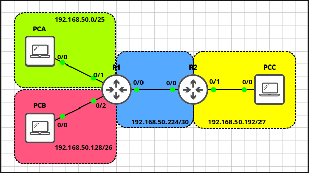
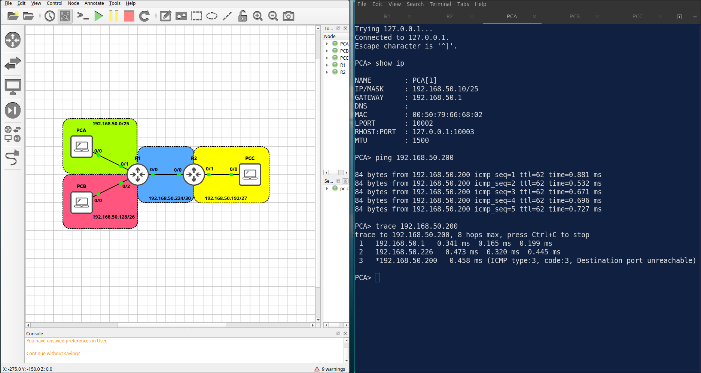
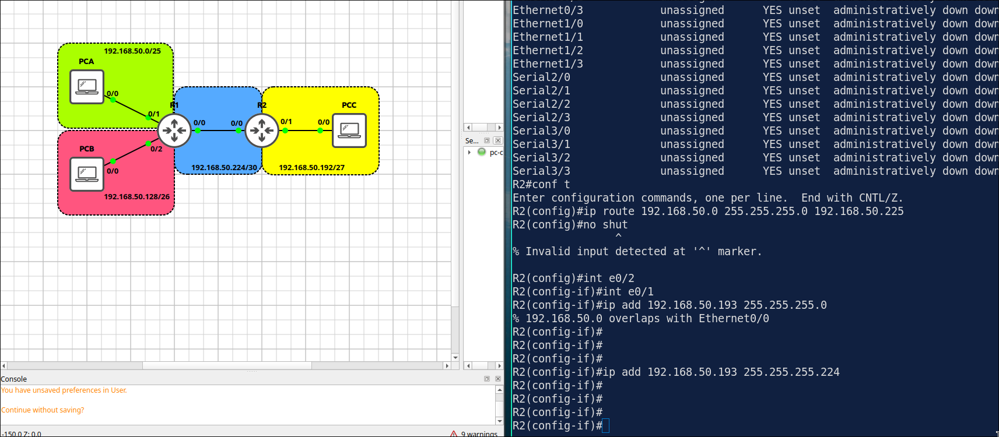

# Lab 2.3: Subnetting & VLSM Design

> **GNS3 Project:** [`Module 2 - IP Connectivity (CCNA) | Lab 3 - Subnetting and VLSM Design.gns3`](./Module%202%20-%20IP%20Connectivity%20%28CCNA%29%20%7C%20Lab%203%20-%20Subnetting%20and%20VLSM%20Design.gns3)
> **Platform:** GNS3 3.1 · Cisco IOL L3 `17.18.2` · 2 routers, 3 VPCS hosts
> **Key takeaway:** With VLSM, allocate subnets from the largest to the smallest so the blocks fit without wasting space. Subnets on a router must never overlap.

---

## 1. Scenario & Tasks

The address space `192.168.50.0/24` must be divided into four subnets: LAN A (100 hosts), LAN B (50 hosts), LAN C (20 hosts), and the WAN link between R1 and R2.

- **Task 1 — Design:** Allocate the subnets from the largest to the smallest and calculate the network address, mask and usable range of each.
- **Task 2 — Interfaces:** Each router uses the first usable address of its LAN. On the WAN link, R1 uses the first and R2 the second usable address.
- **Task 3 — Routing:** Configure static routing so all LANs can reach each other, and verify with a ping from PCA to PCC.

### Task 1: Subnet Design

| Subnet | Hosts needed | Network / Prefix | Mask | Usable range | Broadcast |
| :--- | :---: | :--- | :--- | :--- | :--- |
| **LAN A** | 100 | 192.168.50.0/25 | 255.255.255.128 | .1 – .126 | .127 |
| **LAN B** | 50 | 192.168.50.128/26 | 255.255.255.192 | .129 – .190 | .191 |
| **LAN C** | 20 | 192.168.50.192/27 | 255.255.255.224 | .193 – .222 | .223 |
| **WAN** | 2 | 192.168.50.224/30 | 255.255.255.252 | .225 – .226 | .227 |

### IPv4 Addressing

| Device | Interface | Address | Gateway |
| :--- | :--- | :--- | :--- |
| **R1** | `E0/0` (WAN) | 192.168.50.225/30 | — |
| **R1** | `E0/1` (LAN A) | 192.168.50.1/25 | — |
| **R1** | `E0/2` (LAN B) | 192.168.50.129/26 | — |
| **R2** | `E0/0` (WAN) | 192.168.50.226/30 | — |
| **R2** | `E0/1` (LAN C) | 192.168.50.193/27 | — |
| **PCA** | LAN A | 192.168.50.10/25 | 192.168.50.1 |
| **PCB** | LAN B | 192.168.50.135/26 | 192.168.50.129 |
| **PCC** | LAN C | 192.168.50.200/27 | 192.168.50.193 |

---

## 2. Configuration & Verification

### Task 2: Router Interfaces

**R1:**
~~~cisco
interface Ethernet0/0
 ip address 192.168.50.225 255.255.255.252
 no shutdown
interface Ethernet0/1
 ip address 192.168.50.1 255.255.255.128
 no shutdown
interface Ethernet0/2
 ip address 192.168.50.129 255.255.255.192
 no shutdown
~~~

**R2:**
~~~cisco
interface Ethernet0/0
 ip address 192.168.50.226 255.255.255.252
 no shutdown
interface Ethernet0/1
 ip address 192.168.50.193 255.255.255.224
 no shutdown
~~~

---

### Task 3: Static Routing

**R1:**
~~~cisco
ip route 192.168.50.192 255.255.255.224 192.168.50.226
~~~

**R2:**
~~~cisco
ip route 192.168.50.0 255.255.255.0 192.168.50.225
~~~
* **Verification:** PCA can ping PCC.

---

## 3. Notes & Fault-Injection (Break-It)

* **Classful vs VLSM:** classful addressing uses fixed block sizes, while VLSM allows flexible block sizes, e.g. a `/24` can be split as `/25 + /25`, or `/25 + (/26 + /26)`, and so on.

### Fault-Injection: Overlapping Subnet
* **Injected Fault:** On R2, changed the mask of `E0/1` to `255.255.255.0`.
* **Symptom:** The router rejects the command and reports that the address overlaps with another interface (`Ethernet0/0`).
* **Fix:** Use the mask `255.255.255.224`.

