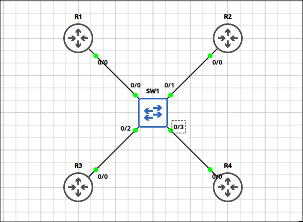
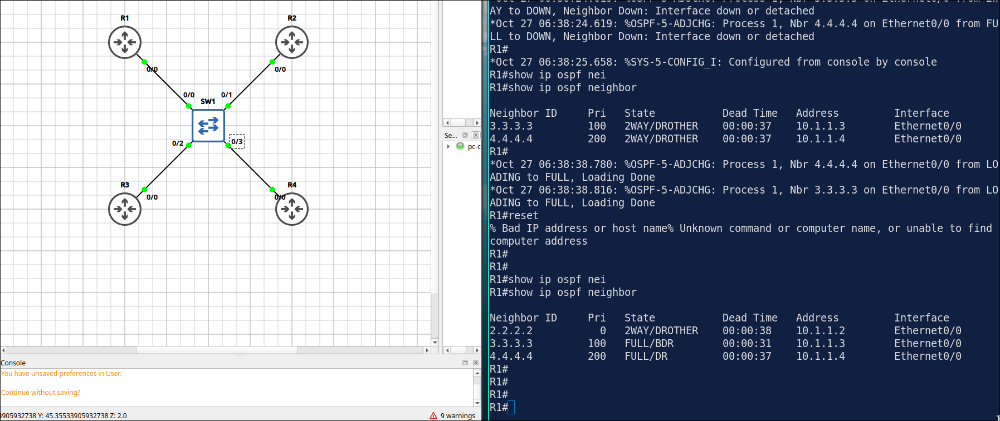
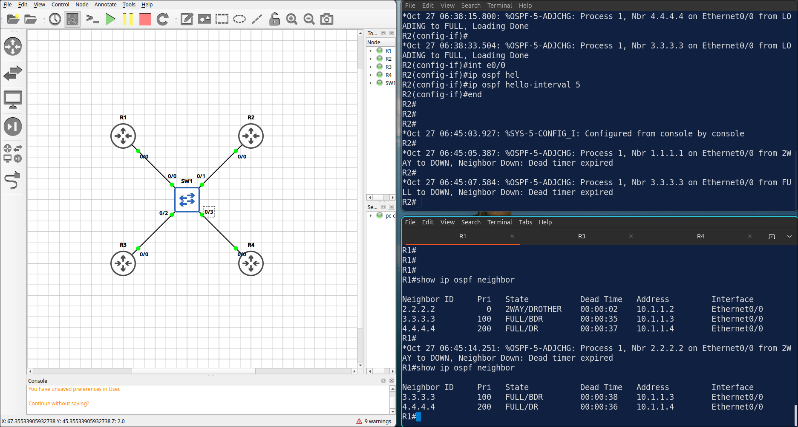
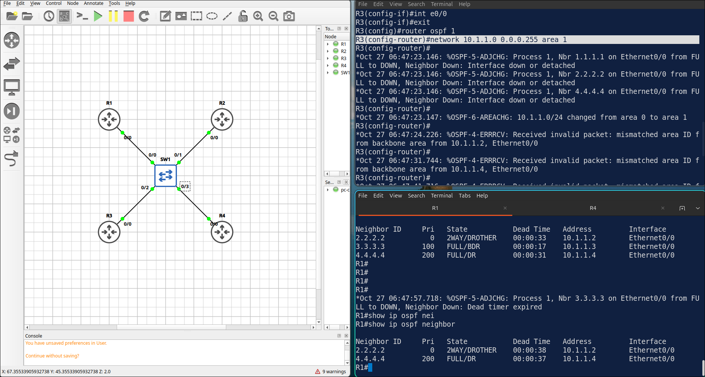

## Lab 4 - Single-Area OSPF and DR-BDR Election

> **GNS3 Project:** [`Module 2 - OSPF (CCNA) | Lab 1 - Single-Area OSPF and DR-BDR Election.gns3`](./Module%202%20-%20OSPF%20%28CCNA%29%20%7C%20Lab%201%20-%20Single-Area%20OSPF%20and%20DR-BDR%20Election.gns3)



## Scenario
Configure OSPF process 1 on R1, R2, R3 and R4. Advertise the 10.1.1.0/24 network and the Loopback 0 of each router in area 0. Hard-code the router ID of each router to the address of its Loopback 0.

- **Devices:** R1 (IOU L3), R2 (IOU L3), R3 (IOU L3), R4 (IOU L3), SW1 (Ethernet Switch)
- **Base Addressing:**
  - `R3` Loopback0: `3.3.3.3` (255.255.255.255)
  - `R3` Ethernet0/0: `10.1.1.3` (255.255.255.0)
  - `R2` Loopback0: `2.2.2.2` (255.255.255.255)
  - `R2` Ethernet0/0: `10.1.1.2` (255.255.255.0)
  - `R1` Loopback0: `1.1.1.1` (255.255.255.255)
  - `R1` Ethernet0/0: `10.1.1.1` (255.255.255.0)
  - `R4` Loopback0: `4.4.4.4` (255.255.255.255)
  - `R4` Ethernet0/0: `10.1.1.4` (255.255.255.0)

Task 1 - Configure OSPF process 1 on R1, R2, R3 and R4.
  - Advertise the 10.1.1.0/24 network and the Loopback 0 of each router in area 0.
  - Hard-code the router ID of each router to the address of its Loopback 0.

Task 2 - Make R4 the DR and R3 the BDR on the 10.1.1.0/24 segment using the OSPF interface priority.
  - R1 and R2 must never become DR or BDR.
  - Restart the OSPF process on all routers after the change.

Task 3 - Verify the neighbor table and the routing table on R1.

## Action
Task 1 - Configure OSPF process 1 on R1, R2, R3 and R4.

**R1:**
```cisco
router ospf 1
router-id 1.1.1.1
network 10.1.1.0 0.0.0.255 area 0
network 1.1.1.1 0.0.0.0 area 0
```

**R2:**
```cisco
router ospf 1
router-id 2.2.2.2
network 10.1.1.0 0.0.0.255 area 0
network 2.2.2.2 0.0.0.0 area 0
```
**R3:**
```cisco
router ospf 1
router-id 3.3.3.3
network 10.1.1.0 0.0.0.255 area 0
network 3.3.3.3 0.0.0.0 area 0
```
**R4:**
```cisco
router ospf 1
router-id 4.4.4.4
network 10.1.1.0 0.0.0.255 area 0
network 4.4.4.4 0.0.0.0 area 0
```
Task 2 - Make R4 the DR and R3 the BDR on the 10.1.1.0/24 segment using the OSPF interface priority.

**R1 and R2:**
```cisco
interface Ethernet0/0
ip ospf priority 0
clear ip ospf process
```

**R3:**
```
interface Ethernet0/0
ip ospf priority 100
clear ip ospf process
```
**R4:**
```
interface Ethernet0/0
ip ospf priority 200
clear ip ospf process
```

Task 3 - Verify the neighbor table and the routing table on R1.



## Note
1. Verification commands: `Show ip ospf neighbor`
2. The OSPF network command does not mean advertise this network. It means ENABLE OSPF on interfaces that its ip fall in that range.
3. Wildcard mask used by OSPF, EIGRP, ACL.
4. OSPF is not preemptive, 'clear ip ospf process' to reset OSPF process and re elect.
5. On R2, set the OSPF hello interval of E 0/0 to 5 seconds. Check the neighbors on R1 and R2. — The hello and dead intervals no longer match the other routers (5/20 against 10/40). R2 loses its neighbors. 



Note: Fix it with no ip ospf hello-interval.

5. On R3, move the 10.1.1.0/24 network into area 1. Check the neighbors on R3. R3 — R3 loses all its neighbors because of a mismatched area ID. 



Note: Put the network back in area 0 to fix it.
