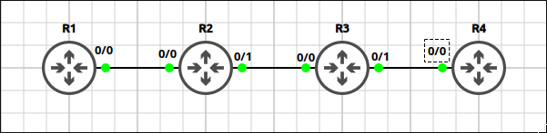
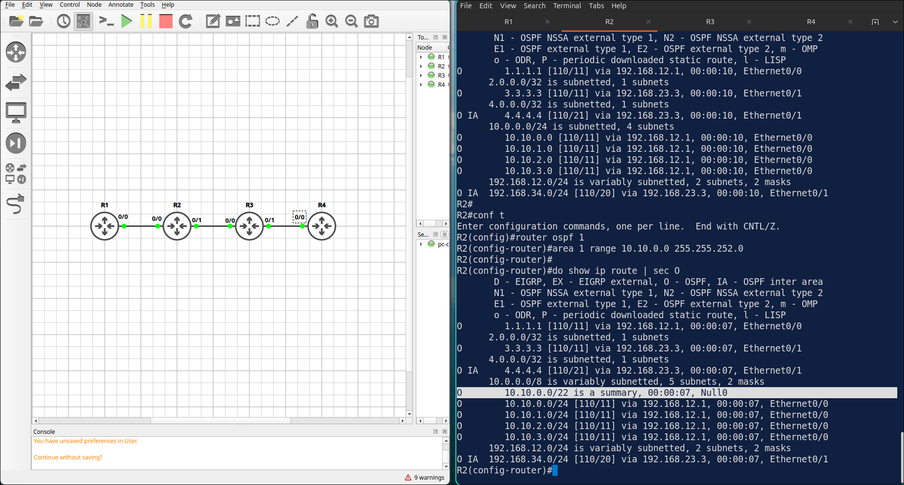
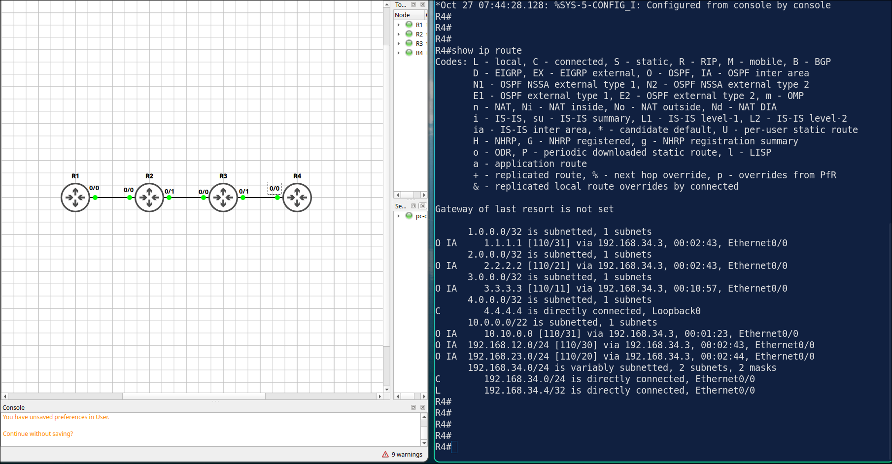
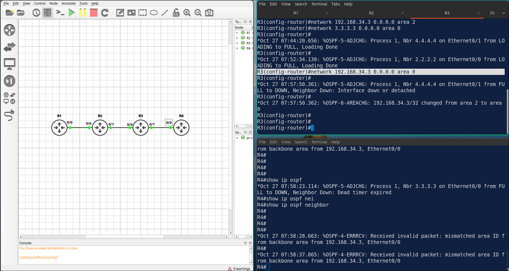
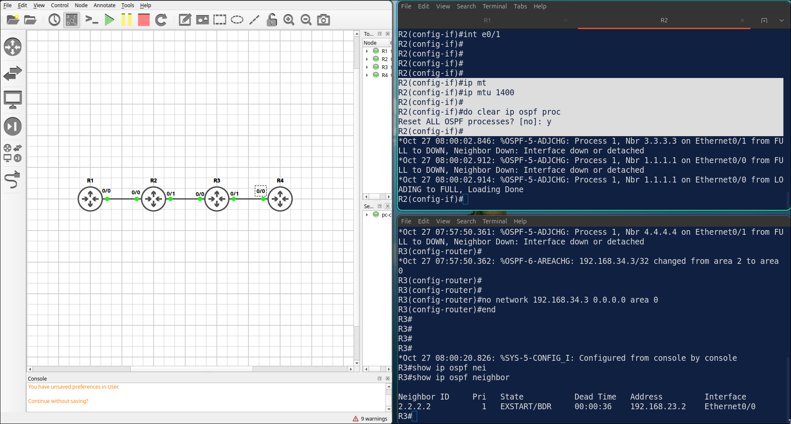

## Lab 5 - Multi-Area OSPF and Inter-Area Summarization

> **GNS3 Project:** [`Module 2 - OSPF (CCNA) | Lab 2 - Multi-Area OSPF and Inter-Area Summarization.gns3`](./Module%202%20-%20OSPF%20%28CCNA%29%20%7C%20Lab%202%20-%20Multi-Area%20OSPF%20and%20Inter-Area%20Summarization.gns3)



## Scenario
Configure multi-area OSPF. The R1–R2 link is in area 1, the R2–R3 link is in area 0 and the R3–R4 link is in area 2. Advertise the loopbacks in the area of their router (R1 in area 1, R2 and R3 in area 0, R4 in area 2). Hard-code the router IDs to 1.1.1.1 – 4.4.4.4. Advertise the R1 loopbacks with their real /24 mask.

- **Devices:** R1 (IOU L3), R2 (IOU L3), R3 (IOU L3), R4 (IOU L3)
- **Base Addressing:**
  - `R2` Ethernet0/0: `192.168.12.2` (255.255.255.0)
  - `R2` Ethernet0/1: `192.168.23.2` (255.255.255.0)
  - `R2` Loopback0: `2.2.2.2` (255.255.255.255)
  - `R3` Ethernet0/0: `192.168.23.3` (255.255.255.0)
  - `R3` Ethernet0/1: `192.168.34.3` (255.255.255.0)
  - `R3` Loopback0: `3.3.3.3` (255.255.255.255)
  - `R4` Ethernet0/0: `192.168.34.4` (255.255.255.0)
  - `R4` Loopback0: `4.4.4.4` (255.255.255.255)
  - `R1` Ethernet0/0: `192.168.12.1` (255.255.255.0)
  - `R1` Loopback0: `1.1.1.1` (255.255.255.255)
  - `R1` Loopback10: `10.10.0.1` (255.255.255.0)
  - `R1` Loopback11: `10.10.1.1` (255.255.255.0)
  - `R1` Loopback12: `10.10.2.1` (255.255.255.0)
  - `R1` Loopback13: `10.10.3.1` (255.255.255.0)

Task 1 - Configure multi-area OSPF.
  - The R1–R2 link is in area 1, the R2–R3 link is in area 0 and the R3–R4 link is in area 2.
  - Advertise the loopbacks in the area of their router (R1 in area 1, R2 and R3 in area 0, R4 in area 2).
  - Hard-code the router IDs to 1.1.1.1 – 4.4.4.4.
  - Advertise the R1 loopbacks with their real /24 mask.

Task 2 - Reduce the size of the routing table in area 0 and area 2 by summarizing the four R1 loopback networks (10.10.0.0/24 – 10.10.3.0/24) into one route on the ABR.
  - Configure on R2

Task 3 - Verify the routing table on R4.

## Action
Task 1 - Configure multi-area OSPF.

**R1:**
```cisco
router ospf 1
router-id 1.1.1.1
network 192.168.12.1 0.0.0.0 area 1
network 1.1.1.1 0.0.0.0 area 1
network 10.10.0.0 0.0.3.255 area 1
interface range Loopback10 - 13
ip ospf network point-to-point
```
**R2:**
```
router ospf 1
router-id 2.2.2.2
network 192.168.12.2 0.0.0.0 area 1
network 192.168.23.2 0.0.0.0 area 0
network 2.2.2.2 0.0.0.0 area 0
```
**R3:**
```
router ospf 1
router-id 3.3.3.3
network 192.168.23.3 0.0.0.0 area 0
network 192.168.34.3 0.0.0.0 area 2
network 3.3.3.3 0.0.0.0 area 0
```
**R4:**
```
router ospf 1
router-id 4.4.4.4
network 192.168.34.4 0.0.0.0 area 2
network 4.4.4.4 0.0.0.0 area 2
```

Task 2 - Reduce the size of the routing table in area 0 and area 2 by summarizing the four R1 loopback networks (10.10.0.0/24 – 10.10.3.0/24) into one route on the ABR.

**R2:**
```cisco
router ospf 1
area 1 range 10.10.0.0 255.255.252.0
```


Task 3 - Verify the routing table on R4.



## Note
1. Task 1 - change loopback interfaces to point-to-point type, so OSPF advertise real /24 subnet instead of /32 for loopback.
2. `area 1 range 10.10.0.0 255.255.252.0` - inter-area summarization on ABR. ABR advertise it as one summary route to other area.
3. R4 have one route for 10.10.0.0/22 marked O IA, instead of four /24 routes. Summarized by R2.
4. On R3, move the R3–R4 network (192.168.34.0/24) into area 0. Check the neighbors on R3 and R4. — R4 is still in area 2, so the adjacency fails because of a mismatched area ID. R4 loses all its OSPF routes. 



Note: Put the network back in area 2 to fix it.

5. On R2, set the MTU of E0/1 to 1400 and restart the OSPF process. Check the neighbor state between R2 and R3. — The neighbor R3 gets stuck in EXSTART or EXCHANGE because the MTU values do not match (1400 and 1500).


 
Note: Fix it with no ip mtu 1400.
