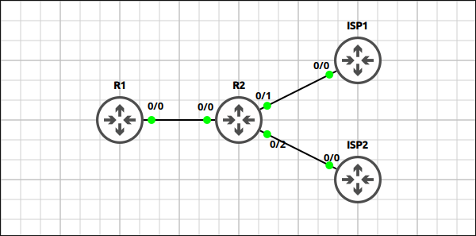
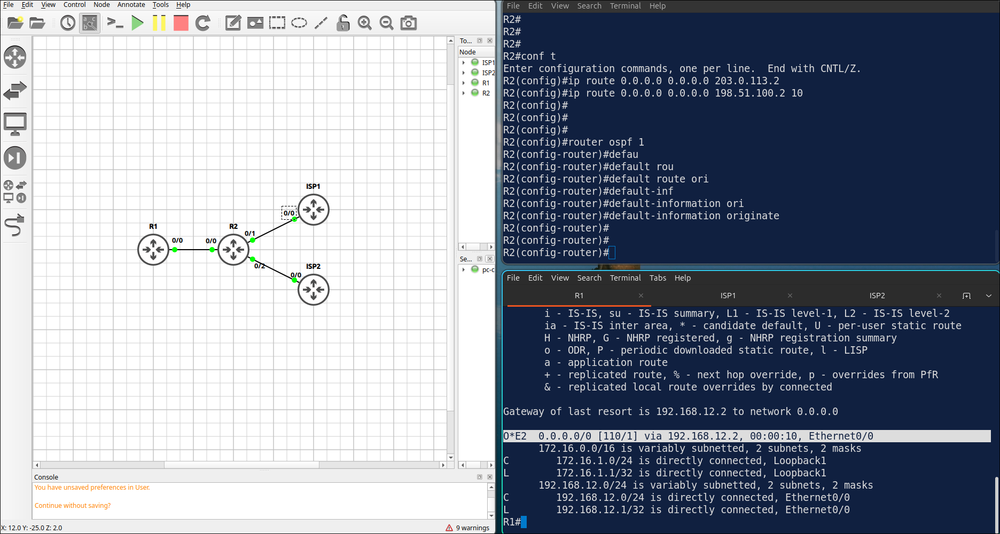
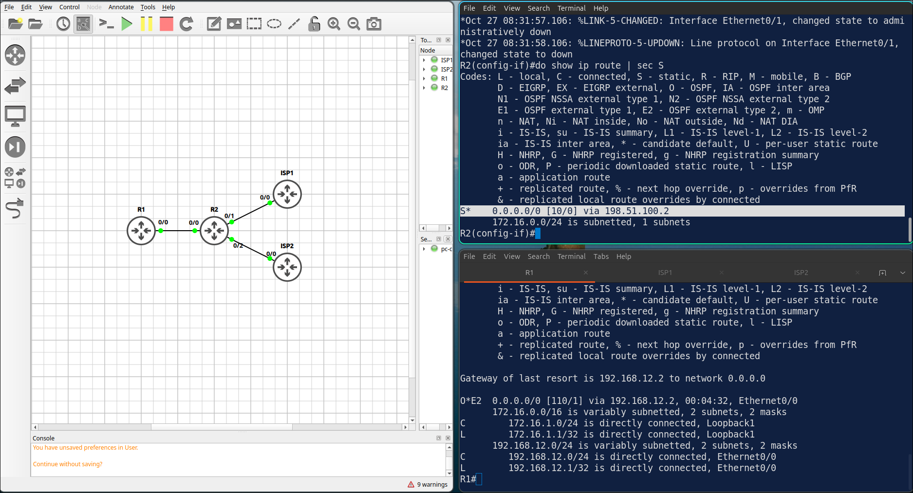
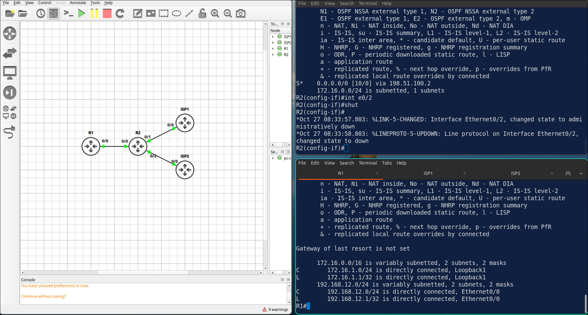

## Lab 6 - Default Route Origination and Floating Static Route

> **GNS3 Project:** [`Module 2 - OSPF (CCNA) | Lab 3 - Default Route Origination and Floating Static Route.gns3`](./Module%202%20-%20OSPF%20%28CCNA%29%20%7C%20Lab%203%20-%20Default%20Route%20Origination%20and%20Floating%20Static%20Route.gns3)



## Scenario
Configure OSPF area 0 between R1 and R2 on the 192.168.12.0/24 network. R1 must also advertise its Loopback 1 network with its real /24 mask. Use the router IDs 1.1.1.1 and 2.2.2.2.

- **Devices:** ISP1 (IOU L3), ISP2 (IOU L3), R1 (IOU L3), R2 (IOU L3)
- **Base Addressing:**
  - `R2` Ethernet0/0: `192.168.12.2` (255.255.255.0)
  - `R2` Ethernet0/1: `203.0.113.1` (255.255.255.252)
  - `R2` Ethernet0/2: `198.51.100.1` (255.255.255.252)
  - `R1` Ethernet0/0: `192.168.12.1` (255.255.255.0)
  - `R1` Loopback1: `172.16.1.1` (255.255.255.0)
  - `ISP2` Ethernet0/0: `198.51.100.2` (255.255.255.252)
  - `ISP1` Ethernet0/0: `203.0.113.2` (255.255.255.252)

Task 1 - Configure OSPF area 0 between R1 and R2 on the 192.168.12.0/24 network.
  - R1 must also advertise its Loopback 1 network with its real /24 mask.
  - Use the router IDs 1.1.1.1 and 2.2.2.2.

Task 2 - R2 must use ISP1 as the primary exit and ISP2 as the backup.
  - Configure a static default route towards ISP1 and a floating static default route towards ISP2 with an administrative distance of 10.

Task 3 - Advertise the default route from R2 into OSPF and verify on R1.
  - Configure on R2

## Action
Task 1 - Configure OSPF area 0 between R1 and R2 on the 192.168.12.0/24 network.

**R1:**
```cisco
router ospf 1
router-id 1.1.1.1
network 192.168.12.1 0.0.0.0 area 0
network 172.16.1.1 0.0.0.0 area 0
interface Loopback1
ip ospf network point-to-point
```

**R2:**
```cisco
router ospf 1
router-id 2.2.2.2
network 192.168.12.0 0.0.0.255 area 0
```

Task 2 - R2 must use ISP1 as the primary exit and ISP2 as the backup.

**R2:**
```cisco
ip route 0.0.0.0 0.0.0.0 203.0.113.2
ip route 0.0.0.0 0.0.0.0 198.51.100.2 10
```

Task 3 - Advertise the default route from R2 into OSPF and verify on R1.

**R2:**
```cisco
router ospf 1
default-information originate
```



## Note
1. Only the route via 203.0.113.2 should be installed. Route to ISP 2 only install when primary route down.
2. R1 have O*E2 0.0.0.0/0 via 192.168.12.2.
3. On R2, shut down E 0/1 (the link to ISP1). Check the default route on R2 and on R1. — R2 now installs the floating static route via 198.51.100.2 [10/0]. R1 still has its OSPF default route.



Note: Fix it with no shutdown.

4. Now shut down E 0/2 on R2 as well. Check the default route on R1. R2 — R2 has no default route left, so default-information originate stops advertising. R1 loses its default route. 
 


Note: Fix it with no shutdown on both interfaces.
