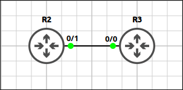
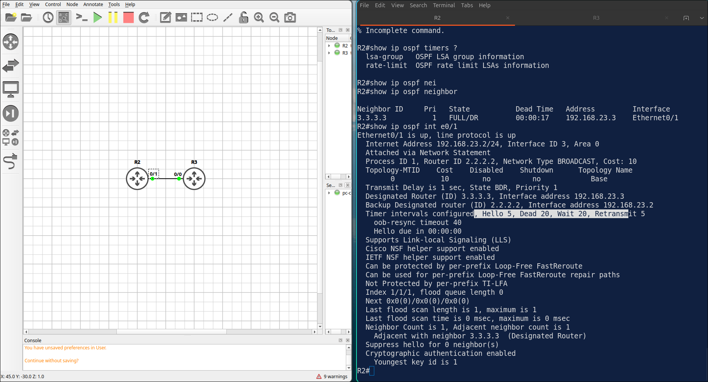
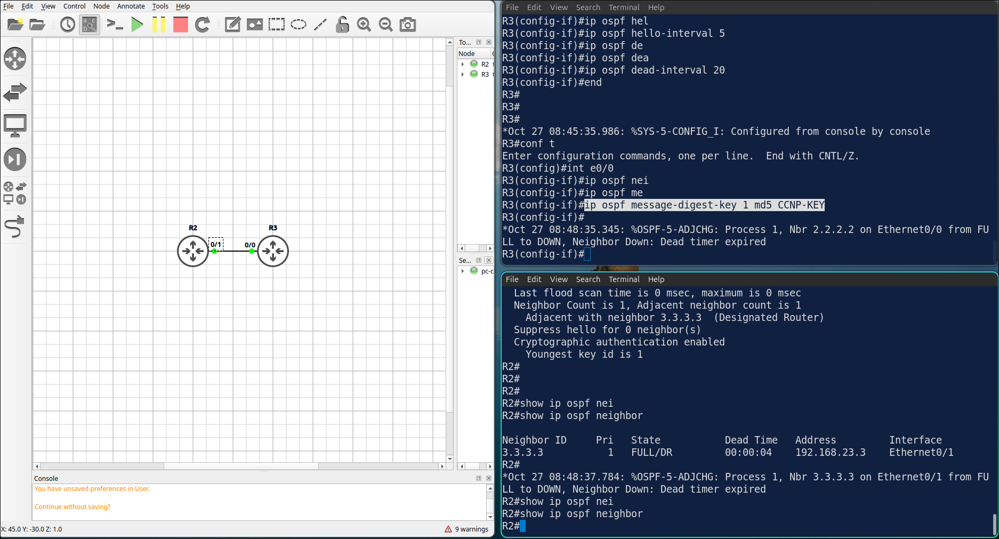
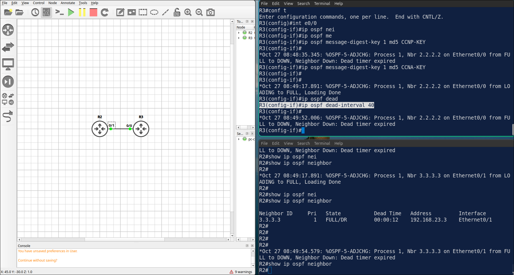

## Lab 7 - OSPF Authentication and Timers

> **GNS3 Project:** [`Module 2 - OSPF (CCNA) | Lab 4 - OSPF Authentication and Timers.gns3`](./Module%202%20-%20OSPF%20%28CCNA%29%20%7C%20Lab%204%20-%20OSPF%20Authentication%20and%20Timers.gns3)



## Scenario
Enable MD5 authentication on the R2–R3 link. Use key ID 1 and the key string CCNA-KEY on both routers.

- **Devices:** R2 (IOU L3), R3 (IOU L3)
- **Base Addressing:**
  - `R3` Ethernet0/0: `192.168.23.3` (255.255.255.0)
  - `R3` Loopback0: `3.3.3.3` (255.255.255.255)
  - `R2` Ethernet0/1: `192.168.23.2` (255.255.255.0)
  - `R2` Loopback0: `2.2.2.2` (255.255.255.255)

Task 1 - Enable MD5 authentication on the R2–R3 link.
  - Use key ID 1 and the key string CCNA-KEY on both routers.

Task 2 - Change the OSPF hello interval to 5 seconds and the dead interval to 20 seconds on the R2–R3 link.
  - Configure on R2
  - Configure on R3

Task 3 - Verify the settings on R2.

## Action
Task 1 - Enable MD5 authentication on the R2–R3 link.

**R2:**
```cisco
interface Ethernet0/1
ip ospf authentication message-digest
ip ospf message-digest-key 1 md5 CCNA-KEY 
```
**R3:**
```cisco
interface Ethernet0/0
ip ospf authentication message-digest
ip ospf message-digest-key 1 md5 CCNA-KEY
```

Task 2 - Change the OSPF hello interval to 5 seconds and the dead interval to 20 seconds on the R2–R3 link.

**R2:**
```cisco
interface Ethernet0/1
ip ospf hello-interval 5
ip ospf dead-interval 20
```

**R3:**
```cisco
interface Ethernet0/0
ip ospf hello-interval 5
ip ospf dead-interval 20
```

Task 3 - Verify the settings on R2.



## Note
1. Verification commands: `Show ip ospf interface ethernet0/1`
  - The timers should be Hello 5 and Dead 20, and message digest authentication should be enabled. 
2. Show ip ospf neighbor - R3 should be in the FULL state.
3. On R3, change the MD5 key string to WRONG-KEY. Check the neighbor R2. R3 — The authentication fails and the adjacency goes down after the dead interval. 



Note: Fix it by configuring the key string CCNA-KEY again.

4. On R3, change the dead interval to 40 seconds. Check the neighbor R2. R3 — R2 expects a dead interval of 20. The hello parameters do not match and the adjacency goes down. 



Note: Fix it with ip ospf dead-interval 20.
