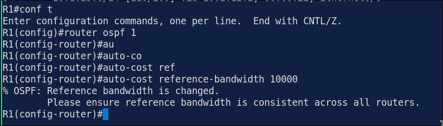
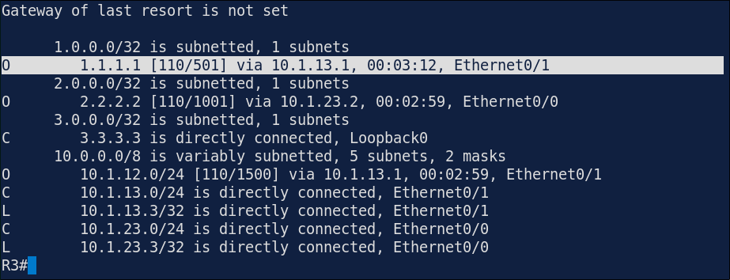
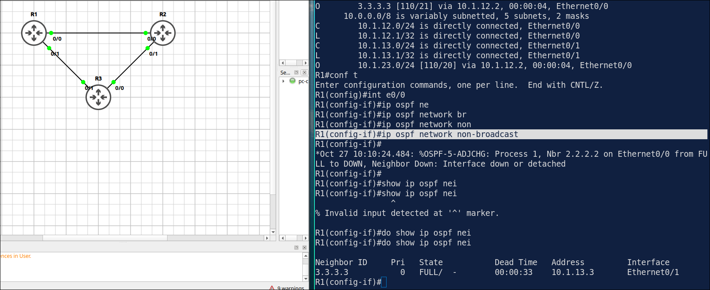

## Lab 8 - OSPF Network Types and Cost Tuning

> **GNS3 Project:** [`Module 2 - IP Connectivity (CCNA) | Lab 8 - OSPF Network Types and Cost Tuning.gns3`](./Module%202%20-%20IP%20Connectivity%20%28CCNA%29%20%7C%20Lab%208%20-%20OSPF%20Network%20Types%20and%20Cost%20Tuning.gns3)


## Scenario
Configure OSPF area 0 on R1, R2 and R3 for all links and Loopback 0. Hard-code the router IDs to 1.1.1.1, 2.2.2.2 and 3.3.3.3.

- **Devices:** R1 (IOU L3), R2 (IOU L3), R3 (IOU L3)
- **Base Addressing:**
  - `R3` Ethernet0/0: `10.1.23.3` (255.255.255.0)
  - `R3` Ethernet0/1: `10.1.13.3` (255.255.255.0)
  - `R3` Loopback0: `3.3.3.3` (255.255.255.255)
  - `R1` Ethernet0/0: `10.1.12.1` (255.255.255.0)
  - `R1` Ethernet0/1: `10.1.13.1` (255.255.255.0)
  - `R1` Loopback0: `1.1.1.1` (255.255.255.255)
  - `R2` Ethernet0/0: `10.1.12.2` (255.255.255.0)
  - `R2` Ethernet0/1: `10.1.23.2` (255.255.255.0)
  - `R2` Loopback0: `2.2.2.2` (255.255.255.255)

Task 1 - Configure OSPF area 0 on R1, R2 and R3 for all links and Loopback 0.
  - Hard-code the router IDs to 1.1.1.1, 2.2.2.2 and 3.3.3.3.

Task 2 - All links are point-to-point connections.
  - Change the OSPF network type of all links to point-to-point so that no DR/BDR election takes place.
  - Then check the neighbors.

Task 3 - The links are Ethernet
  - Set the reference bandwidth to 1000 Mbps on all routers.
  - Then make R1 reach R3 through R2 by setting the cost of the direct R1–R3 link to 500 on both ends.

## Action
Task 1 - Configure OSPF area 0 on R1, R2 and R3 for all links and Loopback 0.

**R1:**
```cisco
router ospf 1
router-id 1.1.1.1
network 10.1.0.0 0.0.255.255 area 0
network 1.1.1.1 0.0.0.0 area 0
router ospf 1
router-id 2.2.2.2
network 10.1.0.0 0.0.255.255 area 0
network 2.2.2.2 0.0.0.0 area 0
router ospf 1
router-id 3.3.3.3
network 10.1.0.0 0.0.255.255 area 0
network 3.3.3.3 0.0.0.0 area 0
```

Task 2 - All links are point-to-point connections.

**R1:**
```cisco
interface range Ethernet0/0 - 1
ip ospf network point-to-point
interface range Ethernet0/0 - 1
ip ospf network point-to-point
interface range Ethernet0/0 - 1
ip ospf network point-to-point
```

Task 3 - The links are Ethernet, the default reference bandwidth is 100 Mbps. Then make R1 reach R3 through R2 by setting the cost of the direct R1–R3 link to 500 on both ends.

**R1:**
```cisco
router ospf 1
auto-cost reference-bandwidth 1000
interface Ethernet0/1
ip ospf cost 500
```
**R2:**
```cisco
router ospf 1
auto-cost reference-bandwidth 1000
```
**R3:**
```cisco
router ospf 1
auto-cost reference-bandwidth 1000
interface Ethernet0/1
ip ospf cost 500
```

## Note
1. Verification commands: `Show ip ospf neighbor`, `Show ip route 1.1.1.1`
  - The neighbors should be FULL/ - . The dash means that there is no DR/BDR on the link. (point to point).
  - Show interface speed with `show int INTERFACE-ID controller`.
  - R3 should reach 1.1.1.1 through R2 (10.1.23.2) because the direct link has a higher cost(501 over 201).
2. On R1 only, change the reference bandwidth to 10000. Check the cost values on R1 and R2. — The router warns that the reference bandwidth must be the same on all routers. The cost values on R1 are now different from the other routers, which can cause unexpected paths. 



Note: Fix it with auto-cost reference-bandwidth 10000.

3. Change reference bandwidth to 10000 on all routers. Because all interface is Ethernet (10mbps), each link cost 1001 (1 is it self). In contrast to earlier scenario, R1 and R3 will use R1-R3 link since manually set to 500. (501<1001)



4. On R1, change the network type of E0/0 to non-broadcast. Check the neighbors of R1. — Non-broadcast networks do not use multicast hellos, so R1 no longer finds R2 on this link. The neighbor is lost. 



Note: Fix it with ip ospf network point-to-point.
