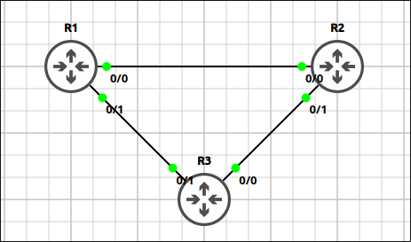

# Lab 2.8: OSPF Network Types & Cost Tuning

> **GNS3 Project:** [`Module 2 - IP Connectivity (CCNA) | Lab 8 - OSPF Network Types and Cost Tuning.gns3`](./Module%202%20-%20IP%20Connectivity%20%28CCNA%29%20%7C%20Lab%208%20-%20OSPF%20Network%20Types%20and%20Cost%20Tuning.gns3)
> **Platform:** GNS3 3.1 · Cisco IOL L3 `17.18.2` · 3 routers in a triangle
> **Key takeaway:** On point-to-point links OSPF skips the DR/BDR election. The reference bandwidth must be the same on every router, and a manually set interface cost overrides the bandwidth-based cost.

---

## 1. Scenario & Tasks

- **Task 1 — OSPF:** Configure OSPF area 0 on R1, R2 and R3 for all links and `Loopback0`, with router IDs `1.1.1.1`, `2.2.2.2` and `3.3.3.3`.
- **Task 2 — Network type:** All links are point-to-point connections. Change the OSPF network type of all links to `point-to-point` so no DR/BDR election takes place, then check the neighbors.
- **Task 3 — Cost tuning:** Set the reference bandwidth to 1000 Mbps on all routers (the default is 100 Mbps and the links are Ethernet). Then make R1 reach R3 through R2 by setting the cost of the direct R1–R3 link to 500 on both ends.

### IPv4 Addressing

| Device | Router-ID (`Lo0`) | Interfaces |
| :--- | :---: | :--- |
| **R1** | `1.1.1.1/32` | `E0/0`: 10.1.12.1/24 (to R2), `E0/1`: 10.1.13.1/24 (to R3) |
| **R2** | `2.2.2.2/32` | `E0/0`: 10.1.12.2/24 (to R1), `E0/1`: 10.1.23.2/24 (to R3) |
| **R3** | `3.3.3.3/32` | `E0/0`: 10.1.23.3/24 (to R2), `E0/1`: 10.1.13.3/24 (to R1) |

---

## 2. Configuration & Verification

### Task 1: OSPF Area 0

**R1:**
~~~cisco
router ospf 1
 router-id 1.1.1.1
 network 10.1.0.0 0.0.255.255 area 0
 network 1.1.1.1 0.0.0.0 area 0
~~~

**R2:**
~~~cisco
router ospf 1
 router-id 2.2.2.2
 network 10.1.0.0 0.0.255.255 area 0
 network 2.2.2.2 0.0.0.0 area 0
~~~

**R3:**
~~~cisco
router ospf 1
 router-id 3.3.3.3
 network 10.1.0.0 0.0.255.255 area 0
 network 3.3.3.3 0.0.0.0 area 0
~~~

---

### Task 2: Point-to-Point Network Type

**R1, R2 and R3:**
~~~cisco
interface range Ethernet0/0 - 1
 ip ospf network point-to-point
~~~
* **Verification (`show ip ospf neighbor`):** the neighbors are `FULL/ -`. The dash means there is no DR/BDR on the link.

---

### Task 3: Reference Bandwidth and Manual Cost

**R1:**
~~~cisco
router ospf 1
 auto-cost reference-bandwidth 1000
interface Ethernet0/1
 ip ospf cost 500
~~~

**R2:**
~~~cisco
router ospf 1
 auto-cost reference-bandwidth 1000
~~~

**R3:**
~~~cisco
router ospf 1
 auto-cost reference-bandwidth 1000
interface Ethernet0/1
 ip ospf cost 500
~~~
* **Verification (`show ip route 1.1.1.1` on R3):** R3 reaches `1.1.1.1` through R2 (`10.1.23.2`), because the direct link now has the higher cost (501 against 201).
* **Interface speed:** `show interface <id> controller`.

---

## 3. Notes & Fault-Injection (Break-It)

### Fault-Injection 1: Reference Bandwidth Changed on One Router
* **Injected Fault:** On R1 only, changed the reference bandwidth to 10000 and checked the cost values on R1 and R2.
* **Symptom:** The router warns that the reference bandwidth must be the same on all routers. The cost values on R1 now differ from the other routers, which can cause unexpected paths.
* **Fix:** Configure the same `auto-cost reference-bandwidth` on all routers (the lab uses 10000 in the next test).

### Fault-Injection 2: Reference Bandwidth Changed on All Routers
* **Injected Change:** Set the reference bandwidth to 10000 on all routers.
* **Result:** All interfaces are 10 Mbps Ethernet, so each link now costs 1000 (plus 1 for the loopback). The path via R2 costs 2001, so R1 and R3 use the direct R1–R3 link, whose cost is manually fixed at 500 (501 with the loopback).

### Fault-Injection 3: Non-Broadcast Network Type
* **Injected Fault:** On R1, changed the network type of `E0/0` to `non-broadcast` and checked R1's neighbors.
* **Symptom:** Non-broadcast networks do not use multicast hellos, so R1 no longer finds R2 on this link and the neighbor is lost.
* **Fix:** `ip ospf network point-to-point`

