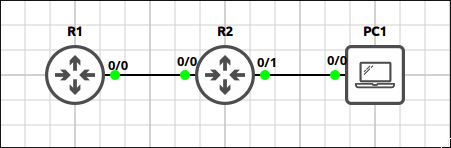
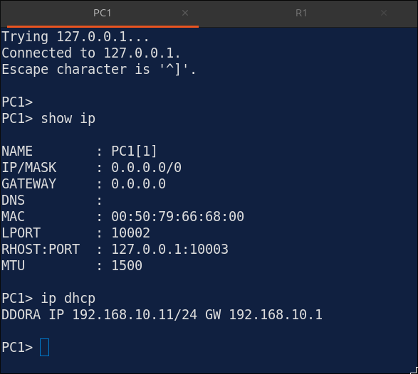
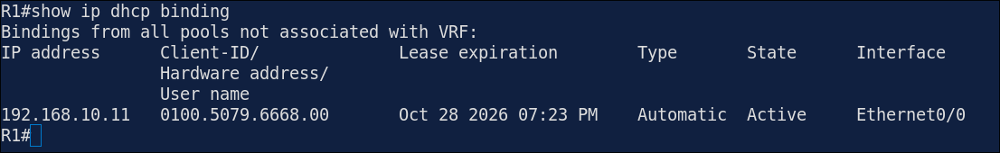
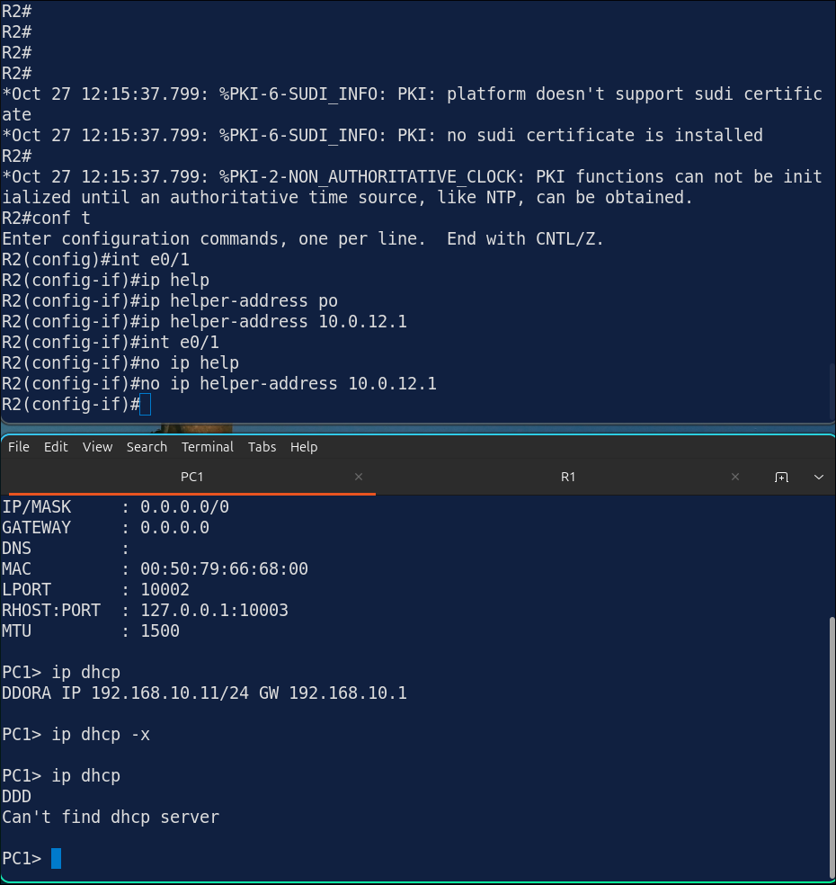
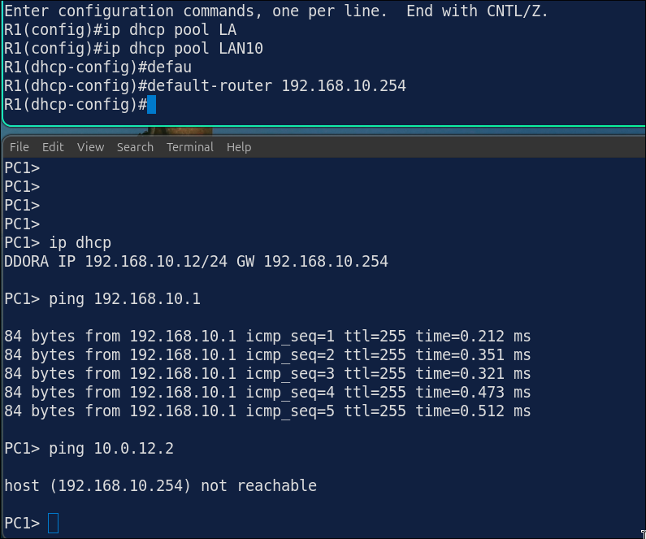
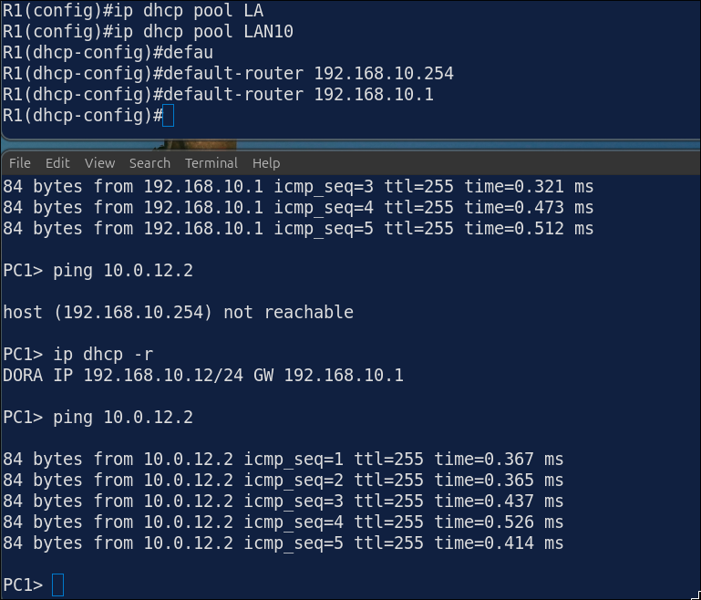

## Lab 1 - DHCP Server and DHCP Relay

> **GNS3 Project:** [`Module 3 - IP Services (CCNA) | Lab 1 - DHCP Server and DHCP Relay.gns3`](./Module%203%20-%20IP%20Services%20%28CCNA%29%20%7C%20Lab%201%20-%20DHCP%20Server%20and%20DHCP%20Relay.gns3)



## Scenario
Configure R1 as a DHCP server for the 192.168.10.0/24 network. Exclude the first 10 addresses. Use 192.168.10.1 (R2) as the default gateway and 192.0.2.53 as the DNS server.

- **Devices:** PC1 (PC), R1 (IOU L3), R2 (IOU L3)
- **Base Addressing:**
  - `R2` Ethernet0/0: `10.0.12.2` (255.255.255.252)
  - `R2` Ethernet0/1: `192.168.10.1` (255.255.255.0)
  - `R1` Ethernet0/0: `10.0.12.1` (255.255.255.252)

Task 1 - Configure R1 as a DHCP server for the 192.168.10.0/24 network.
  - Exclude the first 10 addresses.
  - Use 192.168.10.1 (R2) as the default gateway and 192.0.2.53 as the DNS server.

Task 2 - The PCs are not on the same network as R1.
  - Configure R2 to relay the DHCP requests to R1, and add a static route on R1 so it can answer.

Task 3 - Verify that the PCs received an address.

## Action
Task 1 - Configure R1 as a DHCP server for the 192.168.10.0/24 network.

**R1:**
```cisco
ip dhcp excluded-address 192.168.10.1 192.168.10.10
ip dhcp pool LAN10
network 192.168.10.0 255.255.255.0
default-router 192.168.10.1
dns-server 192.0.2.53
```

Task 2 - Configure R2 as DHCP relay agent.

**R2:**
```cisco
interface Ethernet0/1
ip helper-address 10.0.12.1
```

**R1:**
```cisco
ip route 192.168.10.0 255.255.255.0
10.0.12.2
```

Task 3 - Verify that the PCs received an address.



## Note
1. Verification commands: `Show ip dhcp binding`



  - PC1 should have address starting from 192.168.10.11. Show ip dhcp pool
  - Leased addresses should be 1.

2. On R2, remove the helper address from E0/1. Release and renew the address on PC1. — The DHCP request is not forwarded to R1. PC1 does not get an address. 



Note: Fix it by configuring ip helper-address 10.0.12.1 again.

3. On R1, change the default router of the pool to 192.168.10.254. Renew the address on PC1. — PC1 gets an address, but the wrong default gateway. It can only reach its own subnet. 



Note: Fix it with default-router 192.168.10.1.


