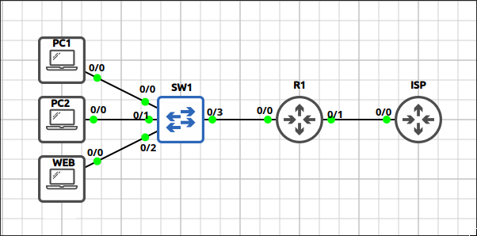
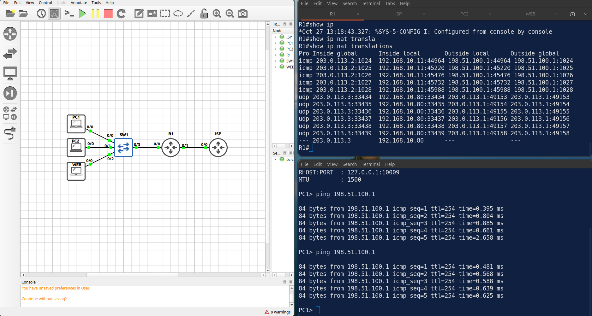
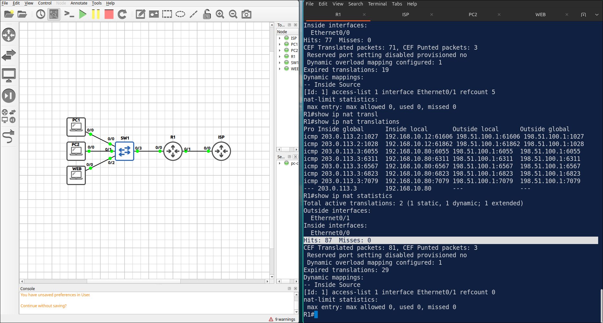
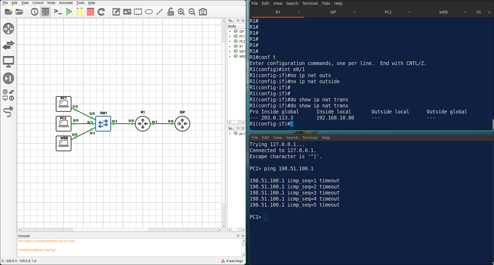
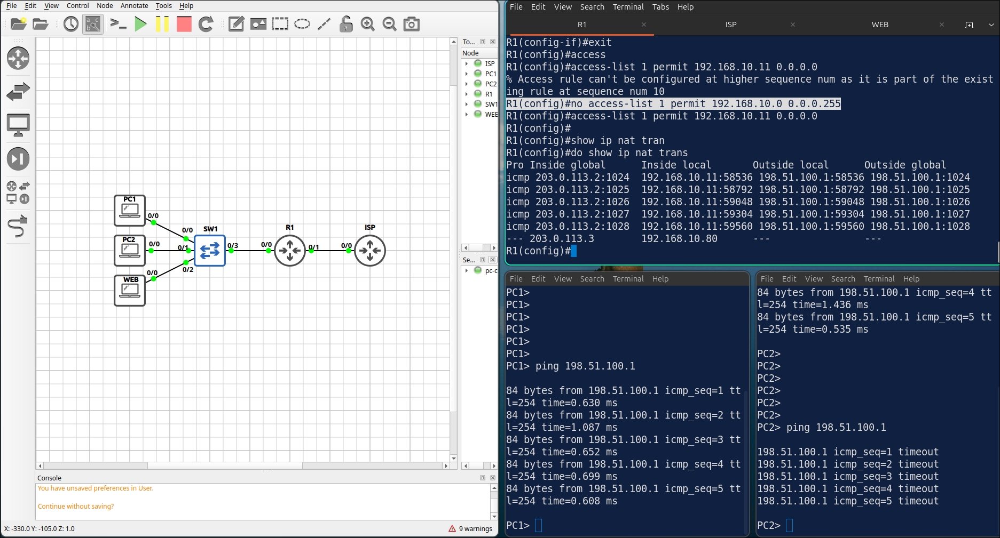
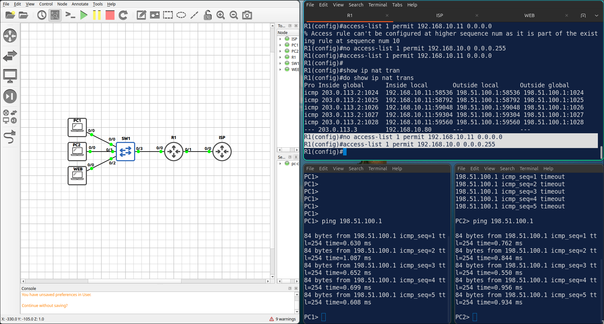

# Lab 3.2: NAT — PAT (Overload) & Static NAT

> **GNS3 Project:** [`Module 3 - IP Services (CCNA) | Lab 2 - NAT: PAT and Static NAT.gns3`](./Module%203%20-%20IP%20Services%20%28CCNA%29%20%7C%20Lab%202%20-%20NAT%3A%20PAT%20and%20Static%20NAT.gns3)
> **Platform:** GNS3 3.1 · Cisco IOL L3 `17.18.2` · 2 routers, 3 VPCS hosts, GNS3 Ethernet switch
> **Key takeaway:** NAT needs both an `inside` and an `outside` interface, and an ACL that selects which source addresses are translated. PAT (`overload`) lets many hosts share one public address, while static NAT publishes one inside host on its own public address.

---

## 1. Scenario & Tasks

- **Task 1 — PAT:** Configure R1 so all hosts in `192.168.10.0/24` can reach the ISP using the address of the outside interface. Add a default route towards the ISP.
- **Task 2 — Static NAT:** Publish the WEB server (`192.168.10.80`) on the Internet with the public address `203.0.113.3`.
- **Task 3 — Verify:** Ping `198.51.100.1` from PC1 and check the translations on R1.

### IPv4 Addressing

| Device | Interface | Address |
| :--- | :--- | :--- |
| **R1** | `E0/0` (inside) | 192.168.10.1/24 |
| **R1** | `E0/1` (outside) | 203.0.113.2/29 |
| **ISP** | `E0/0` | 203.0.113.1/29 |
| **ISP** | `Lo0` (test target) | 198.51.100.1/32 |
| **PC1** / **PC2** / **WEB** | — | 192.168.10.11 / .12 / .80 (/24, gateway 192.168.10.1) |

---

## 2. Configuration & Verification

### Task 1: PAT on the Outside Interface

**R1:**
~~~cisco
access-list 1 permit 192.168.10.0 0.0.0.255
interface Ethernet0/0
 ip nat inside
interface Ethernet0/1
 ip nat outside
ip nat inside source list 1 interface Ethernet0/1 overload
ip route 0.0.0.0 0.0.0.0 203.0.113.1
~~~

---

### Task 2: Static NAT for the WEB Server

**R1:**
~~~cisco
ip nat inside source static 192.168.10.80 203.0.113.3
~~~

---

### Task 3: Verification

* **`show ip nat translations`:** the ICMP entry translates the inside local address `192.168.10.11` to the inside global address `203.0.113.2`.
* **`show ip nat statistics`:** the hits counter increases and the static translation for WEB is listed.

---

## 3. Notes & Fault-Injection (Break-It)

### Fault-Injection 1: Missing `ip nat outside`
* **Injected Fault:** On R1, removed `ip nat outside` from `E0/1` and pinged `198.51.100.1` from PC1.
* **Symptom:** The ping fails and no new translations are created.
* **Fix:** `ip nat outside`

### Fault-Injection 2: ACL Too Narrow
* **Injected Fault:** On R1, changed ACL 1 to permit only the host `192.168.10.11`, and pinged `198.51.100.1` from PC1 and PC2.
* **Symptom:** PC1 still works, but PC2 can no longer reach the ISP because its traffic is not translated.
* **Fix:** Restore the ACL with `access-list 1 permit 192.168.10.0 0.0.0.255`.

