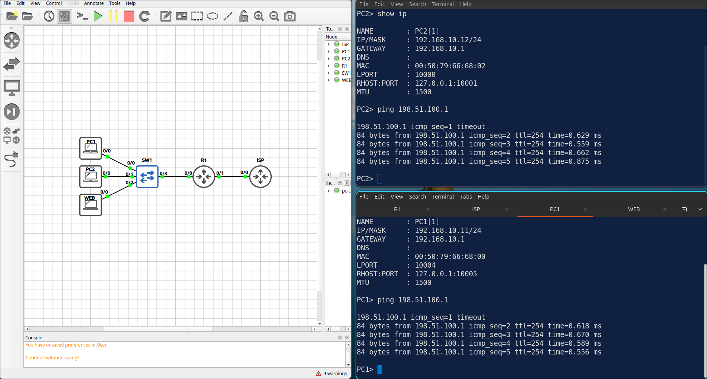
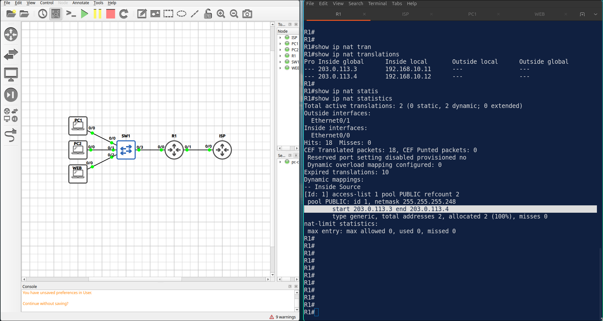
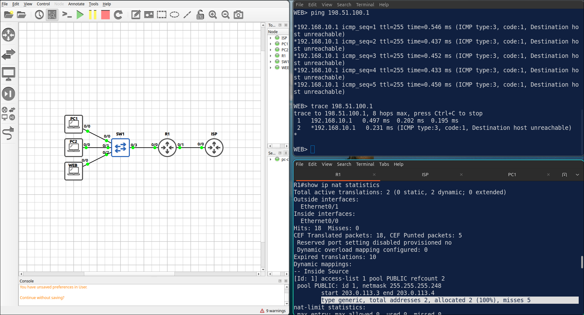
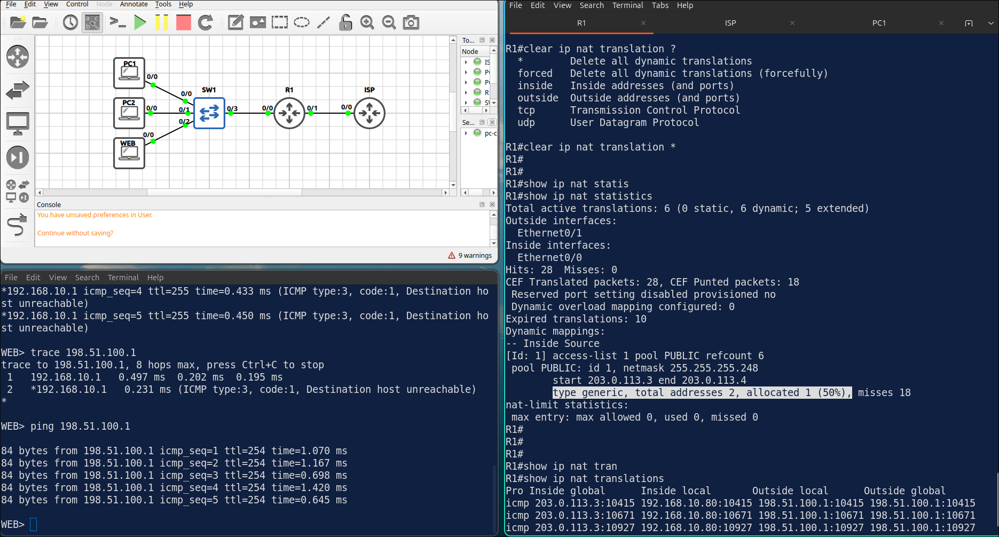
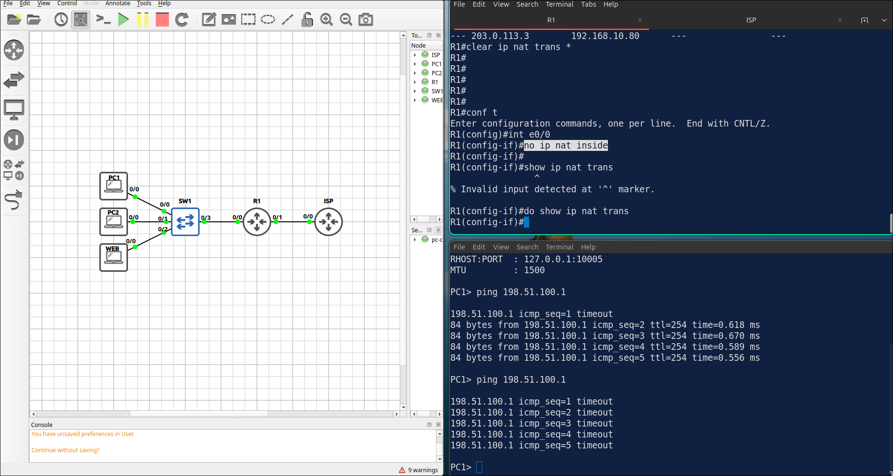
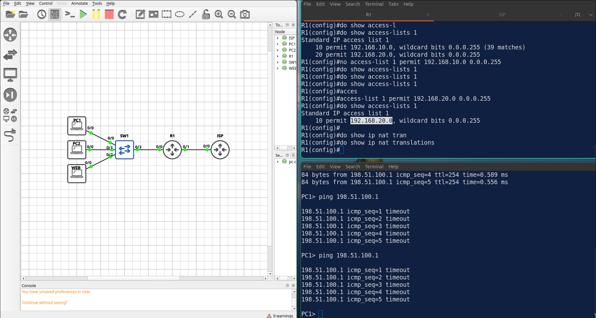

## Lab 3 - Dynamic NAT with a Pool

> **GNS3 Project:** [`Module 3 - IP Services (CCNA) | Lab 3 - Dynamic NAT with a Pool.gns3`](./Module%203%20-%20IP%20Services%20%28CCNA%29%20%7C%20Lab%203%20-%20Dynamic%20NAT%20with%20a%20Pool.gns3)



## Scenario
Configure dynamic NAT on R1. The inside hosts of 192.168.10.0/24 use a pool of two public addresses: 203.0.113.3 and 203.0.113.4. Add a default route towards the ISP.

- **Devices:** ISP (IOU L3), PC1 (PC), PC2 (PC), R1 (IOU L3), SW1 (Ethernet Switch), WEB (PC)
- **Base Addressing:**
  - `ISP` Ethernet0/0: `203.0.113.1` (255.255.255.248)
  - `ISP` Loopback0: `198.51.100.1` (255.255.255.255)
  - `R1` Ethernet0/0: `192.168.10.1` (255.255.255.0)
  - `R1` Ethernet0/1: `203.0.113.2` (255.255.255.248)
  - `PC2` Ethernet0: `192.168.10.12` (GW: 192.168.10.1)
  - `WEB` Ethernet0: `192.168.10.80` (GW: 192.168.10.1)
  - `PC1` Ethernet0: `192.168.10.11` (GW: 192.168.10.1)

Task 1 - Configure dynamic NAT on R1.
  - The inside hosts of 192.168.10.0/24 use a pool of two public addresses: 203.0.113.3 and 203.0.113.4.
  - Add a default route towards the ISP.

Task 2 - Ping 198.51.100.1 from PC1 and PC2 and verify the translations.

Task 3 - The pool has only two addresses.
  - Ping 198.51.100.1 from WEB while PC1 and PC2 have active translations, and check the statistics.

## Action
Task 1 - Configure dynamic NAT on R1.

**R1:**
```cisco
ip nat pool PUBLIC 203.0.113.3 203.0.113.4 netmask 255.255.255.248
access-list 1 permit 192.168.10.0 0.0.0.255
interface Ethernet0/0
ip nat inside
interface Ethernet0/1
ip nat outside
ip nat inside source list 1 pool PUBLIC
ip route 0.0.0.0 0.0.0.0 203.0.113.1
```

Task 2 - Ping 198.51.100.1 from PC1 and PC2 and verify the translations.


Task 3 - The pool has only two addresses.



## Note
1. Verification commands: `Show ip nat translations`, `Show ip nat statistics`
  - PC1 and PC2 each have their own inside global address (203.0.113.3 and 203.0.113.4).
  - The misses counter increases. WEB cannot reach the ISP because no address is left in the pool. clear ip nat translation *



  - After clearing, the next host can use a free address.


5. On R1, remove ip nat inside from E 0/0. Ping 198.51.100.1 from PC1. R1 — No translation is created. The ping fails. 



Note: Fix it with ip nat inside.

6. On R1, replace ACL 1 with access-list 1 permit 192.168.20.0 0.0.0.255. Ping 198.51.100.1 from PC1. — The source address of PC1 does not match the ACL, so it is not translated and the ping fails. Note: Fix it with access-list 1 permit 192.168.10.0 0.0.0.255.


