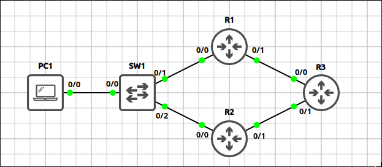
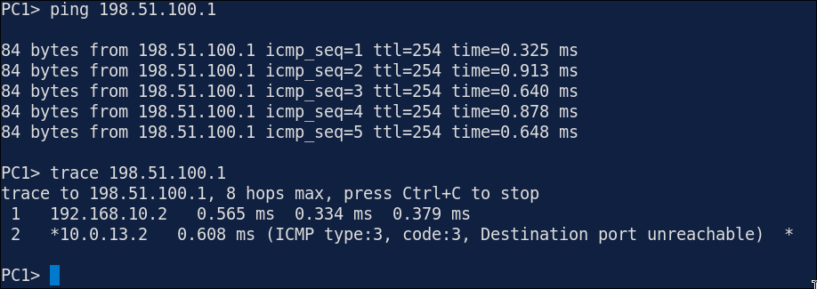
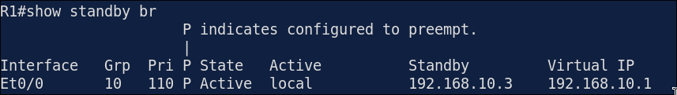
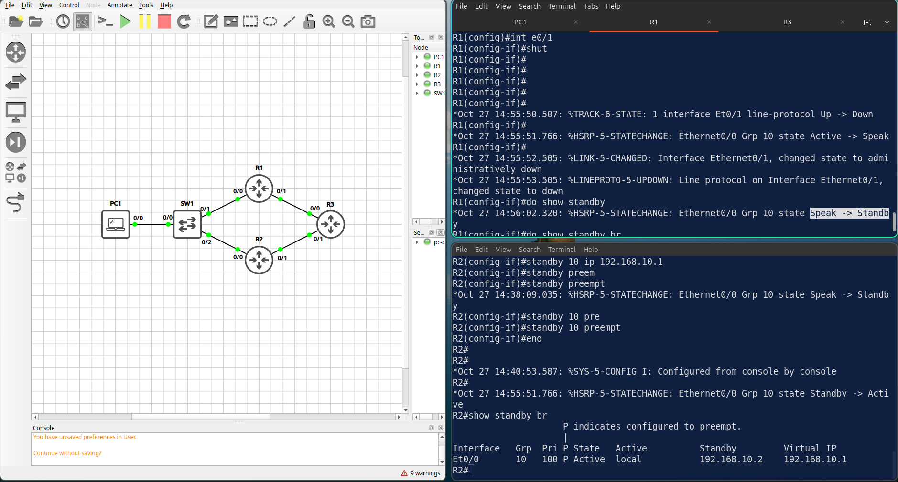
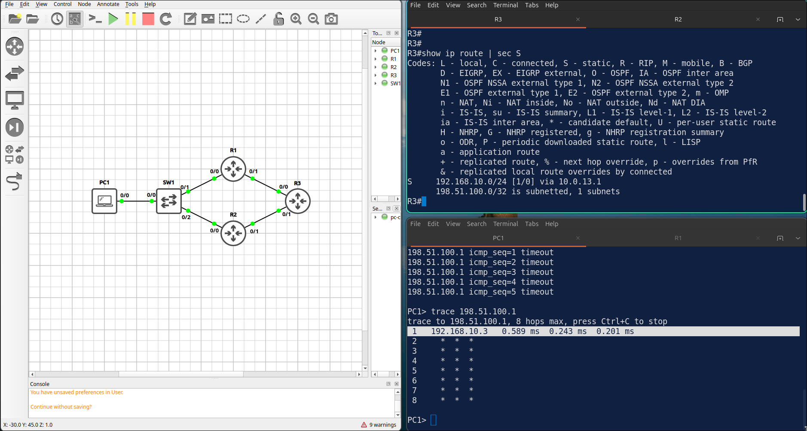

# Lab 3.4: HSRP with Interface Tracking

> **GNS3 Project:** [`Module 3 - IP Services (CCNA) | Lab 3 - HSRP with Interface Tracking.gns3`](./Module%203%20-%20IP%20Services%20%28CCNA%29%20%7C%20Lab%203%20-%20HSRP%20with%20Interface%20Tracking.gns3)
> **Platform:** GNS3 3.1 · Cisco IOL L3 `17.18.2` · 3 routers, 1 VPCS host, GNS3 Ethernet switch
> **Key takeaway:** Tracking an uplink lowers the HSRP priority when the uplink fails, and preemption lets the standby router take over. HSRP only fixes the first hop, so the return path must fail over as well.

---

## 1. Scenario & Tasks

- **Task 1 — HSRP v2:** Configure HSRP version 2 for `192.168.10.0/24`. R1 and R2 use group 10 and the virtual IP `192.168.10.1`. R1 is the active router (priority 110), and preemption is enabled on both routers.
- **Task 2 — Tracking:** Configure R1 to track its uplink `E0/1`. When the interface goes down, R1 lowers its HSRP priority by 20 so R2 becomes the active router.
- **Task 3 — Routing:** Configure routing towards R3 and verify that PC1 can reach the loopback of R3.

### IPv4 Addressing

| Device | Interfaces |
| :--- | :--- |
| **R1** | `E0/0`: 192.168.10.2/24, `E0/1`: 10.0.13.1/30 |
| **R2** | `E0/0`: 192.168.10.3/24, `E0/1`: 10.0.23.1/30 |
| **R3** | `E0/0`: 10.0.13.2/30, `E0/1`: 10.0.23.2/30, `Lo0`: 198.51.100.1/32 |
| **HSRP virtual IP** | 192.168.10.1 (group 10) |
| **PC1** | 192.168.10.11/24, gateway 192.168.10.1 |

---

## 2. Configuration & Verification

### Task 1: HSRP Version 2

**R1:**
~~~cisco
interface Ethernet0/0
 standby version 2
 standby 10 ip 192.168.10.1
 standby 10 priority 110
 standby 10 preempt
~~~

**R2:**
~~~cisco
interface Ethernet0/0
 standby version 2
 standby 10 ip 192.168.10.1
 standby 10 preempt
~~~

---

### Task 2: Track the Uplink

**R1:**
~~~cisco
track 1 interface Ethernet0/1 line-protocol
interface Ethernet0/0
 standby 10 track 1 decrement 20
~~~

---

### Task 3: Routing Towards R3

**R1:**
~~~cisco
ip route 0.0.0.0 0.0.0.0 10.0.13.2
~~~

**R2:**
~~~cisco
ip route 0.0.0.0 0.0.0.0 10.0.23.2
~~~

**R3** (primary return path via R1, floating backup via R2):
~~~cisco
ip route 192.168.10.0 255.255.255.0 10.0.13.1
ip route 192.168.10.0 255.255.255.0 10.0.23.1 10
~~~

* **Verification (`show standby brief`):** R1 is Active with priority 110 and R2 is Standby. A ping from PC1 to `198.51.100.1` succeeds.

---

## 3. Notes & Fault-Injection (Break-It)

### Failover Test: Uplink Down
* **Test:** On R1, shut down `E0/1` and checked the HSRP state on R1 and R2.
* **Result:** R2 becomes Active.

* **Ping caveat:** The ping from PC1 to R3's loopback still failed, because in GNS3 R3 keeps routing the return traffic via R1.
  * In GNS3, use IP SLA tracking on R3, or manually shut down R3's `E0/0`.
  * On real hardware, R3 would detect that the R1 interface went down and install the route via R2.

