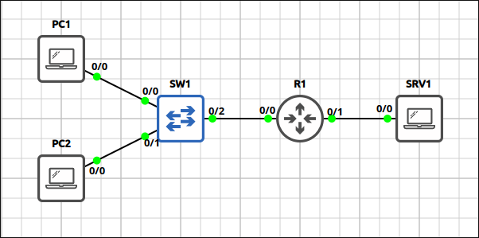
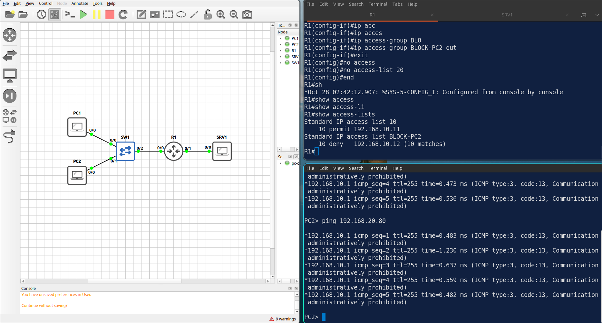
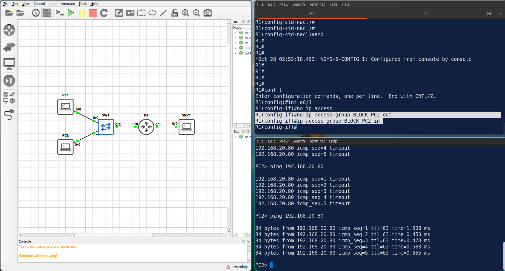
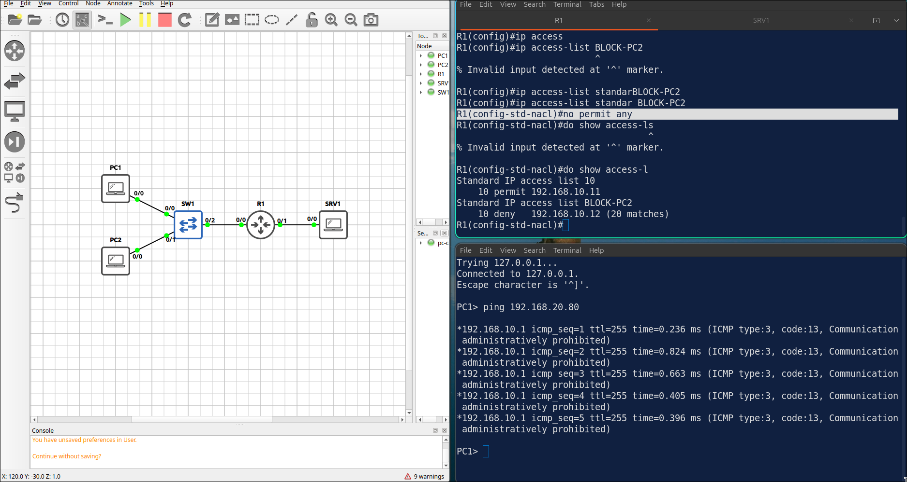

# Lab 3.5: Standard & Named ACLs

> **GNS3 Project:** [`Module 3 - IP Services (CCNA) | Lab 5 - Standard and Named ACLs.gns3`](./Module%203%20-%20IP%20Services%20%28CCNA%29%20%7C%20Lab%205%20-%20Standard%20and%20Named%20ACLs.gns3)
> **Platform:** GNS3 3.1 · Cisco IOL L3 `17.18.2` · 1 router, 3 VPCS hosts, GNS3 Ethernet switch
> **Key takeaway:** A standard ACL matches only the source address, so it belongs close to the destination. Every ACL ends with an implicit `deny any`, so a filter that only denies needs an explicit `permit any`.

---

## 1. Scenario & Tasks

- **Task 1 — Management access:** Only PC1 (`192.168.10.11`) may open a management session to R1. Create a standard ACL and apply it to the VTY lines.
- **Task 2 — Block one host:** PC2 (`192.168.10.12`) must not reach the server network `192.168.20.0/24`. Use a numbered standard ACL applied outbound on `E0/1`, and let all other hosts pass.
- **Task 3 — Named ACL:** Replace the numbered ACL with a named standard ACL that has a remark, and verify the counters after PC2 and PC1 ping SRV1.

### IPv4 Addressing

| Device | Interface | Address | Gateway |
| :--- | :--- | :--- | :--- |
| **R1** | `E0/0` (users) | 192.168.10.1/24 | — |
| **R1** | `E0/1` (servers) | 192.168.20.1/24 | — |
| **PC1** | — | 192.168.10.11/24 | 192.168.10.1 |
| **PC2** | — | 192.168.10.12/24 | 192.168.10.1 |
| **SRV1** | — | 192.168.20.80/24 | 192.168.20.1 |

---

## 2. Configuration & Verification

### Task 1: Restrict the VTY Lines

**R1:**
~~~cisco
access-list 10 permit host 192.168.10.11
line vty 0 4
 access-class 10 in
~~~

---

### Task 2: Numbered Standard ACL

**R1:**
~~~cisco
access-list 20 deny host 192.168.10.12
access-list 20 permit any
interface Ethernet0/1
 ip access-group 20 out
~~~

---

### Task 3: Named Standard ACL

**R1:**
~~~cisco
ip access-list standard BLOCK-PC2
 remark Block PC2 from the server network
 deny host 192.168.10.12
 permit any
interface Ethernet0/1
 no ip access-group 20 out
 ip access-group BLOCK-PC2 out
no access-list 20
~~~
* **Verification (`show access-lists`):** the deny entry shows matches after the ping from PC2, and PC1 still reaches SRV1.

---

## 3. Notes & Fault-Injection (Break-It)

### Fault-Injection 1: ACL in the Wrong Direction
* **Injected Fault:** On R1, applied `BLOCK-PC2` **inbound** on `E0/1` instead of outbound, and pinged SRV1 from PC2.
* **Symptom:** Inbound on `E0/1`, the ACL only sees traffic coming from the server network, so PC2 can reach SRV1 again.
* **Fix:** Apply the ACL outbound.

### Fault-Injection 2: Implicit Deny
* **Injected Fault:** On R1, deleted the `permit any` entry from `BLOCK-PC2` and pinged SRV1 from PC1.
* **Symptom:** Every ACL ends with an implicit deny, so now PC1 cannot reach SRV1 either.
* **Fix:** `permit any`

