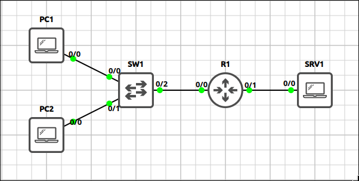
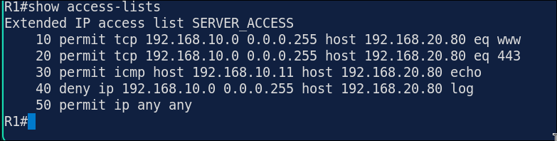
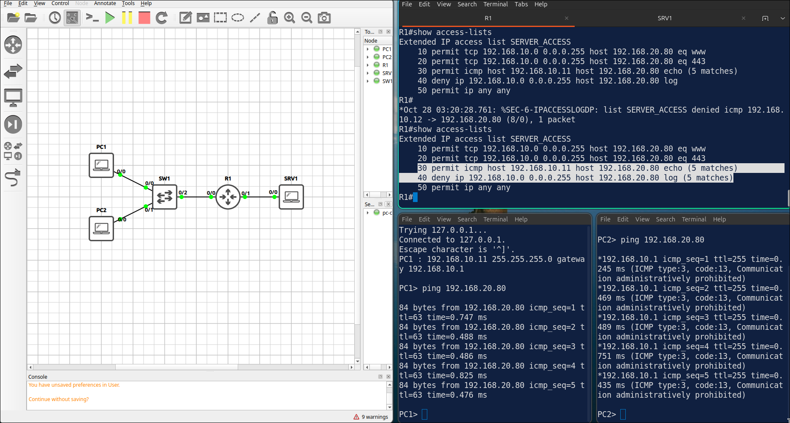
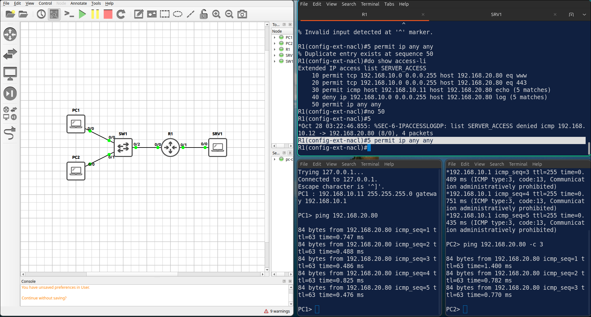
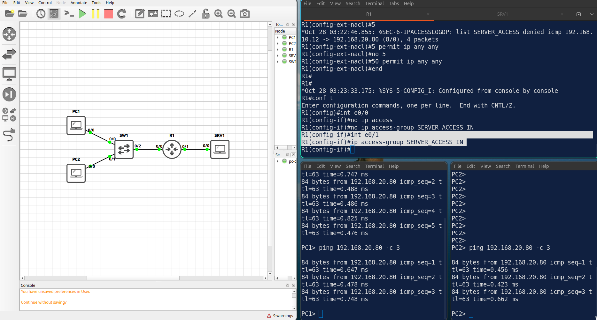

## Lab 6 - Extended ACLs

> **GNS3 Project:** [`Module 3 - IP Services (CCNA) | Lab 4 - Extended ACLs.gns3`](./Module%203%20-%20IP%20Services%20%28CCNA%29%20%7C%20Lab%204%20-%20Extended%20ACLs.gns3)



## Scenario
Create an extended ACL named SERVER_ACCESS that permits HTTP and HTTPS from the 192.168.10.0/24 network to the server SRV1 (192.168.20.80). Apply it inbound on E 0/0 of R1.

- **Devices:** PC1 (PC), PC2 (PC), R1 (IOU L3), SRV1 (PC), SW1 (Ethernet Switch)
- **Base Addressing:**
  - `R1` Ethernet0/0: `192.168.10.1` (255.255.255.0)
  - `R1` Ethernet0/1: `192.168.20.1` (255.255.255.0)
  - `PC1` Ethernet0: `192.168.10.11` (GW: 192.168.10.1)
  - `SRV1` Ethernet0: `192.168.20.80` (GW: 192.168.20.1)
  - `PC2` Ethernet0: `192.168.10.12` (GW: 192.168.10.1)

Task 1 - Create an extended ACL named SERVER_ACCESS that permits HTTP and HTTPS from the 192.168.10.0/24 network to the server SRV1 (192.168.20.80).
  - Apply it inbound on E0/0 of R1.

Task 2 - Allow only PC1 (192.168.10.11) to ping SRV1.
  - All other traffic from the LAN to SRV1 must be denied and logged.

Task 3 - Permit all remaining traffic so the LAN can still reach every other destination.
  - Ping SRV1 from PC1 and PC2 and verify the ACL.

## Action
Task 1 - Create an extended ACL named SERVER_ACCESS that permits HTTP and HTTPS from the 192.168.10.0/24 network to the server SRV1 (192.168.20.80).

**R1:**
```cisco
ip access-list extended SERVER_ACCESS
permit tcp 192.168.10.0 0.0.0.255 host 192.168.20.80 eq 80
permit tcp 192.168.10.0 0.0.0.255 host 192.168.20.80 eq 443
interface Ethernet0/0
ip access-group SERVER_ACCESS in
```

Task 2 - Allow only PC1 (192.168.10.11) to ping SRV1. All other traffic from the LAN to SRV1 must be denied and logged.

**R1:**
```cisco
ip access-list extended SERVER_ACCESS
30 permit icmp host 192.168.10.11 host 192.168.20.80 echo
40 deny ip 192.168.10.0 0.0.0.255 host 192.168.20.80 log
```

Task 3 - Permit all remaining traffic so the LAN can still reach every other destination.

**R1:**
```cisco
ip access-list extended SERVER_ACCESS
50 permit ip any any
```

## Note
1. Verification commands: `Show access-lists`



2. The match counters should increase for the ICMP entry after the ping from PC1, and for the deny entry after the ping from PC2.



3. On R1, add a permit ip any any entry at sequence 5. Ping SRV1 from PC2. R1 — The ACL is processed from top to bottom, so everything is permitted. The ping from PC2 now succeeds. Note: Fix it with no 5.



4. Remove the ACL from E0/0 and apply it inbound on E0/1. Ping SRV1 from PC2. R1 — Traffic from the LAN is no longer filtered because the ACL looks at the wrong interface. The ping from PC2 succeeds. Note: Apply the ACL inbound on E0/0 again to fix it.


