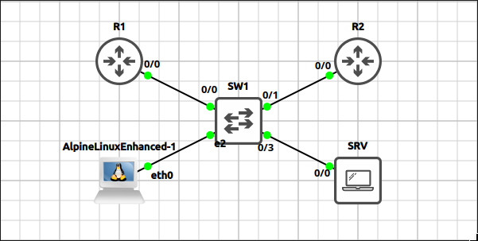
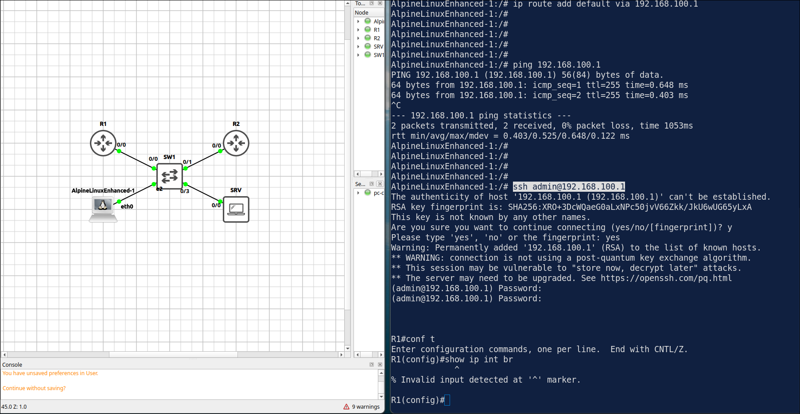
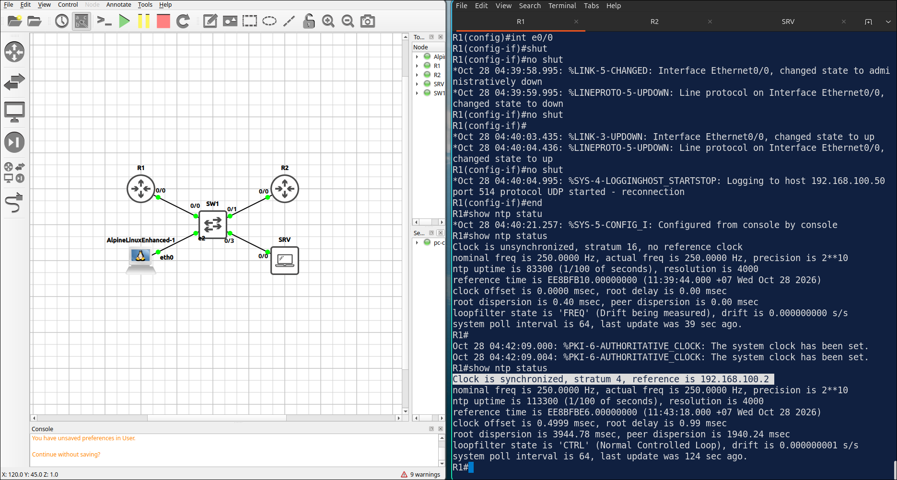
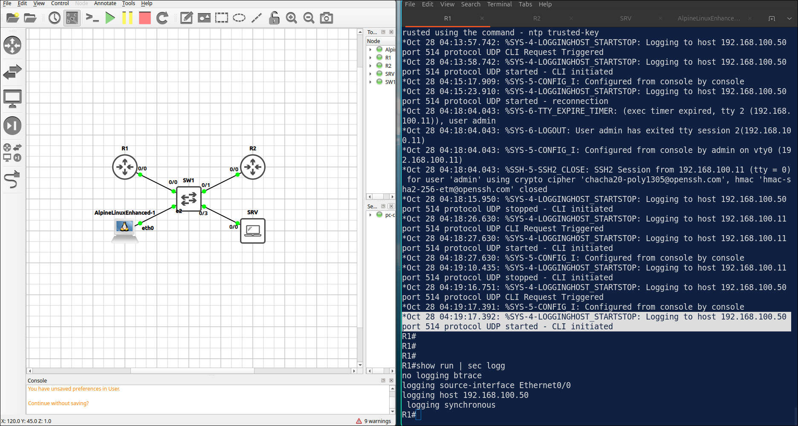
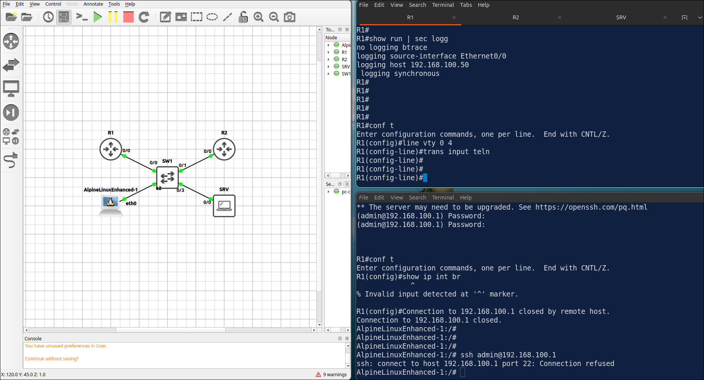
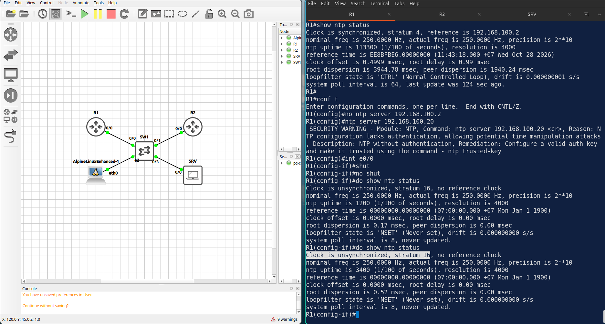

## Lab 7 - Device Management: SSH, NTP and Syslog

> **GNS3 Project:** [`Module 3 - IP Services (CCNA) | Lab 5 - Device Management: SSH, NTP and Syslog.gns3`](./Module%203%20-%20IP%20Services%20%28CCNA%29%20%7C%20Lab%205%20-%20Device%20Management%3A%20SSH%2C%20NTP%20and%20Syslog.gns3)



## Scenario
Configure SSH version 2 on R1 so it can be managed securely from PC1. Use the domain name lab.local and a local user admin with privilege level 15. Allow only SSH on the VTY lines.

- **Devices:** PC1 (PC), R1 (IOU L3), R2 (IOU L3), SRV (PC), SW1 (Ethernet Switch)
- **Base Addressing:**
  - `R1` Ethernet0/0: `192.168.100.1` (255.255.255.0)
  - `R2` Ethernet0/0: `192.168.100.2` (255.255.255.0)
  - `PC1` Ethernet0: `192.168.100.11/24`
  - `SRV` Ethernet0: `192.168.100.50/24`

Task 1 - Configure SSH version 2 on R1 so it can be managed securely from PC1.
  - Use the domain name lab.local and a local user admin with privilege level 15.
  - Allow only SSH on the VTY lines.

Task 2 - Configure R2 as an NTP master with stratum 3 and synchronize R1 with it.
  - Configure on R2
  - Configure on R1

Task 3 - Send the logs of R1 to the syslog server 192.168.100.50 with millisecond timestamps.
  - Configure on R1

## Action
Task 1 - Configure SSH version 2 on R1 so it can be managed securely from PC1.

**R1:**
```cisco
hostname R1
ip domain-name lab.local
crypto key generate rsa modulus 3072
ip ssh version 2
username admin privilege 15 secret Cisco123
line vty 0 4
login local
transport input ssh
```

**PC1:**
```cisco
ssh admin@192.168.100.1
```


Task 2 - Configure R2 as an NTP master with stratum 3 and synchronize R1 with it.

**R2:**
```cisco
ntp master 3
```

**R1:**
```cisco
ntp server 192.168.100.2
```

Task 3 - Send the logs of R1 to the syslog server 192.168.100.50 with millisecond timestamps.

**R1:**
```cisco
service timestamps log datetime msec
logging host 192.168.100.50
logging trap informational
logging source-interface Ethernet0/0
```

## Note
1. Loggings
  - On Alpine Linux machine.
```
tail -f /var/log/messages
```

  - service timestamps log datetime msec -> stamp datetime in milisec into log
  - logging host 192.168.100.50 -> send logs to this host
  - logging trap informational -> sending logs from 1-6 level, 7 is debug `logging debug`
  - logging source-interface Ethernet0/0 -> Make syslog packets from E0/0 ip, so the Monitor Server see the same source address.


2. Verification commands: `Show ntp status`, `Show logging`
  - The SSH login succeed.



  - After a few minutes the clock should be synchronized to 192.168.100.2.


  
  - The output should list the logging host 192.168.100.50.




2. On R1, change the VTY lines to transport input telnet. Try to connect from PC1 with SSH. — The SSH connection is refused. Note: Fix it with transport input ssh.



3. On R1, change the NTP server to 192.168.100.20. Check show ntp status. R1 — The clock shows as unsynchronized because the server does not exist. Note: Fix it by configuring ntp server 192.168.100.2 again.


