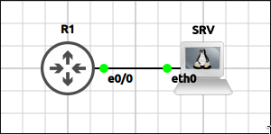
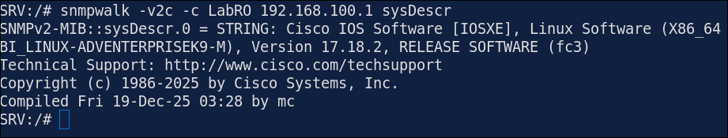
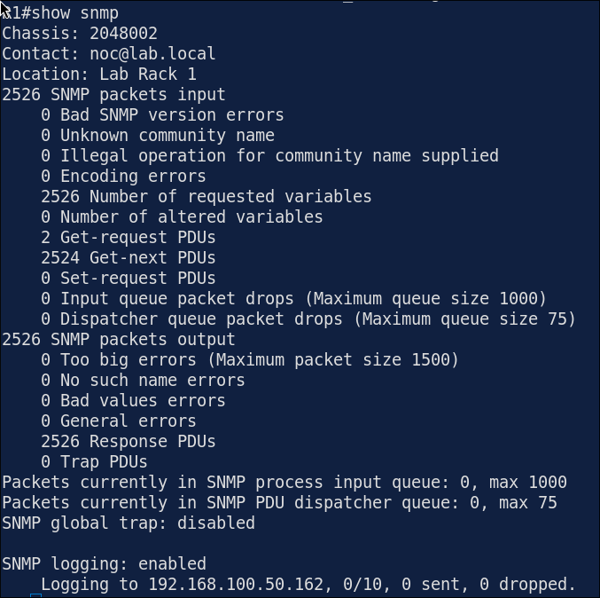
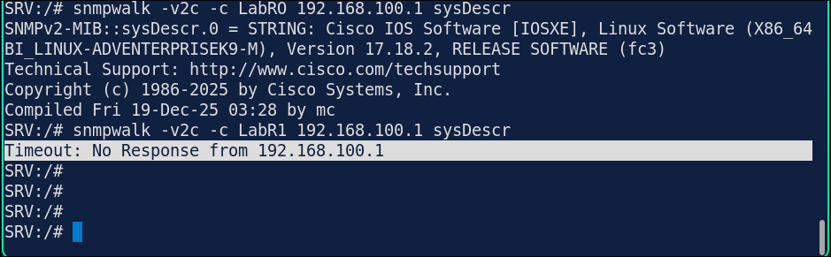
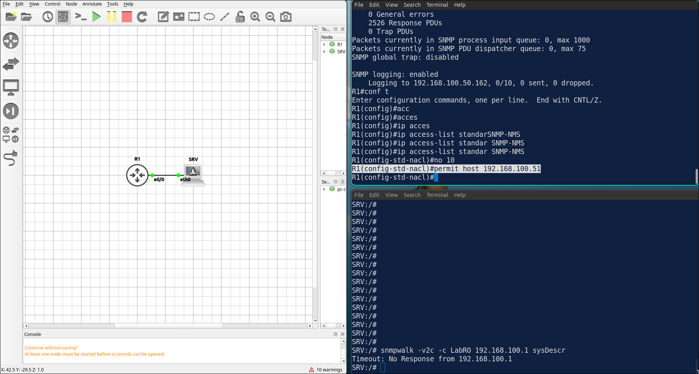

## Lab 8 - SNMPv2c and SNMPv3

> **GNS3 Project:** [`Module 3 - IP Services (CCNA) | Lab 8 - SNMPv2c and SNMPv3.gns3`](./Module%203%20-%20IP%20Services%20%28CCNA%29%20%7C%20Lab%208%20-%20SNMPv2c%20and%20SNMPv3.gns3)



## Scenario
Configure SNMPv2c on R1 with the read-only community LabRO. Only the management server SRV (192.168.100.50) may use it. Set the location and the contact.

- **Devices:** R1 (IOU L3), SRV (PC)
- **Base Addressing:**
  - `R1` Ethernet0/0: `192.168.100.1` (255.255.255.0)
  - `SRV` Ethernet0: `192.168.100.50` (GW: 192.168.100.1)

Task 1 - Configure SNMPv2c on R1 with the read-only community LabRO.
  - Only the management server SRV (192.168.100.50) may use it.
  - Set the location and the contact.

Task 2 - Configure SNMPv3 on R1 with authentication and encryption.
  - Create the group NOC-GROUP with the security level priv and the user noc-user (SHA with the password AuthPass123 and AES-128 with the password PrivPass123).

Task 3 - Send link up and link down traps to SRV and verify SNMP from SRV.
  - Configure on R1
  - Configure on SRV

## Action
Task 1 - Configure SNMPv2c on R1 with the read-only community LabRO.

**R1:**
```cisco
ip access-list standard SNMP-NMS
permit host 192.168.100.50
snmp-server community LabRO RO SNMP-NMS
snmp-server location Lab Rack 1
snmp-server contact noc@lab.local
```

Task 2 - Configure SNMPv3 on R1 with authentication and encryption.

**R1:**
```cisco
snmp-server group NOC-GROUP v3 priv
snmp-server user noc-user NOC-GROUP v3 auth sha AuthPass123 priv aes 128 PrivPass123
```

Task 3 - Send link up and link down traps to SRV and verify SNMP from SRV.

**R1:**
```cisco
snmp-server enable traps snmp linkdown linkup
snmp-server host 192.168.100.50 version 2c LabRO
```

**SRV:**
```cisco
snmpwalk -v2c -c LabRO 192.168.100.1 sysDescr
```



## Note
1. Verification commands: `Show snmp`
  - The output shows the description of the IOS software of R1.
  - The counters of received SNMP packets should increase after the queries from SRV.



2. The output shows the host name of R1. 


3. Query R1 from SRV with the community wrong. Check show snmp on R1. SRV — The query times out.



6. On R1, change the ACL SNMP-NMS to permit the host 192.168.100.51. Query R1 from SRV again. — The requests from SRV are not accepted and time out. Note: Fix it by permitting the host 192.168.100.50 again.


