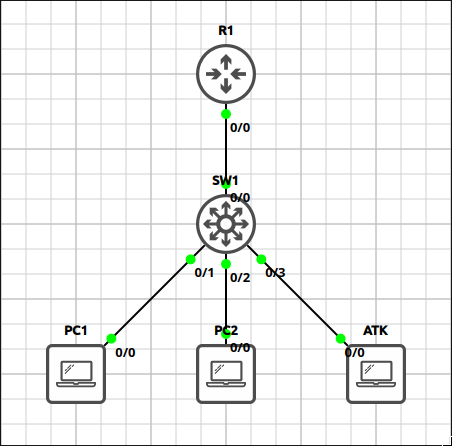
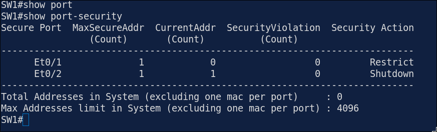
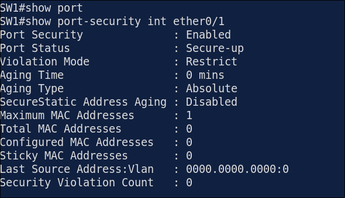
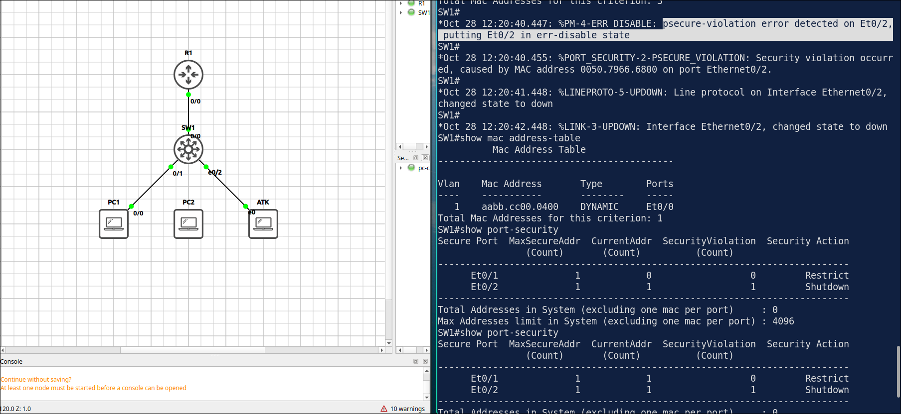
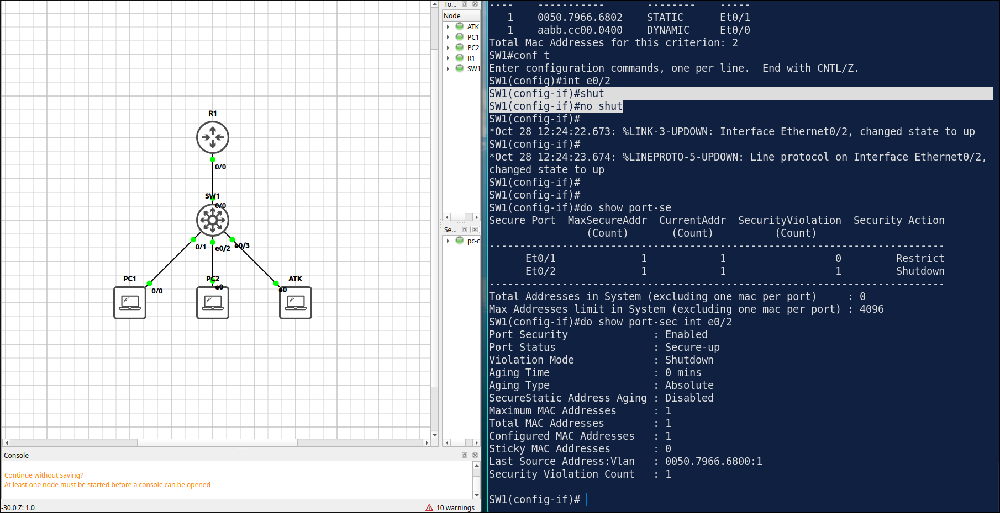

# Lab 4.1: Port Security

> **GNS3 Project:** [`Module 4 - Layer 2 Security (CCNA) | Lab 1 - Port Security.gns3`](./Module%204%20-%20Layer%202%20Security%20%28CCNA%29%20%7C%20Lab%201%20-%20Port%20Security.gns3)
> **Platform:** GNS3 3.1 · Cisco IOL L2/L3 `17.18.2` · 1 switch, 1 router, 3 VPCS hosts (PC1, PC2, ATK)
> **Key takeaway:** The violation mode decides what a port does with an unknown MAC address. `restrict` drops the frames and logs them, while `shutdown` err-disables the port until an admin recovers it.

---

## 1. Scenario & Tasks

- **Task 1 — Sticky MAC, restrict mode:** On SW1 `E0/1`, allow only one MAC address, learned dynamically and kept in the running configuration. On a violation, drop the frames and log the event without shutting down the port.
- **Task 2 — Static MAC, shutdown mode:** On SW1 `E0/2`, allow only the MAC address of PC2 (`0050.7966.6801`), configured statically. On a violation, shut the port down.
- **Task 3 — Verify** the port security configuration.

### IPv4 Addressing

| Device | Address | Gateway |
| :--- | :--- | :--- |
| **R1** `E0/0` | 192.168.10.1/24 | — |
| **PC1** | 192.168.10.11/24 | 192.168.10.1 |
| **PC2** | 192.168.10.12/24 | 192.168.10.1 |
| **ATK** (attacker) | 192.168.10.66/24 | 192.168.10.1 |

---

## 2. Configuration & Verification

### Task 1: Sticky MAC with `restrict`

**SW1:**
~~~cisco
interface Ethernet0/1
 switchport mode access
 switchport port-security
 switchport port-security maximum 1
 switchport port-security mac-address sticky
 switchport port-security violation restrict
~~~

---

### Task 2: Static MAC with `shutdown`

**SW1:**
~~~cisco
interface Ethernet0/2
 switchport mode access
 switchport port-security
 switchport port-security mac-address 0050.7966.6801
 switchport port-security violation shutdown
~~~

---

### Task 3: Verification

* **`show port-security`:** `E0/1` and `E0/2` are listed with a maximum of 1 address each.
* **`show port-security interface ethernet0/1`:** the port status is `Secure-up` and the violation mode is `Restrict`.

---

## 3. Notes & Fault-Injection (Break-It)

### Fault-Injection: Unauthorized Device on a `shutdown` Port
* **Injected Fault:** Connected ATK to SW1 `E0/2` in place of PC2 and checked the port.
* **Symptom:** The port is err-disabled, because the MAC address of ATK does not match the allowed address.

* **Recovery:** After removing ATK, bounce the port (`shutdown`, then `no shutdown`), or enable automatic recovery with `errdisable recovery cause psecure-violation`.

