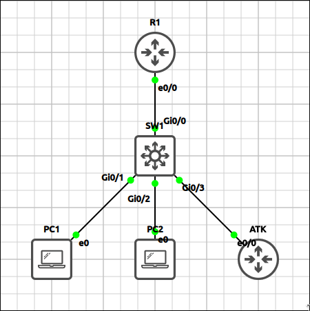
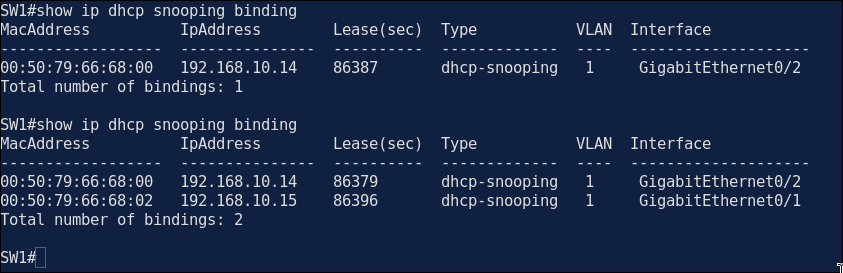
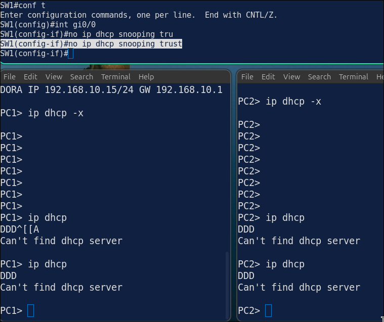
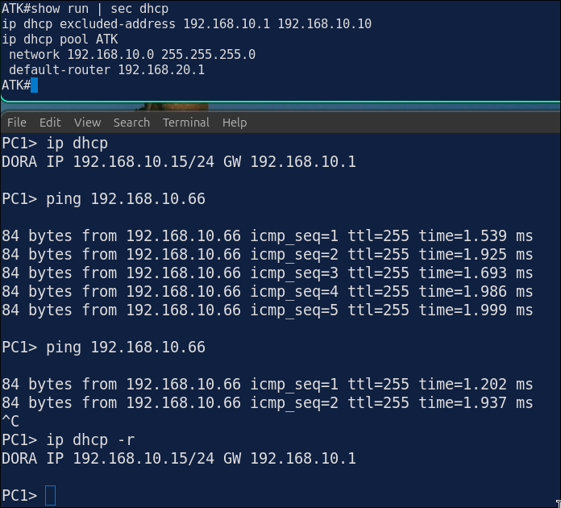
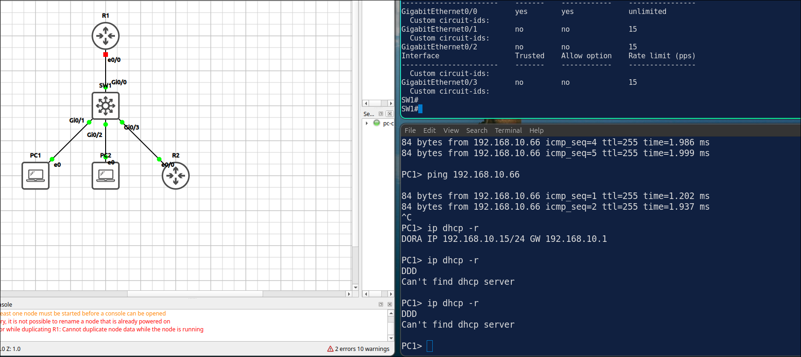

# Lab 4.2: DHCP Snooping

> **GNS3 Project:** [`Module 4 - Layer 2 Security (CCNA) | Lab 2 - DHCP Snooping.gns3`](./Module%204%20-%20Layer%202%20Security%20%28CCNA%29%20%7C%20Lab%202%20-%20DHCP%20Snooping.gns3)
> **Platform:** GNS3 3.1 · Cisco IOSvL2 switch (QEMU) · Cisco IOL L3 `17.18.2` router · 2 VPCS hosts and an attacker host (ATK)
> **Key takeaway:** DHCP snooping accepts DHCP server messages only on trusted ports, which stops rogue DHCP servers. It also builds the binding table that Dynamic ARP Inspection uses in Lab 4.3.

---

## 1. Scenario & Tasks

- **Task 1 — DHCP server:** Configure R1 as a DHCP server for `192.168.10.0/24`. Exclude the first 10 addresses and use R1 as the default gateway.
- **Task 2 — Snooping:** Enable DHCP snooping on SW1 for VLAN 1 and trust only the uplink to R1. Disable the insertion of option 82 so R1 accepts the requests.
- **Task 3 — Rate limit:** Limit the DHCP request rate on the host ports to 15 packets per second and verify the snooping binding table.

### IPv4 Addressing

| Device | Address | Gateway |
| :--- | :--- | :--- |
| **R1** `E0/0` (DHCP server) | 192.168.10.1/24 | — |
| **PC1** / **PC2** | DHCP (192.168.10.11 / .12) | 192.168.10.1 |
| **ATK** (attacker) | 192.168.10.66/24 | 192.168.10.1 |

SW1 ports: `G0/0` uplink to R1 (trusted), `G0/1`–`G0/3` hosts.

---

## 2. Configuration & Verification

### Task 1: DHCP Server on R1

**R1:**
~~~cisco
ip dhcp excluded-address 192.168.10.1 192.168.10.10
ip dhcp pool LAN
 network 192.168.10.0 255.255.255.0
 default-router 192.168.10.1
~~~

---

### Task 2: DHCP Snooping on SW1

**SW1:**
~~~cisco
ip dhcp snooping
ip dhcp snooping vlan 1
no ip dhcp snooping information option
interface G0/0
 ip dhcp snooping trust
~~~
* **Why `no ip dhcp snooping information option`:** otherwise SW1 inserts option 82 into the requests. R1 sees option 82 on a request that came from its own subnet, gets confused, and does not send an offer.

---

### Task 3: Rate Limit and Binding Table

**SW1:**
~~~cisco
interface range G0/1 - 3
 ip dhcp snooping limit rate 15
~~~
* **Verification (`show ip dhcp snooping binding`):** PC1 and PC2 are listed with their MAC address, IP address and port.

---

## 3. Notes & Fault-Injection (Break-It)

### Fault-Injection 1: Trust Removed from the Uplink
* **Injected Fault:** On SW1, removed the trust from `G0/0`, then released and renewed the address on PC1.
* **Symptom:** The DHCP offers from R1 arrive on an untrusted port and are dropped, so PC1 does not get an address.
* **Fix:** `ip dhcp snooping trust`

### Fault-Injection 2: Rogue DHCP Server
* **Injected Fault:** Started a DHCP server on ATK (`G0/3`) offering addresses from `192.168.10.0/24` with ATK as the gateway, then renewed the address on PC2.
* **Symptom:** The offers from ATK are dropped, because they arrive on an untrusted port. PC2 only gets an address from R1.

