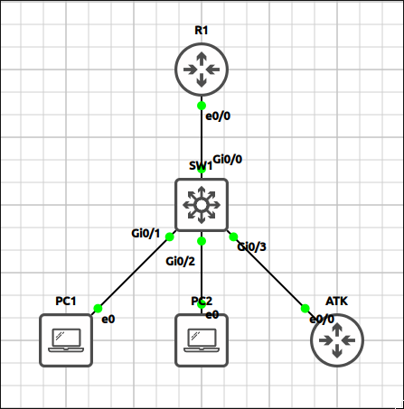
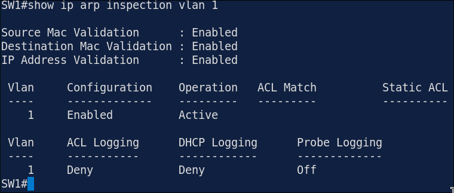
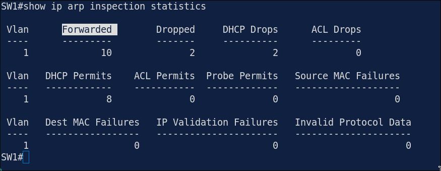
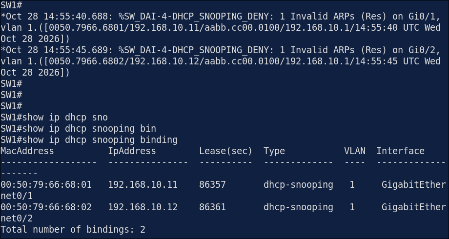
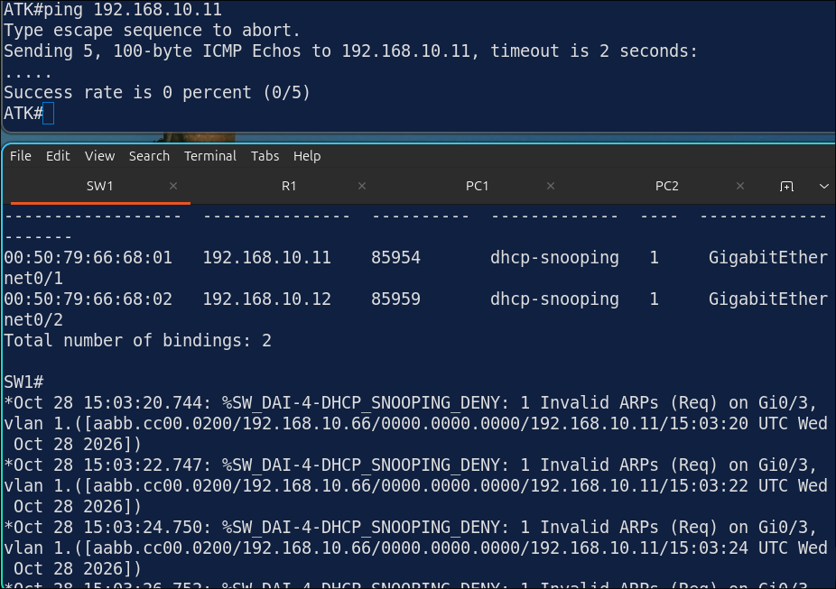
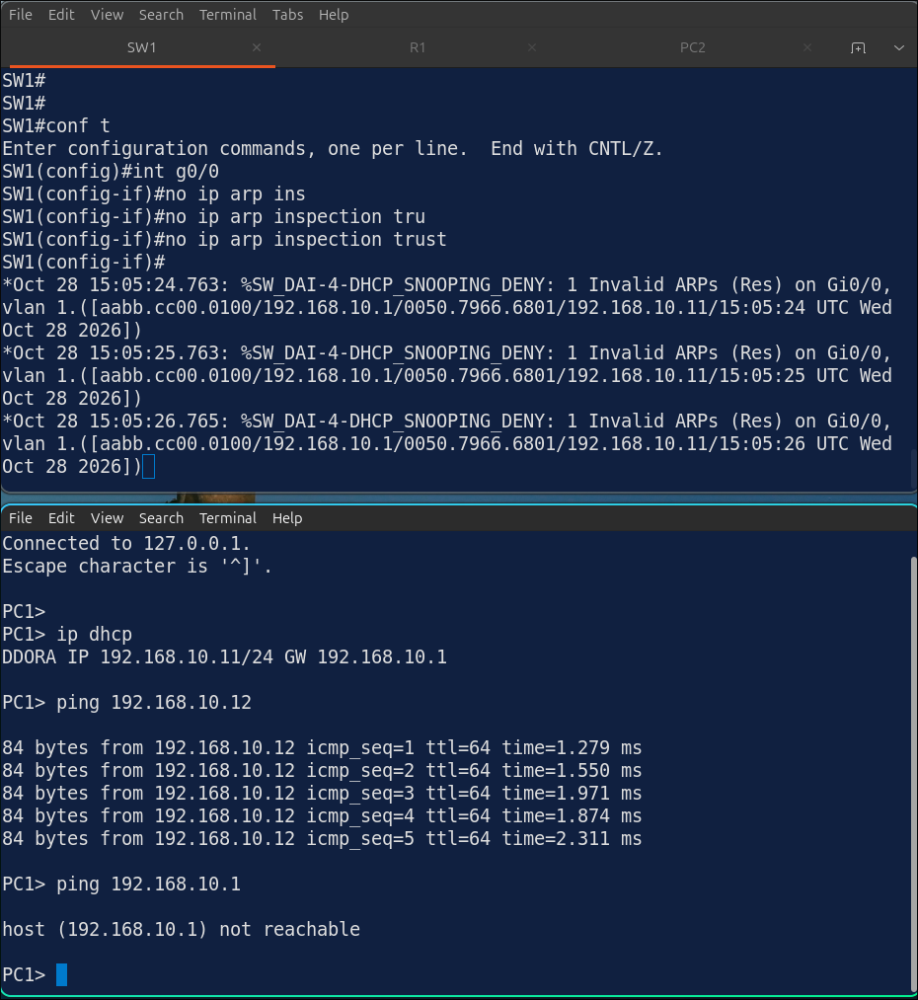

# Lab 4.3: Dynamic ARP Inspection (DAI)

> **GNS3 Project:** [`Module 4 - Layer 2 Security (CCNA) | Lab 3 - Dynamic ARP Inspection.gns3`](./Module%204%20-%20Layer%202%20Security%20%28CCNA%29%20%7C%20Lab%203%20-%20Dynamic%20ARP%20Inspection.gns3)
> **Platform:** GNS3 3.1 · Cisco IOSvL2 switch (QEMU) · Cisco IOL L3 `17.18.2` router · 2 VPCS hosts and an attacker host (ATK)
> **Key takeaway:** DAI checks every ARP packet on untrusted ports against the DHCP snooping binding table. A host with a static IP has no binding, so its ARP is dropped, and a missing trust on the uplink drops legitimate replies too.

---

## 1. Scenario & Tasks

Starting from the Lab 4.2 configuration (same topology and addressing).

- **Task 1 — Enable DAI:** Enable Dynamic ARP Inspection on SW1 for VLAN 1 and trust the uplink to R1.
- **Task 2 — Validation:** Make DAI drop ARP packets with an invalid source MAC, destination MAC or IP address.
- **Task 3 — Rate limit:** Limit the ARP rate on the host ports to 15 packets per second and verify the inspection.

---

## 2. Configuration & Verification

### Task 1: Enable DAI and Trust the Uplink

**SW1:**
~~~cisco
ip arp inspection vlan 1
interface G0/0
 ip arp inspection trust
~~~

---

### Task 2: Extra Validation

**SW1:**
~~~cisco
ip arp inspection validate src-mac dst-mac ip
~~~

---

### Task 3: ARP Rate Limit

**SW1:**
~~~cisco
interface range G0/1 - 3
 ip arp inspection limit rate 15
~~~

---

### Verification

* **`show ip arp inspection vlan 1`:** DAI is enabled and active for VLAN 1.
* **`show ip arp inspection statistics`:** ARP packets from PC1 and PC2 are forwarded, because they match the DHCP snooping binding table.

---

## 3. Notes & Fault-Injection (Break-It)

* **What DAI checks:** it compares the sender IP and MAC of each ARP packet with the DHCP snooping binding table. `validate src-mac dst-mac ip` adds checks that the MAC addresses in the ARP body match the Ethernet header, and that the IP addresses are valid.
* **Hosts without a binding:** a server with a static address has no entry in the binding table, so it needs an ARP ACL.
* **DHCP is not ARP:** the DHCP exchange itself is not checked by DAI, so getting an address works normally.

### Fault-Injection 1: Static IP on an Untrusted Port
* **Injected Fault:** Configured the static address `192.168.10.66/24` on ATK without DHCP and pinged R1.
* **Symptom:** The ARP packets from ATK are dropped, because ATK is not in the DHCP snooping binding table. A `DHCP_SNOOPING_DENY` message is logged.

### Fault-Injection 2: Trust Removed from the Uplink
* **Injected Fault:** On SW1, removed the trust from `G0/0`, cleared the ARP table on PC1 and pinged R1.
* **Symptom:** The ARP replies from R1 are dropped, because R1 is not in the binding table. PC1 cannot resolve the gateway.
* **Fix:** `ip arp inspection trust`

**Why do the pings from PC1 and from R1 behave differently?** (R1 on an untrusted port, with no binding entry)
* **From PC1:** PC1's own ARP request passes DAI because PC1 is in the binding table, but R1's reply is dropped. PC1 cannot resolve the gateway and reports host unreachable.
* **From R1:** R1's ARP packets never pass DAI, so the ping does not get out at all: 0 of 5 succeeded.
