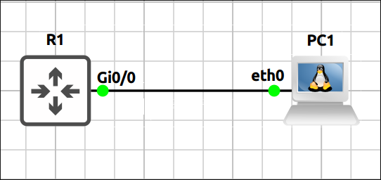
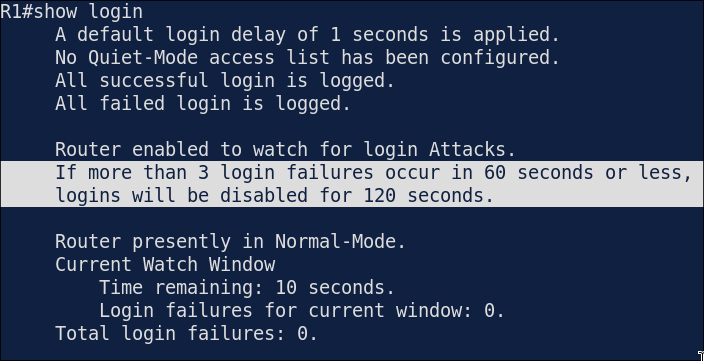
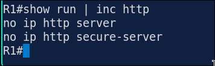
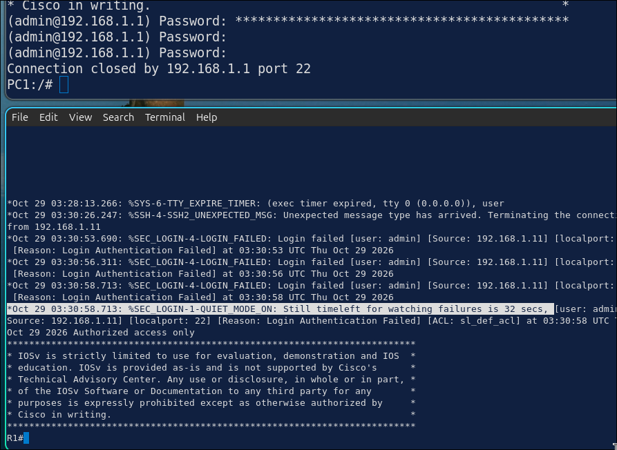
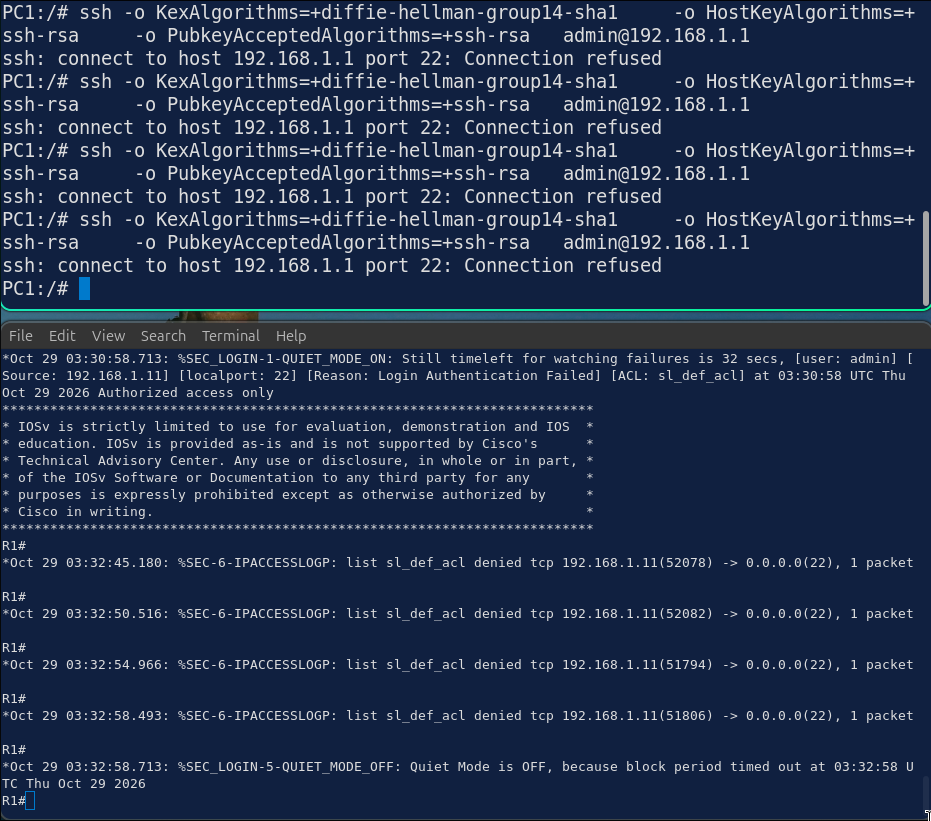
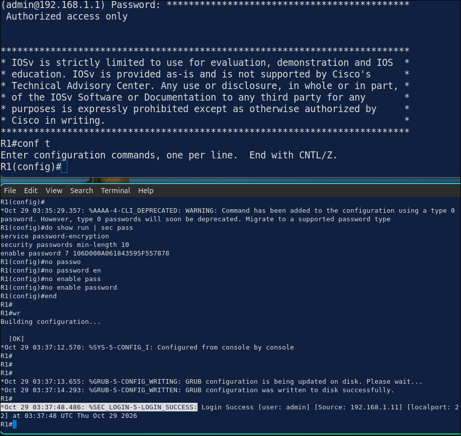
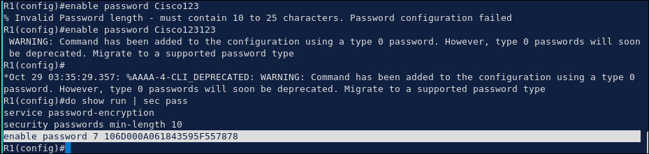

## Lab 4 - Device Hardening

> **GNS3 Project:** [`Module 4 - Layer 2 Security (CCNA) | Lab 4 - Device Hardening.gns3`](./Module%204%20-%20Layer%202%20Security%20%28CCNA%29%20%7C%20Lab%204%20-%20Device%20Hardening.gns3)



## Scenario
Harden the passwords of R1. Protect the privileged mode with a hashed secret, encrypt the other passwords in the configuration and require a minimum length of 10 characters for new passwords.

- **Devices:** PC1 (PC), R1 (IOU L3)
- **Base Addressing:**
  - `R1` G0/0: `192.168.1.1` (255.255.255.0)
  - `PC1` Ethernet0: `192.168.1.11` (GW: 192.168.1.1)

Task 1 - Harden the passwords of R1.
  - Protect the privileged mode with a hashed secret, encrypt the other passwords in the configuration and require a minimum length of 10 characters for new passwords.

Task 2 - Protect the login against brute force attacks.
  - Block the login for 120 seconds after 3 failed attempts within 60 seconds.
  - Log the failures, close idle sessions after 5 minutes and show a warning banner.

Task 3 - Disable services that are not needed and shut down the unused interface G0/3.
  - Verify the result.

## Action
Task 1 - Harden the passwords of R1.

**R1:**
```cisco
enable secret Str0ng!Secret
service password-encryption
security passwords min-length 10
username admin privilege 15 secret Adm1n!Password
```

Task 2 - Protect the login against brute force attacks.

**R1:**
```cisco
login block-for 120 attempts 3 within 60
login on-failure log
login on-success log
line vty 0 4
exec-timeout 5 0
login local
transport input ssh
line con 0
exec-timeout 5 0
logging synchronous
banner motd # Authorized access only #
```

Task 3 - Disable services that are not needed and shut down the unused interface G0/3.

**R1:**
```cisco
no ip http server
no ip http secure-server
no ip source-route
no service pad
no ip domain-lookup
interface G0/3
shutdown
```

## Note
1. Verification commands: `Show login` -The output shows the block-for settings and whether the router is in quiet mode. 



2. Show running-config | include http - Both HTTP servers should be disabled.



3. Enter a wrong password 3 times within a minute when connecting to R1 with SSH from PC1. Check the login state on R1. — R1 enters quiet mode for 120 seconds. New login attempts are not accepted until the time has passed.





After 120secs passed, enter again with correct password.



4. On R1, configure the privileged password with enable password Cisco123 and look at the running configuration. — With service password-encryption the password is stored as a type 7 string instead of 0, which can be reversed easily. An enable secret uses a one-way hash and is much safer. Note: Remove it with no enable password.


