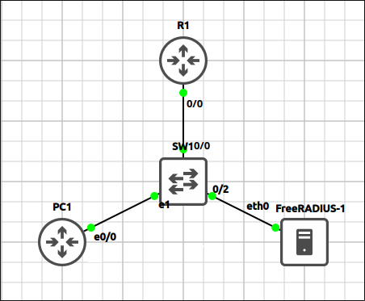
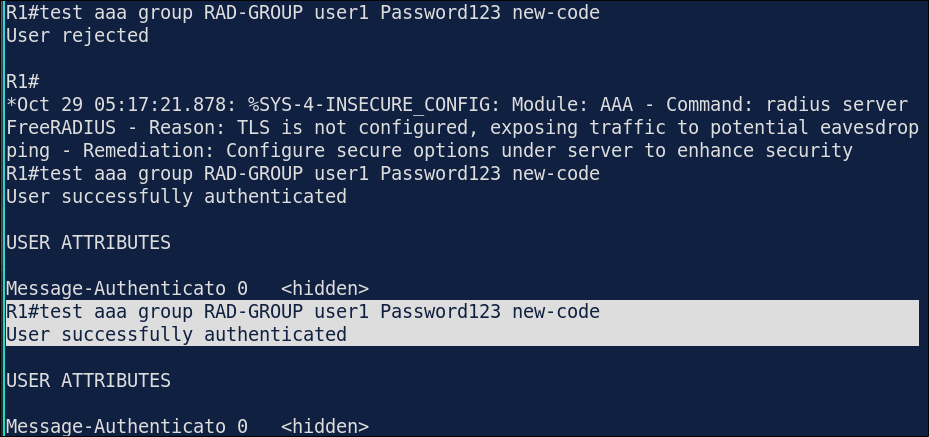
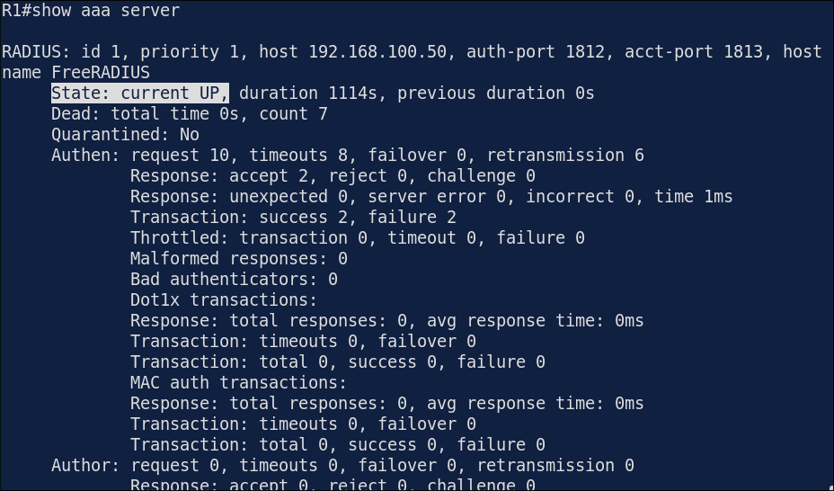
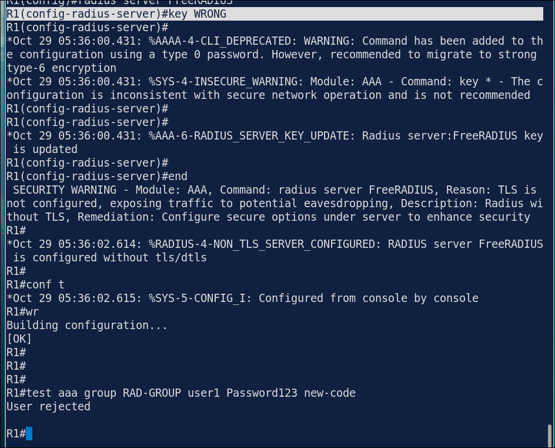

# Lab 4.5: AAA with RADIUS & Local Fallback

> **GNS3 Project:** [`Module 4 - Layer 2 Security (CCNA) | Lab 5 - AAA.gns3`](./Module%204%20-%20Layer%202%20Security%20%28CCNA%29%20%7C%20Lab%205%20-%20AAA.gns3)
> **Platform:** GNS3 3.1 · Cisco IOL L3 `17.18.2` router · FreeRADIUS server (Docker `freeradius-server`) · GNS3 Ethernet switch
> **Key takeaway:** Centralized AAA with a local fallback keeps the router reachable when the RADIUS server is down. The fallback applies when the server does not answer, not when it rejects a login, and the console should always use the local database.
> *All keys and passwords in this lab are lab-only examples.*

---

## 1. Scenario & Tasks

- **Task 1 — RADIUS server:** Configure R1 to use the RADIUS server `192.168.100.50` (SRV) with the shared key `RadKey123` and the standard ports 1812 and 1813. Put the server in a server group.
- **Task 2 — AAA for logins:** Remote users authenticate with RADIUS first, and with the local database if the server cannot be reached. The console always uses the local database, so the router stays reachable if the server fails. Create the local user `backup`.
- **Task 3 — Verify:** Test the RADIUS server and check the AAA status.

### IPv4 Addressing

| Device | Address | Gateway |
| :--- | :--- | :--- |
| **R1** `E0/0` | 192.168.100.1/24 | — |
| **PC1** | 192.168.100.11/24 | 192.168.100.1 |
| **SRV** (FreeRADIUS) | 192.168.100.50/24 | 192.168.100.1 |

---

## 2. Configuration & Verification

### Task 1: RADIUS Server and Server Group

**R1:**
~~~cisco
aaa new-model
radius server FreeRADIUS
 address ipv4 192.168.100.50 auth-port 1812 acct-port 1813
 key RadKey123
aaa group server radius RAD-GROUP
 server name FreeRADIUS
~~~

---

### Task 2: AAA with Local Fallback

**R1:**
~~~cisco
username backup privilege 15 secret Local123
aaa authentication login default group RAD-GROUP local
aaa authentication login CONSOLE local
aaa authorization exec default group RAD-GROUP local if-authenticated
line con 0
 login authentication CONSOLE
~~~

---

### Task 3: Test and Verify

**R1:**
~~~cisco
test aaa group RAD-GROUP user1 Password123 new-code
~~~
* **Result:** `User successfully authenticated`.

* **`show aaa servers`:** the server `192.168.100.50` is in the state `UP`.

---

## 3. Notes & Fault-Injection (Break-It)

### Fault-Injection 1: Wrong Shared Key
* **Injected Fault:** On R1, changed the RADIUS key to `WRONG`, tested the server and tried an SSH login with a RADIUS user.
* **Symptom:** The server rejects the requests because the shared key does not match. The test fails and the RADIUS users cannot log in.
* **Fix:** `key RadKey123`

### Resilience Test: RADIUS Server Unreachable
* **Test:** On R1, changed the server address to `192.168.100.99` and logged in through SSH with the local user `backup`.
* **Result:** The server does not answer. After the timeout, the login falls back to the local database and the user `backup` can log in.
* **Restore:** Set the address back to `192.168.100.50`.
