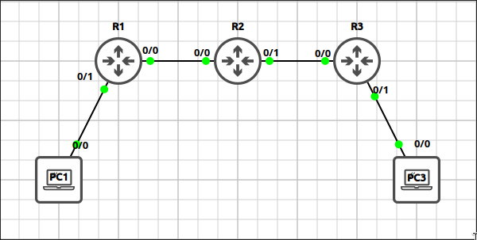
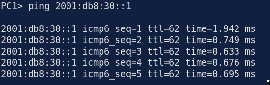
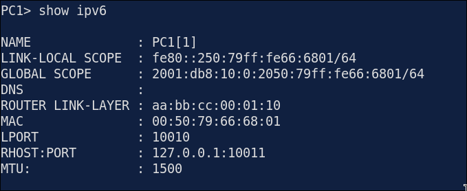
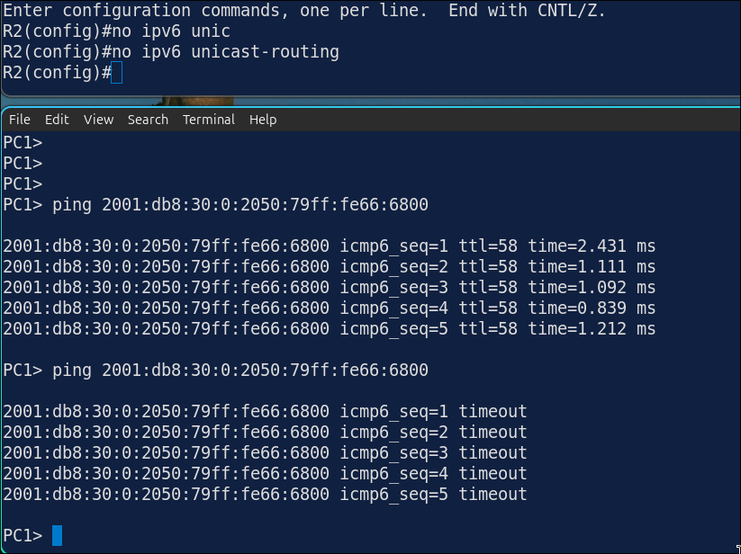
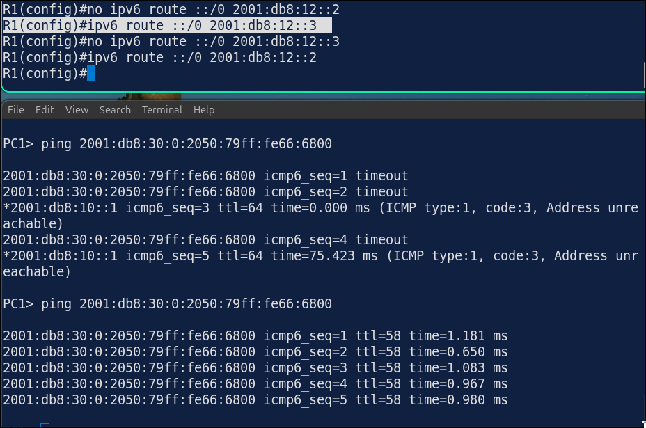

# Lab 5.1: IPv6 Addressing, SLAAC & Static Routing

> **GNS3 Project:** [`Module 5 - IPv6 (CCNA) | Lab 1 - IPv6 Addressing, SLAAC and Static Routing.gns3`](./Module%205%20-%20IPv6%20%28CCNA%29%20%7C%20Lab%201%20-%20IPv6%20Addressing%2C%20SLAAC%20and%20Static%20Routing.gns3)
> **Platform:** GNS3 3.1 · Cisco IOL L3 `17.18.2` · 3 routers, 2 VPCS hosts
> **Key takeaway:** A router forwards IPv6 only after `ipv6 unicast-routing`. Hosts build their own address with SLAAC from the router's advertised prefix, and a static route with a non-existent next hop fails at neighbor discovery.

---

## 1. Scenario & Tasks

- **Task 1 — Addressing:** Enable IPv6 routing on all routers, configure the addresses in the table and bring the interfaces up.
- **Task 2 — SLAAC:** The PCs use SLAAC. Configure R1 and R3 to advertise their LAN prefix with a valid lifetime of 1 day (86400 s) and a preferred lifetime of 12 hours (43200 s).
- **Task 3 — Static routing:** Configure static routes so all networks can reach each other. R1 and R3 use a default route. Verify from PC1.

### IPv6 Addressing

| Device | Interfaces |
| :--- | :--- |
| **R1** | `E0/0`: 2001:db8:12::1/64, `E0/1` (LAN): 2001:db8:10::1/64, `Lo0`: 2001:db8:ffff::1/128 |
| **R2** | `E0/0`: 2001:db8:12::2/64, `E0/1`: 2001:db8:23::2/64, `Lo0`: 2001:db8:ffff::2/128 |
| **R3** | `E0/0`: 2001:db8:23::3/64, `E0/1` (LAN): 2001:db8:30::1/64, `Lo0`: 2001:db8:ffff::3/128 |
| **PC1** / **PC3** | `auto` (SLAAC) |

---

## 2. Configuration & Verification

### Task 1: IPv6 Routing and Addresses

**R1:**
~~~cisco
ipv6 unicast-routing
interface Ethernet0/0
 ipv6 address 2001:db8:12::1/64
 no shutdown
interface Ethernet0/1
 ipv6 address 2001:db8:10::1/64
 no shutdown
interface Loopback0
 ipv6 address 2001:db8:ffff::1/128
~~~

**R2:**
~~~cisco
ipv6 unicast-routing
interface Ethernet0/0
 ipv6 address 2001:db8:12::2/64
 no shutdown
interface Ethernet0/1
 ipv6 address 2001:db8:23::2/64
 no shutdown
interface Loopback0
 ipv6 address 2001:db8:ffff::2/128
~~~

**R3:**
~~~cisco
ipv6 unicast-routing
interface Ethernet0/0
 ipv6 address 2001:db8:23::3/64
 no shutdown
interface Ethernet0/1
 ipv6 address 2001:db8:30::1/64
 no shutdown
interface Loopback0
 ipv6 address 2001:db8:ffff::3/128
~~~

---

### Task 2: SLAAC Prefix Lifetimes

**R1:**
~~~cisco
interface Ethernet0/1
 ipv6 nd prefix 2001:db8:10::/64 86400 43200
~~~

**R3:**
~~~cisco
interface Ethernet0/1
 ipv6 nd prefix 2001:db8:30::/64 86400 43200
~~~
* **`ipv6 nd prefix <prefix> <valid> <preferred>`:** `nd` is neighbor discovery. The valid lifetime is how long the address stays usable. The preferred lifetime is how long it is preferred for new connections. When it expires, existing connections keep working, but the address is no longer used for new ones.

---

### Task 3: Static Routes

**R1:**
~~~cisco
ipv6 route ::/0 2001:db8:12::2
~~~

**R2:**
~~~cisco
ipv6 route 2001:db8:10::/64 2001:db8:12::1
ipv6 route 2001:db8:30::/64 2001:db8:23::3
~~~

**R3:**
~~~cisco
ipv6 route ::/0 2001:db8:23::2
~~~

---

### Verification

* **`ping 2001:db8:30::1`** from PC1 succeeds.

* PC1 has an address in `2001:db8:10::/64`, learned through SLAAC.

---

## 3. Notes & Fault-Injection (Break-It)

### Fault-Injection 1: IPv6 Routing Disabled
* **Injected Fault:** On R2, `no ipv6 unicast-routing`, then pinged R3 from PC1.
* **Symptom:** R2 stops forwarding IPv6 packets. PC1 can still reach R1 but no longer R3.
* **Fix:** `ipv6 unicast-routing`

### Fault-Injection 2: Non-Existent Next Hop
* **Injected Fault:** On R1, replaced the default route with `ipv6 route ::/0 2001:db8:12::3`, then pinged R3 from PC1.
* **Symptom:** The next hop `2001:db8:12::3` does not exist on this link, so the packets are lost.
* **Fix:** Configure the next hop `2001:db8:12::2` again.

**Why do the first two pings time out while the third shows ICMPv6 unreachable (type 1, code 3)?**
* At first, R1 runs neighbor discovery to find the MAC address of the next hop (the wrong address), and the pings time out while it waits.
* When neighbor discovery gets no reply, R1 reports destination unreachable to PC1.
