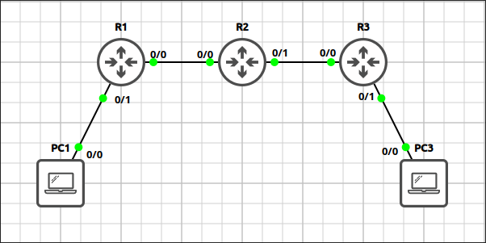
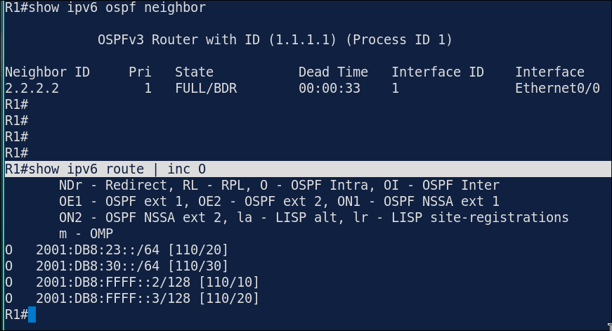
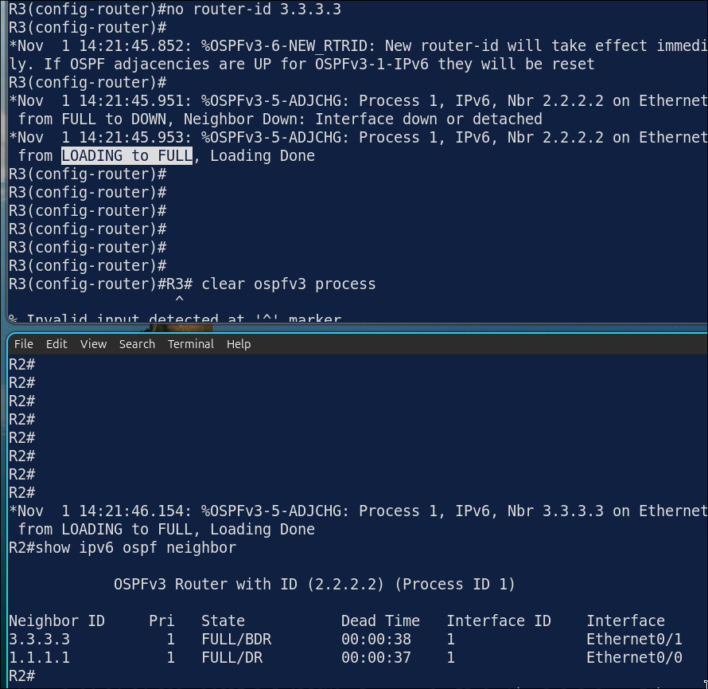
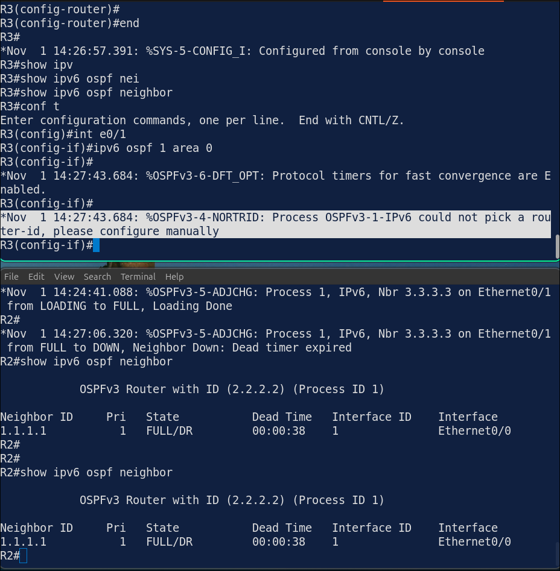
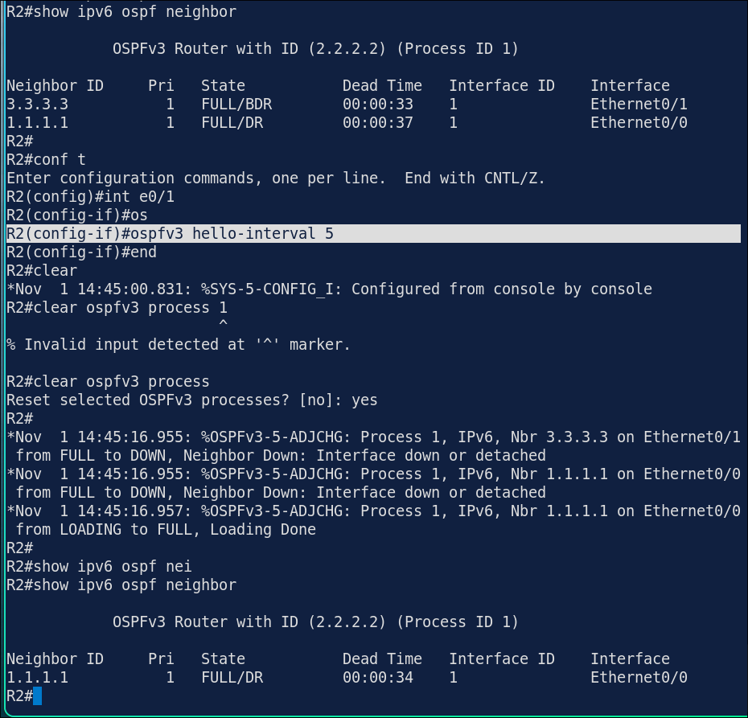

# Lab 5.2: OSPFv3 for IPv6

> **GNS3 Project:** [`Module 5 - IPv6 (CCNA) | Lab 2 - OSPFv3 for IPv6.gns3`](./Module%205%20-%20IPv6%20%28CCNA%29%20%7C%20Lab%202%20-%20OSPFv3%20for%20IPv6.gns3)
> **Platform:** GNS3 3.1 · Cisco IOL L3 `17.18.2` · 3 routers, 2 VPCS hosts
> **Key takeaway:** OSPFv3 is enabled per interface instead of with `network` statements, and it still needs a 32-bit router ID. A router with no IPv4 address cannot derive one, so the router ID must be set by hand.

---

## 1. Scenario & Tasks

Same topology and addressing as Lab 5.1.

- **Task 1 — OSPFv3:** Remove the static routes from Lab 5.1 and configure OSPFv3 (IPv6 OSPF process 1) in area 0 on all links and loopbacks. The routers have no IPv4 address, so hard-code the router IDs to `1.1.1.1`, `2.2.2.2` and `3.3.3.3`.
- **Task 2 — Passive LAN interfaces:** Prevent OSPFv3 neighbors on the LAN links by making `E0/1` passive on R1 and R3.
- **Task 3 — Verify** the neighbors and the routes on R1.

---

## 2. Configuration & Verification

### Task 1: OSPFv3 in Area 0

**R1:**
~~~cisco
no ipv6 route ::/0 2001:db8:12::2
router ospfv3 1
 router-id 1.1.1.1
interface range Ethernet0/0 - 1
 ipv6 ospf 1 area 0
interface Loopback0
 ipv6 ospf 1 area 0
~~~

**R2:**
~~~cisco
no ipv6 route 2001:db8:10::/64 2001:db8:12::1
no ipv6 route 2001:db8:30::/64 2001:db8:23::3
router ospfv3 1
 router-id 2.2.2.2
interface range Ethernet0/0 - 1
 ipv6 ospf 1 area 0
interface Loopback0
 ipv6 ospf 1 area 0
~~~

**R3:**
~~~cisco
no ipv6 route ::/0 2001:db8:23::2
router ospfv3 1
 router-id 3.3.3.3
interface range Ethernet0/0 - 1
 ipv6 ospf 1 area 0
interface Loopback0
 ipv6 ospf 1 area 0
~~~

* `router ospfv3 <id>` is the current syntax. The legacy form is `ipv6 router ospf <id>`.

---

### Task 2: Passive LAN Interfaces

**R1:**
~~~cisco
router ospfv3 1
 passive-interface Ethernet0/1
~~~

**R3:**
~~~cisco
router ospfv3 1
 passive-interface Ethernet0/1
~~~

---

### Task 3: Verification on R1

* R1 learns `2001:db8:23::/64`, `2001:db8:30::/64` and the loopbacks of R2 and R3 through OSPF.

---

## 3. Notes & Fault-Injection (Break-It)

### Fault-Injection 1: Router ID Removed
* **Injected Fault:** On R3, removed the router ID and restarted the OSPFv3 process.
* **Expected:** R3 has no IPv4 address, so it cannot select a router ID and the OSPFv3 process should not start.
* **Observed:** R3 still kept its previous router ID.

* Only after removing and reconfiguring the whole OSPFv3 process (without a router ID) did R2 lose its neighbor:

### Fault-Injection 2: Mismatched Hello Interval
* **Injected Fault:** On R2, set the OSPFv3 hello interval of `E0/1` to 5 seconds and checked the neighbors on R2.
* **Symptom:** The hello timers no longer match, and the adjacency with R3 goes down.
* **Fix:** `no ipv6 ospf hello-interval`

