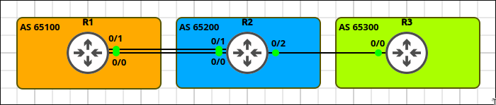
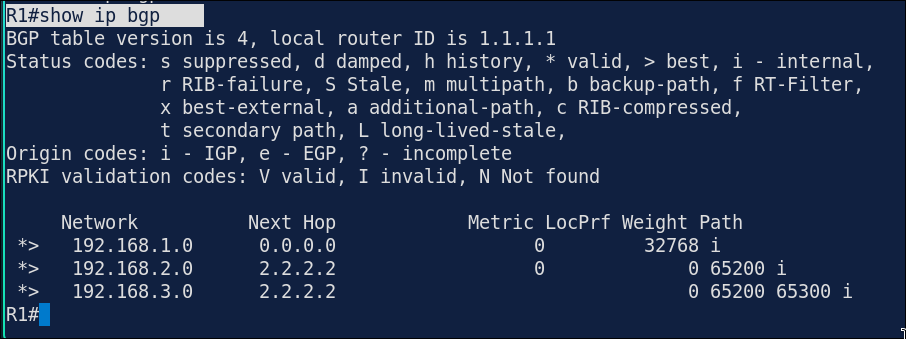
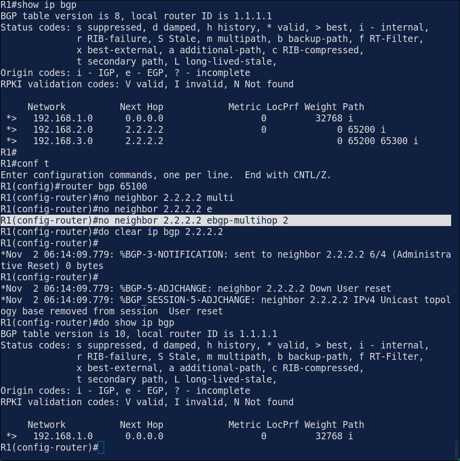
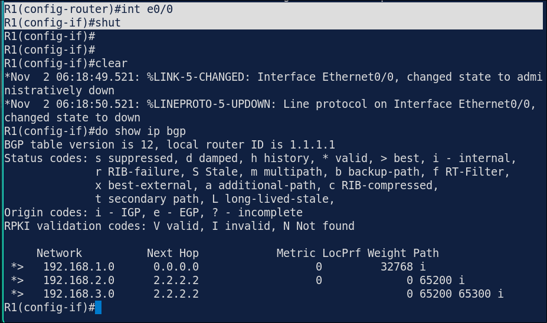

# Lab 7.1: eBGP Neighbors & Loopback Peering

> **GNS3 Project:** [`Module 6 - BGP (CCNP) | Lab 1 - eBGP Neighbors and Loopback Peering.gns3`](./Module%206%20-%20BGP%20%28CCNP%29%20%7C%20Lab%201%20-%20eBGP%20Neighbors%20and%20Loopback%20Peering.gns3)
> **Platform:** GNS3 3.1 · Cisco IOL `x86_64_crb_linux-adventerprisek9-ms.17.18.2.iol` · 3 routers, 3 autonomous systems
> **Key takeaway:** eBGP peers must be directly connected by default. Peering between loopbacks needs `ebgp-multihop` and a route to the peer's loopback, but then the session survives the loss of one link.

---

## 1. Scenario & Tasks

- **Task 1 — eBGP on the directly connected link:** Peer R2 (AS 65200) and R3 (AS 65300) using the addresses of their shared link. Hard-code the router IDs to `2.2.2.2` and `3.3.3.3`, and advertise the `Loopback1` networks.
- **Task 2 — eBGP between loopbacks:** Peer R1 (AS 65100) and R2 using their `Loopback0` addresses, so the session survives the failure of one of the two links. Use static routes over both links to reach the loopbacks. Hard-code R1's router ID to `1.1.1.1` and advertise its `Loopback1`.
- **Task 3 — Verify** the BGP neighbor and the BGP table on R1.

### IPv4 Addressing & AS Schema

| Device | ASN | Router-ID (`Lo0`) | Transit Interfaces | `Lo1` (advertised) |
| :--- | :---: | :---: | :--- | :--- |
| **R1** | `65100` | `1.1.1.1/32` | `E0/0`: 10.12.1.1/24, `E0/1`: 10.12.2.1/24 | 192.168.1.1/24 |
| **R2** | `65200` | `2.2.2.2/32` | `E0/0`: 10.12.1.2/24, `E0/1`: 10.12.2.2/24, `E0/2`: 10.23.1.2/24 | 192.168.2.1/24 |
| **R3** | `65300` | `3.3.3.3/32` | `E0/0`: 10.23.1.3/24 | 192.168.3.1/24 |

---

## 2. Configuration & Verification

### Task 1: eBGP over the Directly Connected Link (R2 ↔ R3)

**R2 (AS 65200):**
~~~cisco
router bgp 65200
 bgp router-id 2.2.2.2
 neighbor 10.23.1.3 remote-as 65300
 network 192.168.2.0 mask 255.255.255.0
~~~

**R3 (AS 65300):**
~~~cisco
router bgp 65300
 bgp router-id 3.3.3.3
 neighbor 10.23.1.2 remote-as 65200
 network 192.168.3.0 mask 255.255.255.0
~~~

---

### Task 2: eBGP Between Loopbacks (R1 ↔ R2)

**R1 (AS 65100):**
~~~cisco
ip route 2.2.2.2 255.255.255.255 10.12.1.2
ip route 2.2.2.2 255.255.255.255 10.12.2.2
router bgp 65100
 bgp router-id 1.1.1.1
 neighbor 2.2.2.2 remote-as 65200
 neighbor 2.2.2.2 update-source Loopback0
 neighbor 2.2.2.2 ebgp-multihop 2
 network 192.168.1.0 mask 255.255.255.0
~~~

**R2 (AS 65200):**
~~~cisco
ip route 1.1.1.1 255.255.255.255 10.12.1.1
ip route 1.1.1.1 255.255.255.255 10.12.2.1
router bgp 65200
 neighbor 1.1.1.1 remote-as 65100
 neighbor 1.1.1.1 update-source Loopback0
 neighbor 1.1.1.1 ebgp-multihop 2
~~~

---

### Task 3: Verification on R1

* **`show ip bgp summary`:** neighbor `2.2.2.2` is established and shows 2 prefixes received.
* **`show ip bgp`:** `192.168.3.0/24` has the AS path `65200 65300`.

---

## 3. Notes & Fault-Injection (Break-It)

### Fault-Injection 1: Missing `ebgp-multihop`
* **Injected Fault:** On R1, removed `ebgp-multihop` from neighbor `2.2.2.2`.
* **Symptom:** The session no longer establishes, because R2's loopback is not on a directly connected network.
* **Fix:** `neighbor 2.2.2.2 ebgp-multihop 2`

### Resilience Test: Link Failure
* **Test:** On R1, shut down `E0/0` and check the BGP neighbor.
* **Result:** The BGP session stays up, because the static route over `E0/1` still reaches `2.2.2.2`. This is the benefit of loopback peering with redundant links.
* **Restore:** `no shutdown`

