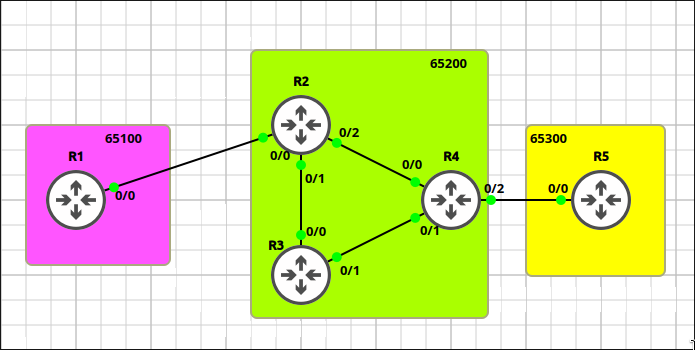
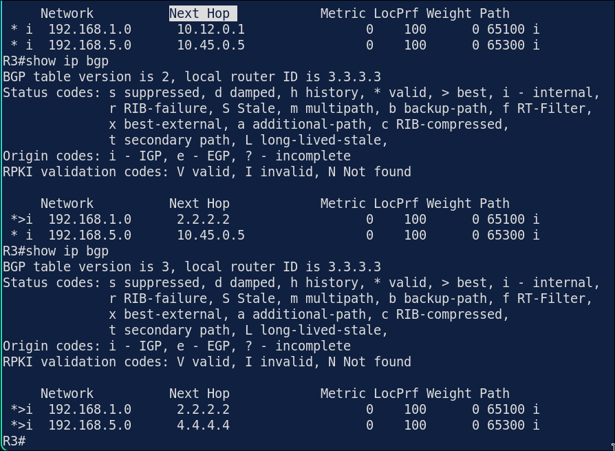
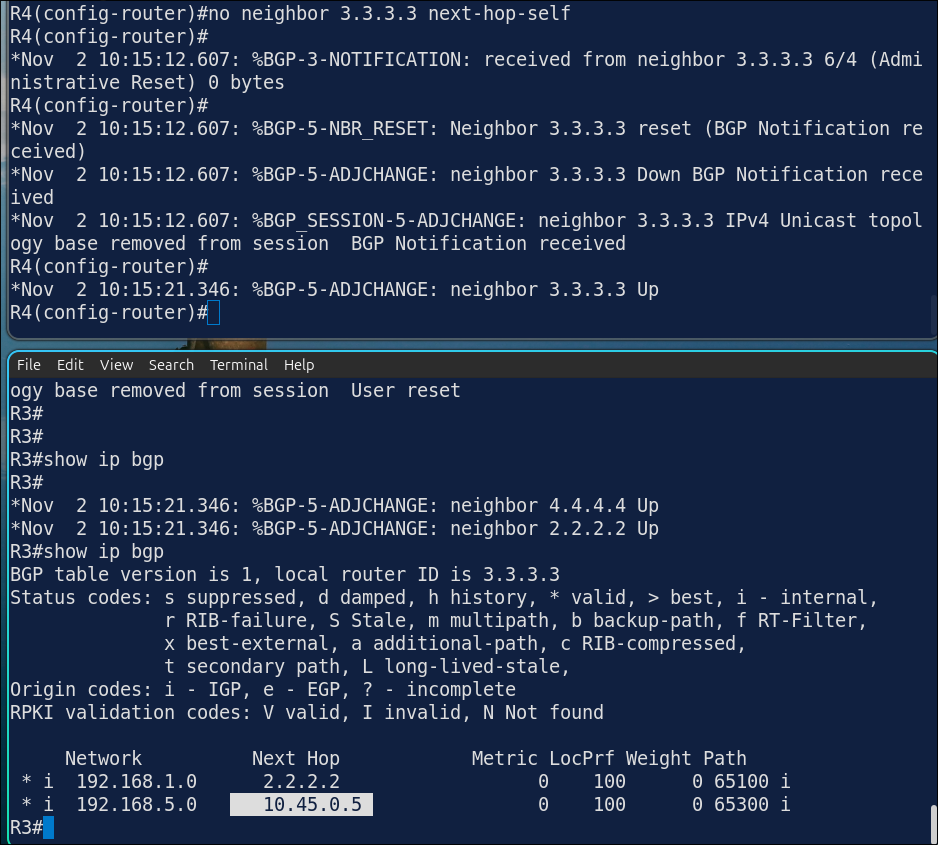
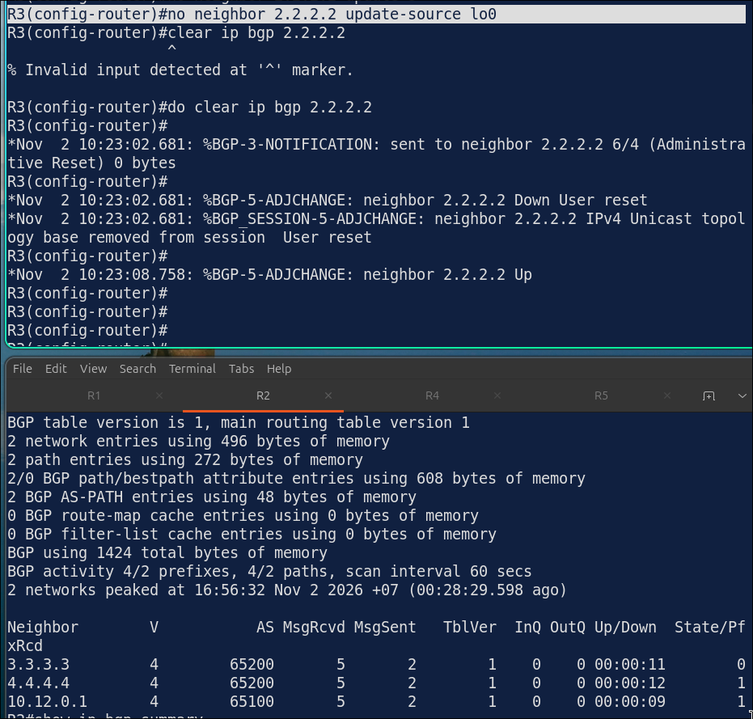
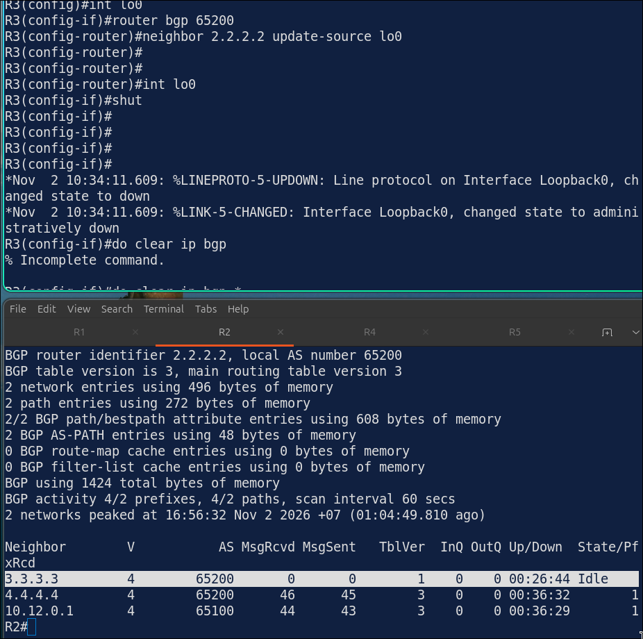

# Lab 7.2: iBGP Full-Mesh & `next-hop-self`

> **GNS3 Project:** [`Module 6 - BGP (CCNP) | Lab 2 - iBGP and next-hop-self.gns3`](./Module%206%20-%20BGP%20%28CCNP%29%20%7C%20Lab%202%20-%20iBGP%20and%20next-hop-self.gns3)
> **Platform:** GNS3 3.1 · Cisco IOL `x86_64_crb_linux-adventerprisek9-ms.17.18.2.iol` · 5 routers, 3 autonomous systems
> **Key takeaway:** A route learned from eBGP keeps its eBGP next hop when it is passed to iBGP peers. Unless the internal routers can reach that address, the route is not usable, so the edge routers need `next-hop-self`.

---

## 1. Scenario & Tasks

AS 65200 (R2, R3, R4) is a transit AS between AS 65100 (R1) and AS 65300 (R5).

- **Task 1 — eBGP:** Peer R1↔R2 and R4↔R5 using the directly connected addresses. Advertise `Loopback1` on R1 and R5, and hard-code each router ID to its `Loopback0`.
- **Task 2 — IGP and iBGP:** Run OSPF area 0 on R2, R3 and R4 for the internal links and `Loopback0` networks (not the links toward R1 and R5). Build an iBGP full mesh between R2, R3 and R4 using the `Loopback0` addresses.
- **Task 3 — `next-hop-self`:** R3 learns the external networks, but the next hop is outside the AS. Configure R2 and R4 so R3 can use the routes, and verify on R3.

### IPv4 Addressing & AS Schema

| Device | ASN | Router-ID (`Lo0`) | Transit Interfaces | Other Loopbacks |
| :--- | :---: | :---: | :--- | :--- |
| **R1** | `65100` | `1.1.1.1/32` | `E0/0`: 10.12.0.1/24 | `Lo1`: 192.168.1.1/24 (advertised), `Lo2`: 172.16.1.1/24 ¹, `Lo10`–`Lo13`: 10.1.0.1 – 10.1.3.1/24 ¹ |
| **R2** | `65200` | `2.2.2.2/32` | `E0/0`: 10.12.0.2/24, `E0/1`: 10.23.0.2/24, `E0/2`: 10.24.0.2/24 | — |
| **R3** | `65200` | `3.3.3.3/32` | `E0/0`: 10.23.0.3/24, `E0/1`: 10.34.0.3/24 | — |
| **R4** | `65200` | `4.4.4.4/32` | `E0/0`: 10.24.0.4/24, `E0/1`: 10.34.0.4/24, `E0/2`: 10.45.0.4/24 | — |
| **R5** | `65300` | `5.5.5.5/32` | `E0/0`: 10.45.0.5/24 | `Lo1`: 192.168.5.1/24 (advertised) |

¹ Configured but not used in this lab.

---

## 2. Configuration & Verification

### Task 1: eBGP Peering

**R1 (AS 65100):**
~~~cisco
router bgp 65100
 bgp router-id 1.1.1.1
 neighbor 10.12.0.2 remote-as 65200
 network 192.168.1.0 mask 255.255.255.0
~~~

**R2 (AS 65200):**
~~~cisco
router bgp 65200
 bgp router-id 2.2.2.2
 neighbor 10.12.0.1 remote-as 65100
~~~

**R4 (AS 65200):**
~~~cisco
router bgp 65200
 bgp router-id 4.4.4.4
 neighbor 10.45.0.5 remote-as 65300
~~~

**R5 (AS 65300):**
~~~cisco
router bgp 65300
 bgp router-id 5.5.5.5
 neighbor 10.45.0.4 remote-as 65200
 network 192.168.5.0 mask 255.255.255.0
~~~

---

### Task 2: OSPF Underlay and iBGP Full Mesh (R2, R3, R4)

**R2:**
~~~cisco
router ospf 1
 router-id 2.2.2.2
 network 10.23.0.0 0.0.0.255 area 0
 network 10.24.0.0 0.0.0.255 area 0
 network 2.2.2.2 0.0.0.0 area 0
router bgp 65200
 neighbor 3.3.3.3 remote-as 65200
 neighbor 3.3.3.3 update-source Loopback0
 neighbor 4.4.4.4 remote-as 65200
 neighbor 4.4.4.4 update-source Loopback0
~~~

**R3:**
~~~cisco
router ospf 1
 router-id 3.3.3.3
 network 10.23.0.0 0.0.0.255 area 0
 network 10.34.0.0 0.0.0.255 area 0
 network 3.3.3.3 0.0.0.0 area 0
router bgp 65200
 bgp router-id 3.3.3.3
 neighbor 2.2.2.2 remote-as 65200
 neighbor 2.2.2.2 update-source Loopback0
 neighbor 4.4.4.4 remote-as 65200
 neighbor 4.4.4.4 update-source Loopback0
~~~

**R4:**
~~~cisco
router ospf 1
 router-id 4.4.4.4
 network 10.24.0.0 0.0.0.255 area 0
 network 10.34.0.0 0.0.0.255 area 0
 network 4.4.4.4 0.0.0.0 area 0
router bgp 65200
 neighbor 2.2.2.2 remote-as 65200
 neighbor 2.2.2.2 update-source Loopback0
 neighbor 3.3.3.3 remote-as 65200
 neighbor 3.3.3.3 update-source Loopback0
~~~

---

### Task 3: `next-hop-self` on the Edge Routers

**R2:**
~~~cisco
router bgp 65200
 neighbor 3.3.3.3 next-hop-self
 neighbor 4.4.4.4 next-hop-self
~~~

**R4:**
~~~cisco
router bgp 65200
 neighbor 2.2.2.2 next-hop-self
 neighbor 3.3.3.3 next-hop-self
~~~
* **Verification (`show ip bgp` on R3):** `192.168.1.0/24` has next hop `2.2.2.2` and `192.168.5.0/24` has next hop `4.4.4.4`. Both routes are marked best (`>`).

---

## 3. Notes & Fault-Injection (Break-It)

* **Why `next-hop-self` is manual:** a router rewrites the next hop when it advertises to an eBGP peer, but not when it passes an externally learned route to an iBGP peer. The edge routers (R2, R4) therefore need it configured by hand.

### Fault-Injection 1: Missing `next-hop-self`
* **Injected Fault:** On R4, removed `next-hop-self` for neighbor `3.3.3.3` and refreshed the session.
* **Symptom:** R3 learns `192.168.5.0/24` with next hop `10.45.0.5`, which it cannot reach, so the route is not marked best.
* **Fix:** `neighbor 3.3.3.3 next-hop-self`

### Fault-Injection 2: Missing `update-source` on One Side
* **Injected Fault:** On R3, removed `update-source Loopback0` from neighbor `2.2.2.2` and restarted the session.
* **Behavior:** R3 now sources the session from its interface address, but R2 expects `3.3.3.3`. I expected the session to fail. It did not, because R2 still initiates the TCP connection correctly to `3.3.3.3`. The mismatch only breaks the session if `Lo0` on R3 goes down.

