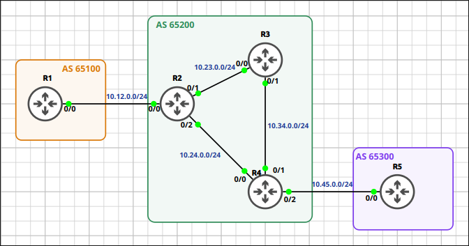
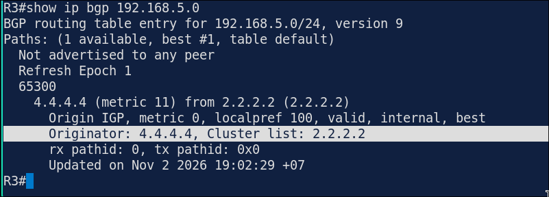
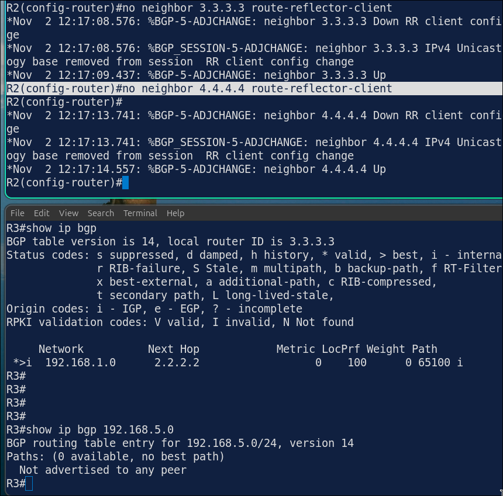

## Lab 3 - BGP Route Reflectors

> **GNS3 Project:** [`Module 6 - BGP (CCNP) | Lab 3 - BGP Route Reflectors.gns3`](./Module%206%20-%20BGP%20%28CCNP%29%20%7C%20Lab%203%20-%20BGP%20Route%20Reflectors.gns3)



## Scenario
Starting from the Lab 2 configuration, remove the iBGP neighbor relationship between R3 and R4.

- **Devices:** R1 (IOU L3), R2 (IOU L3), R3 (IOU L3), R4 (IOU L3), R5 (IOU L3)
- **Base Addressing:**
  - `R3` Ethernet0/0: `10.23.0.3` (255.255.255.0)
  - `R3` Ethernet0/1: `10.34.0.3` (255.255.255.0)
  - `R3` Loopback0: `3.3.3.3` (255.255.255.255)
  - `R5` Ethernet0/0: `10.45.0.5` (255.255.255.0)
  - `R5` Loopback0: `5.5.5.5` (255.255.255.255)
  - `R5` Loopback1: `192.168.5.1` (255.255.255.0)
  - `R4` Ethernet0/0: `10.24.0.4` (255.255.255.0)
  - `R4` Ethernet0/1: `10.34.0.4` (255.255.255.0)
  - `R4` Ethernet0/2: `10.45.0.4` (255.255.255.0)
  - `R4` Loopback0: `4.4.4.4` (255.255.255.255)
  - `R1` Ethernet0/0: `10.12.0.1` (255.255.255.0)
  - `R1` Loopback0: `1.1.1.1` (255.255.255.255)
  - `R1` Loopback1: `192.168.1.1` (255.255.255.0)
  - `R1` Loopback2: `172.16.1.1` (255.255.255.0)
  - `R1` Loopback10: `10.1.0.1` (255.255.255.0)
  - `R1` Loopback11: `10.1.1.1` (255.255.255.0)
  - `R1` Loopback12: `10.1.2.1` (255.255.255.0)
  - `R1` Loopback13: `10.1.3.1` (255.255.255.0)
  - `R2` Ethernet0/0: `10.12.0.2` (255.255.255.0)
  - `R2` Ethernet0/1: `10.23.0.2` (255.255.255.0)
  - `R2` Ethernet0/2: `10.24.0.2` (255.255.255.0)
  - `R2` Loopback0: `2.2.2.2` (255.255.255.255)

Task 1 - Starting from the Lab 2 configuration, remove the iBGP neighbor relationship between R3 and R4.
  - Configure on R3
  - Configure on R4

Task 2 - Configure R2 as a route reflector.
  - R3 and R4 are its clients.

Task 3 - Verify that R3 learns the network of R5 through the route reflector.

## Action
Task 1 - Starting from the Lab 2 configuration, remove the iBGP neighbor relationship between R3 and R4.

**R3:**
```cisco
router bgp 65200
no neighbor 4.4.4.4 remote-as 65200
```

**R4:**
```cisco
router bgp 65200
no neighbor 3.3.3.3 remote-as 65200
```

Task 2 - Configure R2 as a route reflector.

**R2:**
```cisco
router bgp 65200
neighbor 3.3.3.3 route-reflector-client
neighbor 4.4.4.4 route-reflector-client
```

Task 3 - Verify that R3 learns the network of R5 through the route reflector.



## Note
1. Verification commands: `Show ip bgp 192.168.5.0` - The route should show the Originator 4.4.4.4 and the Cluster list 2.2.2.2.
2. On R2, remove the route-reflector-client configuration for both neighbors. Check the BGP table of R3. — iBGP routes are no longer passed from one iBGP neighbor to another. R3 no longer learns 192.168.5.0/24. Note: Fix it by configuring route-reflector-client again for both neighbors.


