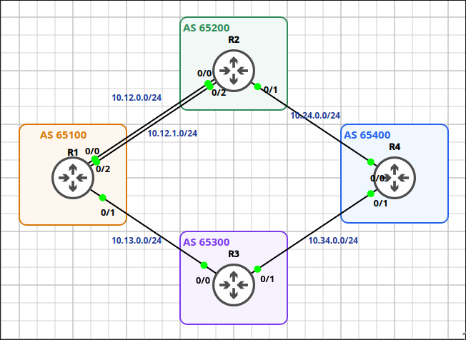
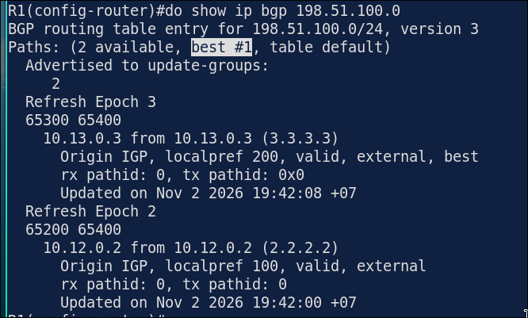
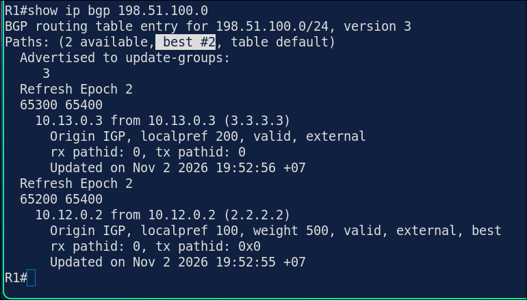
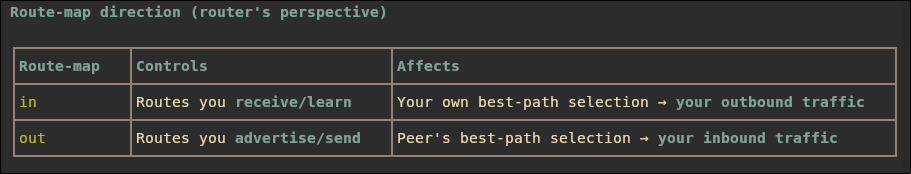
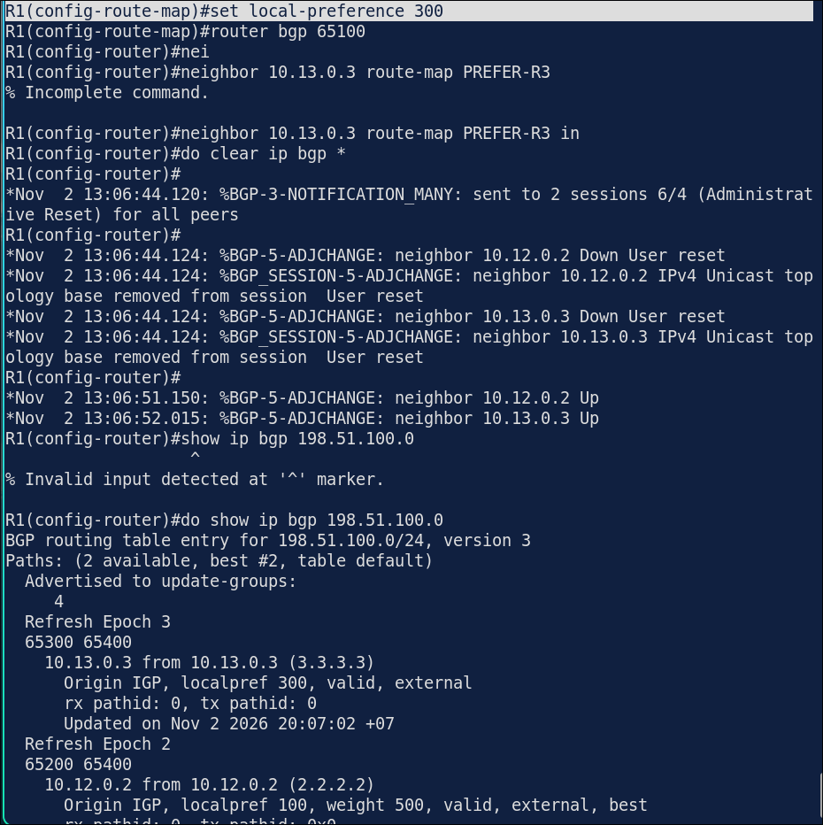
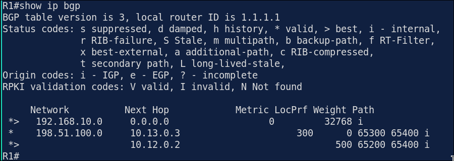

# Lab 7.4: BGP Path Selection — Local Preference & Weight

> **GNS3 Project:** [`Module 6 - BGP (CCNP) | Lab 4 - Local Preference and Weight.gns3`](./Module%206%20-%20BGP%20%28CCNP%29%20%7C%20Lab%204%20-%20Local%20Preference%20and%20Weight.gns3)
> **Platform:** GNS3 3.1 · Cisco IOL `x86_64_crb_linux-adventerprisek9-ms.17.18.2.iol` · 4 routers, 4 autonomous systems
> **Key takeaway:** BGP evaluates **Weight** (Cisco-local, highest wins) *before* **Local Preference** (highest wins), so a weight on one neighbor overrides any local-preference policy.

---

## 1. Scenario & Tasks

R1 (AS 65100) is multihomed to two ISPs, ISP-A (R2) and ISP-B (R3), which both reach the remote network behind R4 (AS 65400).

- **Task 1 — Baseline eBGP:** Configure direct eBGP peering R1↔R2, R1↔R3, R2↔R4 and R3↔R4 over their directly connected links. Hard-code Router-IDs to `Loopback0`, and advertise `Loopback1` on R1 and R4.
- **Task 2 — Outbound Preference (`LOCAL_PREF`):** Force R1 to prefer ISP-B (R3) for outbound traffic by setting `local-preference 200` on routes received from R3.
- **Task 3 — Local Override (`Weight`):** Without modifying Local Preference, force R1 to use ISP-A (R2) by setting `weight 500` on routes received from R2. In this lab, `198.51.100.0/24` is the only prefix learned from the R4 side, so it is the prefix affected.

### IPv4 Addressing & AS Schema

| Device | ASN | Router-ID (`Lo0`) | Transit Interfaces | Advertised / Test Loopbacks |
| :--- | :---: | :---: | :--- | :--- |
| **R1** | `65100` | `1.1.1.1/32` | `E0/0`: 10.12.0.1/24, `E0/1`: 10.13.0.1/24, `E0/2`: 10.12.1.1/24 ¹ | `Lo1`: 192.168.10.1/24 (advertised) |
| **R2 (ISP-A)** | `65200` | `2.2.2.2/32` | `E0/0`: 10.12.0.2/24, `E0/1`: 10.24.0.2/24, `E0/2`: 10.12.1.2/24 ¹ | — |
| **R3 (ISP-B)** | `65300` | `3.3.3.3/32` | `E0/0`: 10.13.0.3/24, `E0/1`: 10.34.0.3/24 | — |
| **R4** | `65400` | `4.4.4.4/32` | `E0/0`: 10.24.0.4/24, `E0/1`: 10.34.0.4/24 | `Lo1`: 198.51.100.1/24 (advertised), `Lo2`: 203.0.113.1/24 ², `Lo3`: 192.0.2.1/24 ² |

¹ The second R1–R2 link (`E0/2`, 10.12.1.0/24) is addressed but has no BGP session in this lab.
² `Lo2`/`Lo3` are configured but not advertised in this lab.

---

## 2. Configuration & Verification

### Task 1: Baseline eBGP Peering

*Interfaces and loopbacks are pre-configured per the addressing table; only the BGP configuration is shown.*

**R1 (AS 65100):**
~~~cisco
router bgp 65100
 bgp router-id 1.1.1.1
 neighbor 10.12.0.2 remote-as 65200
 neighbor 10.13.0.3 remote-as 65300
 network 192.168.10.0 mask 255.255.255.0
~~~

**R2 (AS 65200 - ISP-A):**
~~~cisco
router bgp 65200
 bgp router-id 2.2.2.2
 neighbor 10.12.0.1 remote-as 65100
 neighbor 10.24.0.4 remote-as 65400
~~~

**R3 (AS 65300 - ISP-B):**
~~~cisco
router bgp 65300
 bgp router-id 3.3.3.3
 neighbor 10.13.0.1 remote-as 65100
 neighbor 10.34.0.4 remote-as 65400
~~~

**R4 (AS 65400):**
~~~cisco
router bgp 65400
 bgp router-id 4.4.4.4
 neighbor 10.24.0.2 remote-as 65200
 neighbor 10.34.0.3 remote-as 65300
 network 198.51.100.0 mask 255.255.255.0
~~~

---

### Task 2: Prefer ISP-B (R3) via Local Preference

**R1:**
~~~cisco
route-map PREFER-R3 permit 10
 set local-preference 200
exit
router bgp 65100
 neighbor 10.13.0.3 route-map PREFER-R3 in
 do clear ip bgp 10.13.0.3 in
~~~
* **Verification (`show ip bgp 198.51.100.0`):** Best path (`*>`) shifts to `10.13.0.3` with `LocPrf 200`; the R2 path keeps the default `LocPrf 100`.

---

### Task 3: Override Local Preference via Weight (ISP-A / R2)

**R1:**
~~~cisco
route-map WEIGHT-R2 permit 10
 set weight 500
exit
router bgp 65100
 neighbor 10.12.0.2 route-map WEIGHT-R2 in
 do clear ip bgp 10.12.0.2 in
~~~
* **Verification (`show ip bgp 198.51.100.0`):** Best path (`*>`) shifts to `10.12.0.2` because BGP evaluates `Weight` (`500`) before `Local Preference` (`200`), even though R3 still carries the higher `LocPrf`.

> **Scope note:** this route-map has no `match` clause, so `weight 500` applies to *every* route learned from R2. That is harmless here because only one remote prefix exists. To limit it to one prefix, add `ip prefix-list REMOTE seq 5 permit 198.51.100.0/24` and `match ip address prefix-list REMOTE` to the `WEIGHT-R2` sequence.

---

## 3. Notes & Fault-Injection (Break-It)

* **Direct Neighbor Weight:** `neighbor 10.12.0.2 weight 500` (applies to all routes from that neighbor without a route-map).
* **Global Default Local-Pref:** `bgp default local-preference 200` (sets the default on this router; the value travels to iBGP peers, but it is not a per-neighbor control — use a route-map for that).

### Fault-Injection: Editing a Route-Map Without Refreshing the Session
* **Injected Change:** Raised `PREFER-R3` from `set local-preference 200` to `300`.
* **Behavior:** An inbound route-map is applied when a route is received or refreshed, so editing the route-map alone does not rewrite entries already in the BGP table. The new value appears only after the session or the inbound policy is refreshed.
* **Fix applied in the lab:** A hard reset (`clear ip bgp *`) — both sessions flapped, as the log in the screenshot shows — after which `10.13.0.3` shows `LocPrf 300`:

* **Result (`show ip bgp`):** R3's path carries `LocPrf 300`, yet R1 still selects the R2 path (`*>`, `Weight 500`). This confirms again that Weight outranks Local Preference:

* **Lesson learned:** I used `clear ip bgp *` here, which was overkill because it dropped both sessions. `clear ip bgp 10.13.0.3 in` would have re-applied the route-map on just that neighbor without tearing down the TCP session, so that is what I'll use next time.
