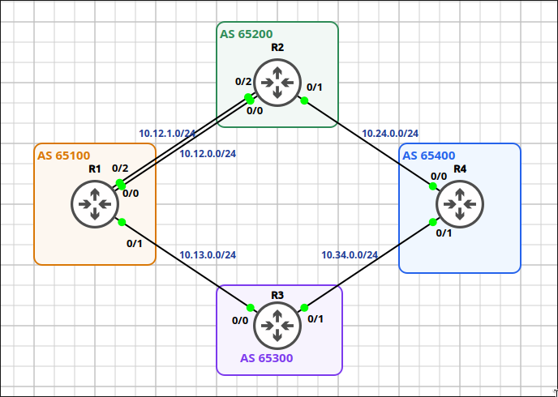
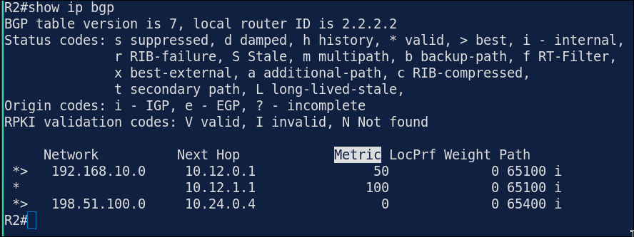
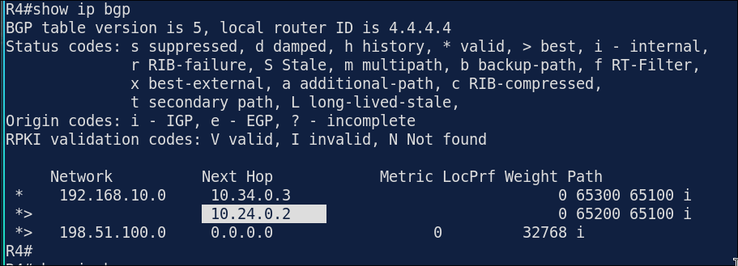
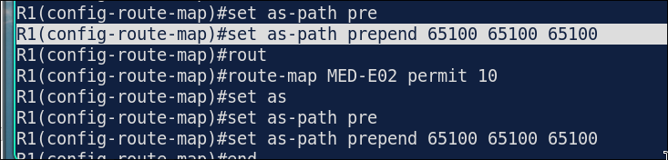
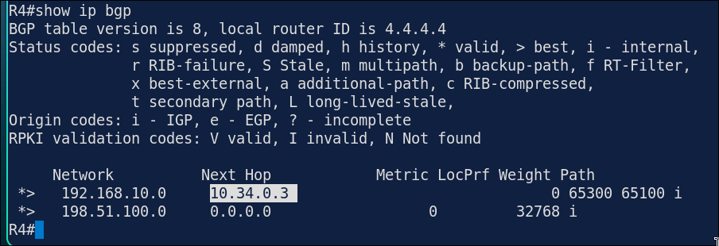
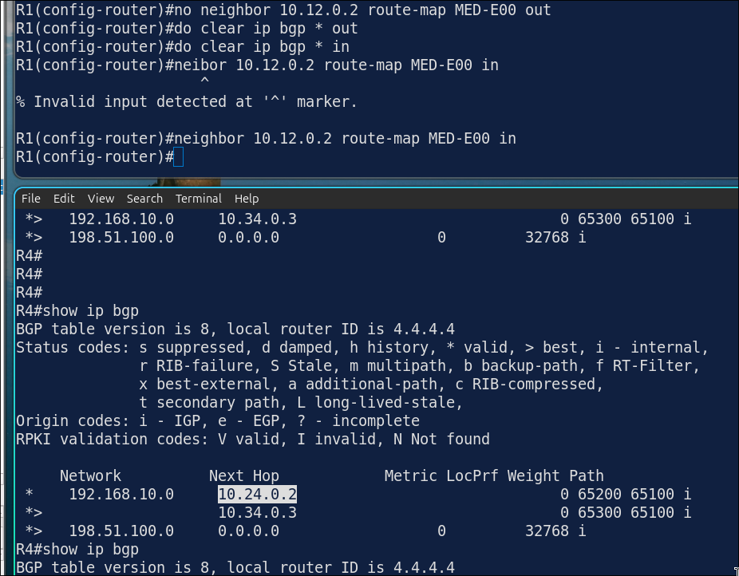
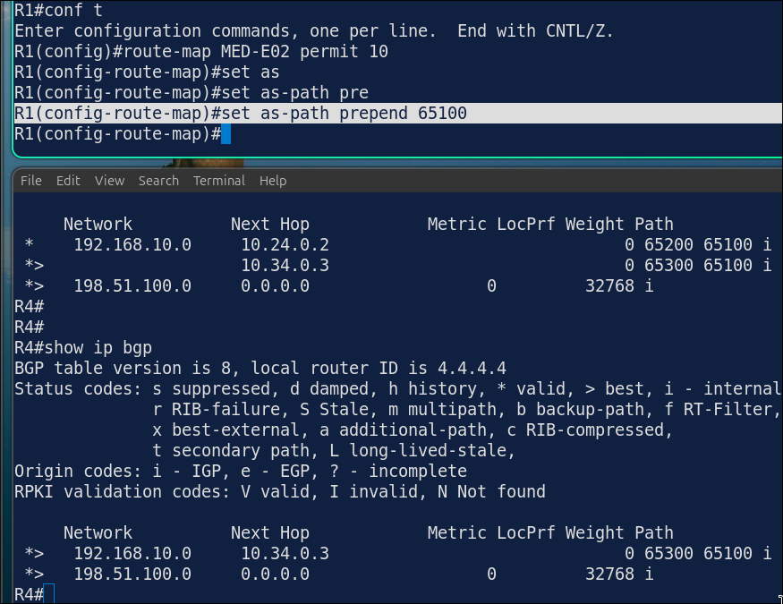
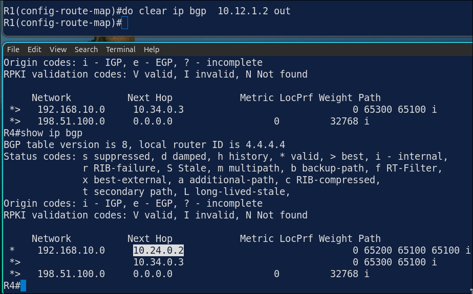

# Lab 7.5: BGP Path Control — MED & AS-Path Prepending

> **GNS3 Project:** [`Module 6 - BGP (CCNP) | Lab 5 - MED and AS-Path Prepending.gns3`](./Module%206%20-%20BGP%20%28CCNP%29%20%7C%20Lab%205%20-%20MED%20and%20AS-Path%20Prepending.gns3)
> **Platform:** GNS3 3.1 · Cisco IOL `x86_64_crb_linux-adventerprisek9-ms.17.18.2.iol` · 4 routers (R1–R4), 4 autonomous systems
> **Key takeaway:** A route-map applied **out** changes what your neighbor sees, so it influences **inbound** traffic. A route-map applied **in** (Lab 7.4) changes what you choose, so it influences **outbound** traffic.

---

## 1. Scenario & Tasks

Starting from the eBGP baseline of Lab 7.4 (Task 1), R1 (AS 65100) gets a second eBGP session to R2 (AS 65200) and uses outbound policy to steer how the rest of the network reaches `192.168.10.0/24`.

- **Task 1 — MED:** Add a second eBGP session between R1 and R2 over `E0/2` (10.12.1.0/24). Make R2 prefer the `E0/0` link for `192.168.10.0/24` by sending MED 50 on `E0/0` and MED 100 on `E0/2`.
- **Task 2 — AS-Path Prepending:** ISP-B (R3) must be the preferred path into AS 65100. Prepend `65100` three times on the routes R1 sends to R2 on both links.
- **Task 3 — Verify** the paths on R2 and R4.

### IPv4 Addressing & AS Schema

Same topology and addressing as Lab 7.4.

| Device | ASN | Router-ID (`Lo0`) | Transit Interfaces | Loopbacks |
| :--- | :---: | :---: | :--- | :--- |
| **R1** | `65100` | `1.1.1.1/32` | `E0/0`: 10.12.0.1/24, `E0/1`: 10.13.0.1/24, `E0/2`: 10.12.1.1/24 | `Lo1`: 192.168.10.1/24 |
| **R2 (ISP-A)** | `65200` | `2.2.2.2/32` | `E0/0`: 10.12.0.2/24, `E0/1`: 10.24.0.2/24, `E0/2`: 10.12.1.2/24 | — |
| **R3 (ISP-B)** | `65300` | `3.3.3.3/32` | `E0/0`: 10.13.0.3/24, `E0/1`: 10.34.0.3/24 | — |
| **R4** | `65400` | `4.4.4.4/32` | `E0/0`: 10.24.0.4/24, `E0/1`: 10.34.0.4/24 | `Lo1`: 198.51.100.1/24, `Lo2`: 203.0.113.1/24, `Lo3`: 192.0.2.1/24 |

---

## 2. Configuration & Verification

### Task 1: MED on the Parallel R1–R2 Links

**R1:**
~~~cisco
route-map MED-E00 permit 10
 set metric 50
route-map MED-E02 permit 10
 set metric 100
router bgp 65100
 neighbor 10.12.1.2 remote-as 65200
 neighbor 10.12.0.2 route-map MED-E00 out
 neighbor 10.12.1.2 route-map MED-E02 out
 do clear ip bgp * out
~~~

**R2:**
~~~cisco
router bgp 65200
 neighbor 10.12.1.1 remote-as 65100
~~~
* **Verification:** R2 has two paths to `192.168.10.0/24`. The path from `10.12.0.1` has the lower metric (50) and is the best path.

---

### Task 2: Make ISP-B (R3) the Preferred Path with AS-Path Prepending

**R1:**
~~~cisco
route-map MED-E00 permit 10
 set as-path prepend 65100 65100 65100
route-map MED-E02 permit 10
 set as-path prepend 65100 65100 65100
do clear ip bgp * out
~~~
* **Verification:** R4 selects the path via R3 (`10.34.0.3`). Its AS path `65300 65100` is shorter than `65200 65100 65100 65100 65100`.

Before prepending:

After prepending:

---

## 3. Notes & Fault-Injection (Break-It)

* **Direction matters:** `out` policy acts on the routes you advertise, so it shapes **incoming** traffic. In Lab 7.4, `in` policy (local preference, weight) acted on learned routes and shaped **outgoing** traffic.
* **Prepending has limits:** AS-path length is compared only after Weight and Local Preference. Here R4 has no policy of its own, so path length decides and prepending works. If R4 preferred ISP-A with a higher local preference, R1's prepending would be ignored, so prepending is a hint to the neighbor, not a guarantee.

### Fault-Injection 1: Route-Map Applied in the Wrong Direction
* **Injected Fault:** On R1, applied `MED-E00` **inbound** instead of outbound for neighbor `10.12.0.2`.
* **Symptom:** R2 no longer receives the prepended path or the MED from that neighbor, so R4 can choose the path via R2 again.
* **Fix:** Apply the route-map outbound.

### Fault-Injection 2: Unrefreshed Outbound Policy
* **Injected Fault:** Changed the number of prepends in `MED-E02` to 1 without refreshing the session.
* **Symptom:** R2 still shows the old AS path, because an outbound policy only applies to updates sent after a refresh:

* **Fix & Verification:** `clear ip bgp 10.12.1.2 out` re-sends the updates through the new policy, and R2 shows the new AS path:

