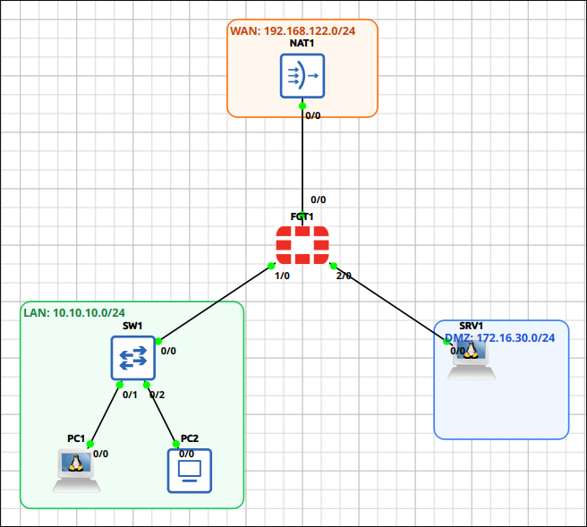
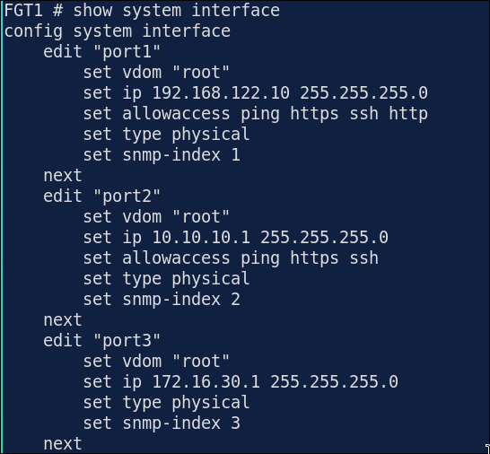
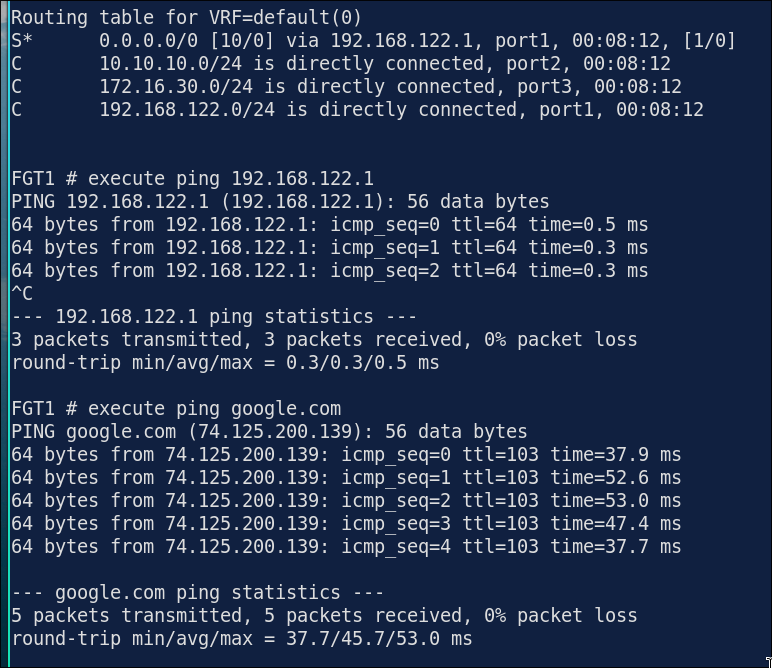
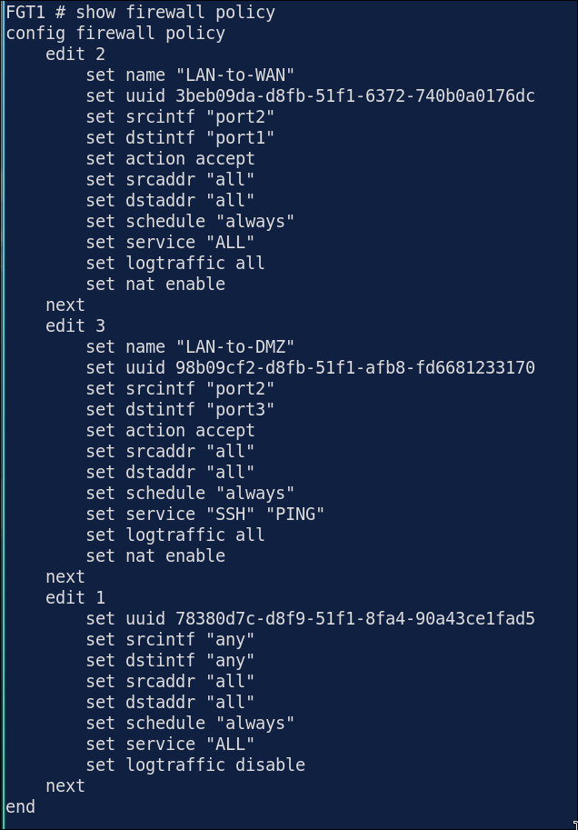
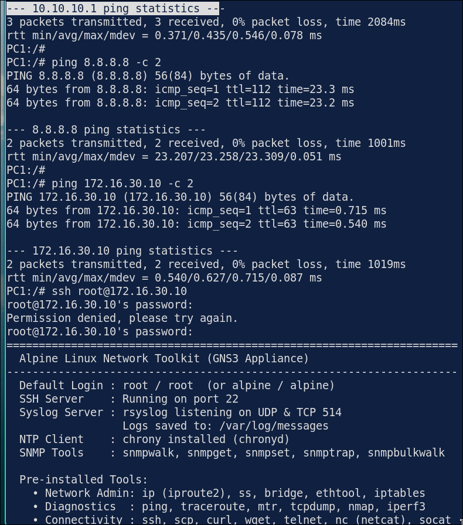
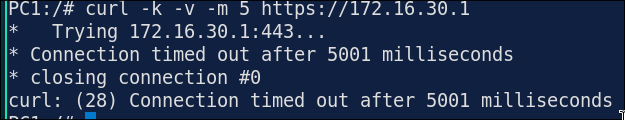
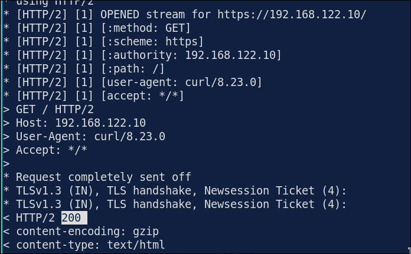
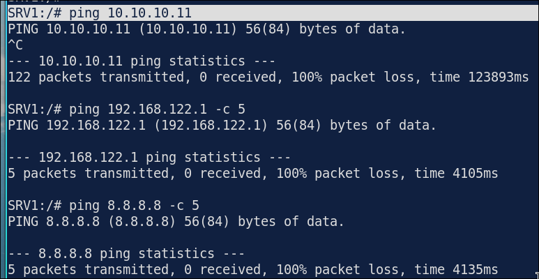

# Lab 1.1: Interfaces, Static Routing & Firewall Policy

> **GNS3 Project:** [`Fortigate Module 1 - Fundamentals | Lab 1 - Interfaces, Static Routing and Firewall Policy.gns3`](./Fortigate%20Module%201%20-%20Fundamentals%20%7C%20Lab%201%20-%20Interfaces%2C%20Static%20Routing%20and%20Firewall%20Policy.gns3)
> **Platform:** GNS3 3.1 · FortiGate-VM `7.4.7` (QEMU, evaluation license) · 1 firewall, 1 unmanaged switch, 1 VPCS host (PC2), 2 Alpine Linux hosts (PC1, SRV1), 1 NAT cloud
> **Key takeaway:** _(fill in after the lab, one or two sentences)_

---

## 1. Scenario & Tasks

FGT1 is the edge firewall of a small site. It has three zones: the **WAN** towards the NAT cloud, a **LAN** with two user PCs, and a **DMZ** with one server. Users must reach the Internet, and they may reach the DMZ server over SSH and ping only. Nothing else is allowed in.

- **Task 1: First boot and interfaces.** Log in to the console of FGT1 (`admin`, blank password; FortiOS asks for a new one on first login). Set the hostname to `FGT1` and configure `port1`, `port2` and `port3` with the addresses below. Allow only `ping` on `port1` and `port3`. Allow `ping`, `https` and `ssh` on `port2` so the firewall can be managed from the LAN.
- **Task 2: Static routing.** Add a default route out of `port1` towards the NAT cloud (`192.168.122.1`) and set the DNS servers. Verify that FGT1 itself can reach the Internet.
- **Task 3: Firewall policies.** FortiGate drops everything without a matching policy, so create these:
  - `LAN-to-WAN`: allow all LAN traffic to the Internet, with source NAT on the outgoing interface address.
  - `LAN-to-DMZ`: allow only `SSH` and `PING` from the LAN to SRV1.
  - Log all sessions on both policies.
  - No policy for WAN-to-LAN, WAN-to-DMZ or DMZ-to-anywhere.
- **Task 4: End hosts and testing.** Configure PC1, PC2 and SRV1 with the addresses below. Prove that every allowed flow works and every other flow is blocked, using the policy hit counters and the session table.

### IPv4 Addressing

| Device | Interface | Zone | Address | Gateway |
| :--- | :--- | :---: | :--- | :--- |
| **FGT1** | `port1` | WAN | 192.168.122.10/24 | 192.168.122.1 (NAT1) |
| **FGT1** | `port2` | LAN | 10.10.10.1/24 | — |
| **FGT1** | `port3` | DMZ | 172.16.30.1/24 | — |
| **PC1** | `eth0` | LAN | 10.10.10.11/24 | 10.10.10.1 |
| **PC2** | `eth0` | LAN | 10.10.10.12/24 | 10.10.10.1 |
| **SRV1** | `eth0` | DMZ | 172.16.30.10/24 | 172.16.30.1 |

### Cabling

| From | To |
| :--- | :--- |
| FGT1 `port1` | NAT1 `nat0` |
| FGT1 `port2` | SW1 `Ethernet0` |
| FGT1 `port3` | SRV1 `eth0` |
| SW1 `Ethernet1` | PC1 `eth0` |
| SW1 `Ethernet2` | PC2 `eth0` |

---

## 2. Configuration & Verification

### Task 1: First Boot and Interfaces

**FGT1:**
~~~fortios
config system global
  set hostname FGT1
end

config system interface
  edit port1
    set mode static
    set ip 192.168.122.10 255.255.255.0
  next
  edit port2
    set mode static
    set ip 10.10.10.1 255.255.255.0
  next
  edit port3
    set mode static
    set ip 172.16.30.1
  end
~~~
* **Verification:** _(to be completed)_ Suggested commands: `get system status`, `get system interface physical`, `show system interface`.

---

### Task 2: Static Routing and DNS

**FGT1:**
~~~fortios
config router static
  edit 1
    set gateway 192.168.122.1
    set device port1
  end
~~~
* **Verification:** _(to be completed)_ Suggested commands: `get router info routing-table all`, `execute ping 192.168.122.1`, `execute ping 8.8.8.8`, `execute ping google.com`.

---

### Task 3: Firewall Policies

**FGT1:**
~~~fortios
config firewall policy
  edit 0
    set name "LAN-to-WAN"
    set srcinf port2
    set dstinf port1
    set srcaddr all
    set dstaddr all
    set service ALL
    set action accept
    set schedule always
    set nat enable
    set logtraffic all
  next
  edit 0
    set name "LAN-to-DMZ"
    set srcinf port2
    set dstinf port3
    set srcaddr all
    set dstaddr all
    set service PING SSH
    set action accept
    set schedule always
    set nat enable
    set logtraffic all
  next
  move 2 before 1
  move 3 before 1
  end

~~~
* **Verification:** _(to be completed)_ Suggested commands: `show firewall policy`, `diagnose firewall iprope list 100004` (policy hit counts), and the **Policy & Objects** page in the GUI.

---

### Task 4: End Hosts and Testing

**PC1 (Alpine):**

**SRV1 (Alpine):**

| Test | Expected | Result |
| :--- | :---: | :---: |
| PC1 → 10.10.10.1 (FGT1 `port2`) | Allowed | |
| PC1 → 8.8.8.8 | Allowed (NAT) | |
| PC1 → SRV1 ping | Allowed | |
| PC1 → SRV1 SSH (tcp/22) | Allowed | |
| PC1 → SRV1 any other TCP port | Blocked | |
| SRV1 → PC1 | Blocked | |
| SRV1 → 8.8.8.8 | Blocked | |
| PC1 → FGT1 `port1` / `port3` over HTTPS | Blocked | |

* **Verification:** Suggested commands: `diagnose sys session list`, `diagnose sniffer packet any 'host 8.8.8.8' 4`, and the **Forward Traffic** log in the GUI.

PC1->FGT1 port1 via HTTPS return 200, with firewall policy 2 allowaccess to ALL service.

---

## 3. Notes & Fault-Injection (Break-It)

Pick the faults below (or add my own), inject them one at a time, record the symptom, then fix it.

### Fault-Injection 1: NAT Disabled on `LAN-to-WAN`
* **Injected Fault:** _(to be completed)_ Planned: turn off NAT on the policy.
* **Symptom:** _(to be completed)_ Planned: compare the `diagnose sniffer` output on `port1` before and after.
* **Fix:** _(to be completed)_

### Fault-Injection 2: Policies in the Wrong Order
* **Injected Fault:** _(to be completed)_ Planned: add a deny-all policy above `LAN-to-DMZ`.
* **Symptom:** _(to be completed)_ Planned: use `diagnose debug flow` to see which policy ID matches.
* **Fix:** _(to be completed)_

### Fault-Injection 3: Missing Default Route
* **Injected Fault:** _(to be completed)_ Planned: delete the static default route.
* **Symptom:** _(to be completed)_ Planned: PC1 can reach FGT1 but not the Internet; `diagnose debug flow` shows `no route`.
* **Fix:** _(to be completed)_

---

## 4. Checklist

- [x] Topology screenshot saved as `image.png`
- [x] Tasks 1–4 configured and verified
- [x] All tests in the Task 4 table filled in
- [ ] At least two Break-It exercises documented
- [ ] Key takeaway written
- [ ] Config backups checked: no password hashes, PSKs or license data in the README
